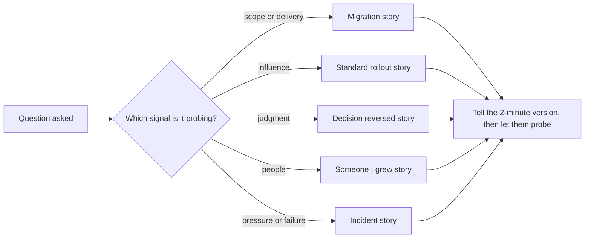

## 89.2 Building your story bank

#### Concept

A **story bank** is a set of eight to ten prepared stories from your real work, each one proving scope and impact at the level you are interviewing for. Every behavioural, leadership and strategy question in a staff loop is answered from it, and the architecture deep dive is usually one of its stories told at full length. Each story is written down once, with numbers, with your specific contribution separated from the team's, and with the follow-up questions you expect.

Part 59, 59.21, gave senior-level answers to ten common behavioural questions, and 68.5 named the shape of a strong staff answer. This section is the system that produces those answers on demand for any question.

#### Why does it exist?

Staff-plus behavioural rounds are not a list of questions you can memorise answers to. They are probes: "Tell me about a time you changed another team's direction", then "what did they say?", "what would you do if they had refused?", "how do you know it worked?". If you invent the story in the room, you will pick a weak one, forget the numbers, and drift into "we". If you have ten strong stories ready, almost any question maps onto one of them, and the probes land on material you have already thought through.

There is a credibility reason too. Interviewers trust specific detail. "Checkout payment errors went from 0.9% to 0.2% over two quarters" is believable because it is checkable. "We significantly improved reliability" sounds like every other candidate.

#### Mental model

Imagine a lawyer preparing for trial. They do not walk into court and improvise; they prepare exhibits, each one proving a specific point, and they know which exhibit answers which question from the other side. Your stories are exhibits. Each proves one or two signals (scope, influence, judgment, growing people), and you know in advance which exhibit to reach for when a question arrives.

#### How it works

**Step 1: fill the slots.** Aim for one story per slot. A single project can supply two stories if different parts of it prove different things (the migration itself, and the conflict inside it).

| Slot | What it proves | Questions it answers | Where the book teaches the skill |
|---|---|---|---|
| A migration you led | Multi-team execution over months, risk management | "Biggest project", "most complex system", "how do you deliver large work" | Part 84 |
| An incident you led | Calm under pressure, turning an instance into a class | "Hardest incident", "a failure", "how do you handle pressure" | 49.7, 49.10, 58.7.3 |
| A strategy you set | Diagnosis, guiding policy, saying no | "Technical vision", "how do you decide what to work on" | Part 82 |
| A standard you rolled out | Influence without authority, adoption | "Changing other teams", "governance" | Part 83 |
| A decision you reversed | Judgment, humility, learning | "A mistake", "a decision you regret", "changing your mind" | 81.7, 63.22 |
| A conflict you resolved | Disagreement on the problem, not the person | "Disagreement with a peer or leader", "difficult stakeholder" | 86.4, 86.7 |
| Someone you grew | Multiplying others, sponsorship | "Mentoring", "growing seniors", "hiring" | Part 87 |
| A business case you won | Money framing, executive communication | "Getting funding", "explaining to non-engineers" | 86.3 |
| Something you stopped or said no to | Opportunity cost, courage | "Pushing back", "saying no to leadership" | 82.6, 86.5 |
| A bet that failed, or nearly did | Accountability, risk sizing | "Biggest failure", "what would you do differently" | 58.6 (principal rubric) |

**Step 2: write each story in the template.** Write it fully once. You will not recite it, but writing forces the numbers and the "I" out of your memory.

```text
TITLE:        short name you will recognise under pressure
HEADLINE:     one sentence with a number: what changed, at what scope
CONTEXT:      company size, teams, traffic or money, the year, your role
PROBLEM:      why it mattered, in time, money or risk; what happened if nobody acted
MY PART:      what I decided, wrote, built, convinced, stopped (I)
TEAM'S PART:  what others did, named by role (we)
DECISIONS:    two or three, each with the alternative I rejected and why
RESISTANCE:   who disagreed, their real constraint, how it was resolved
WHAT WENT WRONG: at least one thing, and what I changed because of it
OUTCOME:      before and after numbers; how they were measured
NOW:          what I would do differently; what lasted after I left
PROBES:       the five follow-ups I expect, with one-line answers
```

**Step 3: build the "I versus we" ledger.** For each story, list the actions that were yours. Staff interviewers will ask "what did you specifically do?" at least once per story. A useful rule: "we" for outcomes and for the team's execution, "I" for decisions, documents, conversations and code that were yours. Never claim a teammate's work; interviewers sometimes know your former colleagues, and it is wrong anyway.

**Step 4: find the numbers honestly.** If you did not measure something, you can still often reconstruct it: deploy logs give lead time, incident trackers give counts, billing pages give cost, the pull request history gives scope. If a number is an estimate, say so ("roughly 30 engineer-hours a week, from the on-call logs"). Never invent a number. A probe on an invented number collapses the whole story, and with it your credibility for the rest of the round.

**Step 5: map coverage.** Make a grid of stories against the signals interviewers score (scope, ambiguity, influence, judgment, technical depth, people, business). Every signal should have at least two stories; any story that covers only one signal is a candidate for replacement.



**Step 6: rehearse three lengths.** Each story needs a two-minute version (headline, problem, your actions, outcome), a five-minute version (add decisions and resistance), and a twenty-minute version for the deep dive. Start with the two-minute version in the room and let the interviewer choose where to dig. Interviewers at this level want to steer; a ten-minute monologue removes their chance to probe where their rubric needs evidence.

#### Practical example: two fully written stories

The stories below are examples of the template filled in. The companies are composites and the numbers are illustrative, but each number is the kind you can reconstruct from real logs.

**Story 1: the incident that became a standard (slots: incident led, standard rolled out).**

```text
TITLE:     Double charges and the idempotency standard
HEADLINE:  Led the response to a double-charge incident, then rolled out an
           idempotency standard across 9 services; duplicate-charge incidents
           went from about 7 per quarter to 0 for the next three quarters.
CONTEXT:   Food-delivery company, ~120 engineers, ~2 million orders a month,
           9 services touching money. I was a senior engineer on Payments.
PROBLEM:   During a payment provider slowdown, client and gateway retries hit
           POST /payments again; 1,840 customers were charged twice in 40 minutes.
           Refunds, support load and an app-store review spike followed.
           Smaller versions of the same bug happened about 7 times a quarter.
MY PART:   Incident commander for the main incident. Wrote the postmortem. Wrote
           the idempotency RFC (key per client action, stored with the response,
           24-hour retention). Built the shared NestJS interceptor and the
           PostgreSQL-backed key store. Ran the adoption tracker. Paired with
           each team for their first endpoint.
TEAM'S PART: Payments engineers ran refunds; each service team migrated its own
           endpoints; SRE added the duplicate-charge alert.
DECISIONS: 1. Shared library plus a contract test, not a written guideline only.
              Rejected guideline-only because two earlier guidelines had ~20%
              adoption after a year.
           2. Key store in each service's PostgreSQL, not a central Redis.
              Rejected Redis because a cache eviction would silently disable
              protection; we wanted the key and the side effect in one transaction.
           3. Rolled out by money risk, not team readiness: payments first,
              promotions last.
RESISTANCE: Orders team lead objected: Q3 roadmap was full. His real constraint
           was a launch date. I offered to pair on the first two endpoints and
           scheduled their remaining ones after the launch. He became the
           standard's second-loudest supporter.
WHAT WENT WRONG: My first version keyed on request body hash. Two identical
           orders placed on purpose (same basket, same user) were rejected.
           Changed to client-generated keys and added that case to the tests.
OUTCOME:   9 of 9 services adopted within two quarters. Duplicate-charge
           incidents: 0 in three quarters (from ~7 per quarter). The contract
           test now runs in CI for every new money endpoint.
NOW:       I would have written the standard before the incident; the warning
           signs were in two earlier postmortems that nobody connected.
PROBES:    "Why not exactly-once from the provider?" "How long do you keep keys,
           and why?" "What did adoption look like at month 2?" "What if a team
           refused?" "What did you personally code?"
```

Spoken as a two-minute answer, it starts: "During a provider slowdown, retries charged 1,840 customers twice in forty minutes. I was incident commander. The bigger problem was that smaller versions of the same bug were hitting us about seven times a quarter, so after the postmortem I wrote an idempotency RFC and built the shared interceptor. I rolled it out to nine services in two quarters, starting with the ones that move money. We have had zero duplicate charges in the three quarters since. The hardest part was not the code; it was getting the Orders team to do it in a full quarter, and I can tell you how that went."

**Story 2: the decision I reversed (slots: decision reversed, bet that nearly failed).**

```text
TITLE:     Kafka for everything, then not
HEADLINE:  I championed Kafka for all inter-service events; nine months later I
           led the reversal to a PostgreSQL outbox plus a managed queue for most
           flows, cutting platform on-call pages by about 70%.
CONTEXT:   B2B SaaS, ~45 engineers, 14 services, ~300 events per second at peak.
           I was the staff engineer for the platform area.
PROBLEM:   Services called each other synchronously; one slow service cascaded.
           I proposed events, and chose a self-managed Kafka cluster.
MY PART:   Wrote the original RFC choosing Kafka. Nine months later, wrote the
           reversal RFC, the cost and pager analysis, and the migration plan.
           Presented both to the engineering leadership group.
TEAM'S PART: Platform team operated the cluster and later ran the migration;
           service teams moved their producers and consumers.
DECISIONS: 1. Original: Kafka over a queue, for replay and future streaming.
              The future streaming need did not arrive.
           2. Reversal: outbox in each service's PostgreSQL plus a managed queue
              for 11 of 13 flows; kept Kafka (managed) for the two flows that
              genuinely needed replay (audit and analytics feed).
           3. Did not reverse all the way to synchronous calls; the decoupling
              itself was right.
RESISTANCE: Two engineers had invested heavily in Kafka skills and felt the
           reversal judged their work. I said in the RFC, in writing, that the
           original decision was mine, and asked one of them to lead the
           migration of the two flows that stayed on Kafka.
WHAT WENT WRONG: The original RFC had no exit criteria. I had not written down
           what would tell us the choice was wrong, so it took nine months to
           admit it instead of three.
OUTCOME:   Platform pages from ~25 a month to ~7. Infrastructure cost for
           messaging down by roughly 60% (moved to managed services). The two
           remaining Kafka flows still run.
NOW:       Every RFC I write has a "how we will know this was wrong" section
           with a date to check it (81.4).
PROBES:    "How did you calculate the operational cost?" "Why not managed Kafka
           for everything?" "How did leadership react?" "What did you tell the
           two engineers?" "What would you choose today for 300 events/s?"
```

Notice what each story proves beyond its plot. Story 1 proves you turn an instance into a class (58.7.3) and win adoption without authority. Story 2 proves judgment and honesty, which is why interviewers ask for reversed decisions: someone who has never been wrong at staff scope has either not made decisions or not noticed their outcomes.

#### Failure scenario

A candidate with a genuinely impressive history answered "tell me about a time you influenced another team" with a story about a shared logging library. Probe one: "How many teams adopted it?" "Most of them." Probe two: "How many is most?" "I would have to check." Probe three: "What did you do when a team said no?" "I think my manager talked to them." The interviewer wrote: "Influence evidence weak; adoption unquantified, resistance handled by the manager." The library was real and successful. The candidate had simply never written the story down, so the details that prove influence were not available when they were needed.

#### Edge cases & failure modes

- **Confidential work.** Change names and round the numbers; say you have done so. Never disclose a former employer's secrets; interviewers notice and wonder what you would disclose about them.
- **All your best work is at one company.** Fine. Use different slots of the same programme, and show range in the decisions.
- **Your best story failed.** Use it in the failure slot. A cancelled project you helped stop early is strong staff evidence (68.5.1).
- **The interviewer asks a question no story fits.** Say so, take a breath, and pick the nearest story honestly: "The closest example I have is..." Inventing a story under pressure is worse than adapting a true one.
- **Stories older than five years.** Use at most one or two; interviewers want to know what you do now.

#### How a Principal Engineer thinks about this

A principal knows the loop will be decided by a few quotable facts in written feedback, so they make their stories easy to quote: one headline number, one named decision, one named person. They separate "I" from "we" precisely and give credit generously, because both are what staff behaviour looks like. They choose stories for the signals the rubric needs, not for the technology that was most fun. And they keep the bank alive between job searches by writing a few lines after each significant piece of work, which also makes their next promotion packet easy.

#### Common mistakes

- Ten stories about building things and none about people, conflict or saying no.
- Numbers that are adjectives ("massively faster").
- Telling the twenty-minute version to a two-minute question.
- Hiding the failure in a failure story ("my weakness is that I care too much").
- Rehearsing word for word; it sounds recited and breaks under the first probe.

#### Interview questions

1. **"Tell me about a time you changed the direction of a team you did not lead."** Use the standard-rollout story. What a principal-level answer adds: why that team's direction mattered to the company, and what you did to make the new direction cheaper than the old one.
2. **"Tell me about a decision you got wrong."** Use the reversal story. Strong answers own the decision, name the evidence that should have triggered the reversal earlier, and state the habit that changed.
3. **"Who have you grown, and how do you know?"** Name the person's role before and after, the stretch work you gave or sponsored (87.1), and something they did without you.
4. **"What did you specifically do?"** Expected: three to five verbs that were yours (decided, wrote, built, convinced, stopped), with artefacts.

#### Practical exercise

Write your story bank: ten slots, at least eight filled, each in the template, plus the coverage grid. Then ask a peer to pick three stories at random and probe each with "what did you specifically do?", "how do you know?" and "who disagreed?". Acceptance criteria: every story has a headline with a number, at least one rejected alternative, one thing that went wrong, and an "I" list; every signal in the grid has two stories; no story collapses under the three probes.
