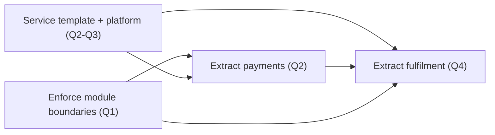

## 89.3 Building a multi-quarter roadmap: sequencing, dependencies and capacity

#### Concept

A roadmap turns a strategy into a sequence of initiatives over time. The craft is not drawing the Gantt chart; it is the sequencing — deciding what comes before what, so that dependencies are respected, risk is front-loaded, early wins build momentum, and the plan fits the capacity you actually have rather than the capacity you wish you had. A roadmap that ignores dependencies builds the roof before the walls. A roadmap that ignores capacity promises twelve quarters of work in four and fails publicly.

#### Why does it exist?

Imagine a strategy with five coherent actions and no roadmap. The teams start all five at once, because they are all important. Each is now understaffed, each takes three times as long, and three of them turn out to depend on the fourth, which nobody sequenced first, so they stall halfway and have to be redone. A year later, five things are 60% done, which in software means zero things are done, because a half-built platform has all the cost and none of the benefit.

The roadmap exists to impose an order that respects reality: you cannot build the service-extraction on top of boundaries you have not enforced yet; you cannot ship three platform features with a team that can ship one. Sequencing is how a strategy becomes achievable instead of merely correct.

#### Mental model

Imagine building a house. You cannot choose the order of construction freely: the foundation must precede the walls, the walls precede the roof, the plumbing rough-in must happen before the walls are closed up. Some things can happen in parallel (electrical and plumbing), some strictly cannot (roof after walls). And you have a fixed crew — five builders, not fifty — so even work that *could* be parallel is limited by how many hands you have. A roadmap is the construction schedule: it respects what must come first, parallelises what can, and never schedules more simultaneous work than the crew can do. Build the roof first and it collapses; that is a dependency violation. Schedule ten tasks for five builders and everything slips; that is a capacity violation.

#### How it works

Four forces shape the sequence.

1. **Dependencies.** Some initiatives are prerequisites for others. Map them as a directed graph; the roadmap must be a valid ordering of that graph (nothing scheduled before its prerequisites).
2. **Risk.** Front-load the riskiest, most uncertain work. If something might be impossible or might blow up the plan, you want to learn that in quarter one, when you can still adjust, not in quarter four, when the whole roadmap depends on it.
3. **Momentum.** Schedule an early, visible win. Teams and stakeholders lose faith in long programs that show nothing for six months. An early win buys you the patience to do the slow structural work.
4. **Capacity.** The total work scheduled in any quarter must fit the teams you have, with realistic allowance for on-call, interrupts, and the fact that people take holidays and leave. Over-scheduling is the most common roadmap failure.



This dependency graph for the velocity strategy shows why boundaries (B) and the platform/template (T) must precede extractions (E1, E2): you cannot cleanly extract a service whose boundaries are not enforced, and extracting without the template means hand-rolling pipelines each time. A valid roadmap respects every arrow.

A capacity view sits alongside it:

| Quarter | Team Platform (6 eng) | Team Payments (5 eng) | Team Fulfilment (5 eng) |
|---|---|---|---|
| Q1 | Boundary lint + CI split | Support boundary work in payments module | Support boundary work |
| Q2 | Service template v1 | Extract payments (own DB) | Business-as-usual + readiness |
| Q3 | Deploy platform (self-service) | Harden payments service | Prep fulfilment extraction |
| Q4 | Platform support + next paved road | BAU | Extract fulfilment |

Each cell is one team's quarter, and no team has two major initiatives at once. That is a capacity-honest roadmap.

#### Practical example

A food-delivery company's platform team wants to deliver three things from its strategy: a service template, a self-service deploy platform, and a centralised secrets manager. All three are valuable. A naive roadmap starts all three in Q1. The capacity-honest, dependency-aware roadmap sequences them: the secrets manager first (Q1), because both the template and the deploy platform need to consume secrets, so it is a prerequisite; the service template second (Q2), as the most visible early win that every team immediately benefits from; the deploy platform third (Q3), the largest and riskiest piece, scheduled once the team has shipped two successes and built confidence and once its prerequisites exist. Same three initiatives, but sequenced so each is fully staffed, dependencies are respected, and momentum is built before the hard part.

#### Artifact example

A multi-quarter roadmap one-pager — the artifact you actually circulate. It leads with the strategy it serves, shows the sequence with its reasoning, and is explicit about capacity and what is deliberately deferred.

```markdown
# Platform Roadmap 2026 (serves the Engineering Velocity strategy)

## What this roadmap delivers
Independent, safe, self-service delivery for product teams. See strategy
kernel: the crux is coupling; these initiatives remove it.

## Sequence and reasoning
| Q | Initiative | Why now (dependency / risk / momentum) |
|---|---|---|
| Q1 | Secrets manager | Prerequisite: template & deploy platform both need it. Low risk, do it first. |
| Q1 | Boundary enforcement (lint + CI) | Prerequisite for any clean extraction. Cheap, high leverage. |
| Q2 | Service template v1 | Early visible win — every team benefits immediately. Depends on secrets. |
| Q2 | Extract payments | Most-blocked context. Depends on boundaries. Front-loads extraction risk. |
| Q3 | Self-service deploy platform | Largest, riskiest. Scheduled after 2 wins build confidence + prereqs exist. |
| Q4 | Extract fulfilment | Depends on template + platform being real. Cheap by now. |

## Capacity assumptions (honest)
- Platform team = 6 engineers, but plan for ~4.5 effective (on-call,
  interrupts, 1 known departure in Q2). Roadmap is sized to 4.5, not 6.
- Product teams contribute ~1 eng each during their own extraction quarter.

## Explicitly deferred (NOT this year)
- Multi-region deploys (no business driver yet; revisit 2027).
- Service mesh (our incidents are not mesh-shaped; see reliability strategy).
- Internal developer portal UI (the CLI paved road is enough for now).

## How we'll know it's working
- Lead time for change trending 30d -> <5d by Q4 (on the way to <1d).
- Two services extracted and independently deployable by year end.
- Platform team interrupt load (tickets) falling as self-service lands.
```

Notice the three features that make it credible: the "why now" column gives a reason for every position in the sequence (so it survives reprioritisation), the capacity section plans for 4.5 effective engineers not the nominal 6 (so it is achievable), and the "explicitly deferred" section says no to three tempting things (so scope is controlled). A roadmap without those three is a wish list with dates.

#### Real-world scenario

A new engineering director inherits a roadmap that promises fourteen initiatives in the year with a team that can realistically deliver five. Everyone knew it was undeliverable, but nobody wanted to be the one to cut it, so it was approved and is now failing on every front. The principal engineer helps the director fix it with one move: size the roadmap to 4.5 effective engineers per team (accounting for on-call, interrupts and a known departure), which forces the fourteen initiatives down to five, and make the nine deferred items *explicit* in a "not this year" section with reasons. The painful part is not the sequencing; it is saying no to nine things stakeholders wanted. But the honest roadmap, delivered, beats the dishonest one, failed — and the explicit "not this year" list actually reduces thrash, because stakeholders stop re-asking for things they can see were deliberately deferred.

#### Failure scenario

A team builds a roadmap that ignores a dependency. It schedules "extract the payments service" in Q1 and "enforce module boundaries" in Q3, because boundaries felt like cleanup and extraction felt urgent. In Q1 they try to extract payments and discover the module has tendrils into six other modules that import its internals directly — exactly what boundary enforcement would have surfaced and prevented. The extraction balloons from one quarter to three, drags in five other teams to untangle the imports, and misses its deadline badly. The work was all necessary; the *order* was wrong. Boundaries were a prerequisite for extraction, and scheduling the prerequisite after the thing that needed it turned a clean one-quarter job into a three-quarter mess. Dependency order is not a nicety; it is the difference between a smooth roadmap and a cascading slip.

#### Edge cases & failure modes

- **Over-scheduling.** Sizing the roadmap to nominal headcount instead of effective capacity (minus on-call, interrupts, departures, holidays). The most common failure; everything slips.
- **Dependency violation.** Scheduling something before its prerequisite, so it balloons when the missing foundation surfaces.
- **Risk at the end.** The riskiest, most uncertain initiative scheduled last, so you discover it is infeasible after everything downstream has committed to it.
- **No early win.** Six months of invisible structural work; stakeholders lose faith and pull funding before the payoff.
- **No explicit deferrals.** Everything that was not chosen stays implicitly "maybe", so stakeholders keep re-asking and the team keeps re-litigating.
- **Roadmap never revisited.** Treated as a contract rather than a living plan; it drifts from reality as the quarter teaches you things.

#### How a Principal Engineer thinks about this

They sequence by dependency and risk first, momentum second, and they are ruthless about capacity, because they have learned that the gap between nominal and effective headcount is where roadmaps quietly die. They front-load risk deliberately — they want the thing that could sink the plan to be attempted early, while there is still room to adjust, not discovered in Q4. They insist on at least one early, visible win, because they know that a long program with nothing to show loses its funding before it can deliver, however correct it is.

They also make deferrals explicit, because an unstated "no" gets re-asked endlessly, and a stated "no, and here is why, revisit in 2027" actually sticks and reduces thrash. And they treat the roadmap as a living document that the quarter's learnings revise, not a contract — a roadmap that never changes means execution is teaching nobody anything.

#### Common mistakes

- **Sizing to nominal headcount,** so the roadmap is undeliverable from day one.
- **Violating dependency order** because the dependent work felt more urgent than its prerequisite.
- **Scheduling the riskiest work last,** so infeasibility is discovered too late to adjust.
- **No early win,** so the program loses faith and funding before the payoff.
- **Leaving deferrals implicit,** so stakeholders re-ask and the team re-litigates endlessly.

#### Interview questions

1. **How do you sequence a multi-quarter roadmap?**
   *Expected answer:* respect dependencies (nothing before its prerequisite), front-load risk (learn the plan-killers early), schedule an early visible win for momentum, and size everything to effective (not nominal) capacity. *Follow-up:* why front-load risk rather than tackle the easy things first.

2. **A roadmap promised fourteen initiatives and delivered four. Diagnose it.**
   *Expected answer:* almost certainly over-scheduled against nominal rather than effective capacity; probably also lacked explicit deferrals so scope was never controlled. Fix by sizing to effective capacity and making the cut list explicit with reasons. *Why it matters:* tests capacity realism, the most common roadmap failure.

3. **Why make deferred items explicit instead of just leaving them off the roadmap?**
   *Expected answer:* an unstated "no" gets re-asked and re-litigated, consuming energy; an explicit "not this year, here's why, revisit then" sticks, reduces thrash, and shows stakeholders their request was considered, not forgotten. *Why it matters:* tests understanding of roadmaps as communication tools, not just plans.

#### Practical exercise

Take the coherent actions from your strategy (52.1/52.2) and build a four-quarter roadmap. Draw the dependency graph first (as a Mermaid diagram), then place initiatives in quarters respecting it, front-loading risk and scheduling one early win. Build a capacity table that uses *effective* headcount (subtract a realistic amount for on-call, interrupts and known departures). Finally, write the "explicitly deferred" section with at least three items and a reason for each.

**Acceptance criteria:** the sequence violates no dependency arrow; the riskiest initiative is in Q1 or Q2; there is a visible win by Q2; the total work per quarter fits effective (not nominal) capacity; and the deferred list says no to at least three tempting things with reasons.
