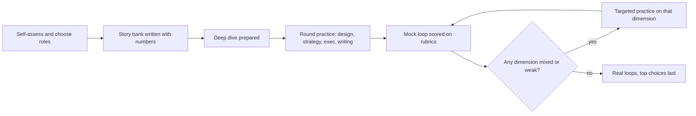

## 89.9 A preparation plan, a mock loop, and the failure modes

#### Concept

Staff-plus preparation is mostly not learning new material. You already have the experience; the work is turning it into evidence that survives probing, practising the round formats under a clock, and getting honest feedback from people who have sat on staff loops. This section gives a six-to-eight-week plan, a complete mock loop with transcripts scored against rubrics in the style of Part 87, and the failure modes that most often turn a staff candidate into a senior offer.

#### Why does it exist?

Without a plan, experienced candidates spend their time on what feels productive (system design practice on standard prompts, reading) and neglect what decides staff loops (the story bank, the deep dive, the strategy and executive rounds). And without mock loops scored by someone else, nobody tells you that you said "we" forty times or never gave a number.

#### How it works

**The plan.** About 8 to 10 hours a week alongside a full-time job. The eight-week version is below; to compress to six weeks, merge weeks 1 and 2 and weeks 6 and 7.

| Week | Evidence (stories and deep dive) | Rounds practice | Other |
|---|---|---|---|
| 1 | Self-assess against 58.6; list candidate stories for all ten slots (89.2) | Re-read 68.5 and 89.1; one senior-style design to warm up | Choose target roles; identify archetype and level for each (89.1) |
| 2 | Write six stories fully in the template, with numbers checked against logs | One timed large-scope design (89.4), recorded | Write your five-line scope statement |
| 3 | Finish the bank; build the coverage grid | Prepare the deep dive: diagrams, decisions, failures (89.3) | Read Parts 82 and 86 sections you are weakest in |
| 4 | Peer probes three random stories ("what did you do?", "how do you know?", "who disagreed?") | Deep dive presented to a peer, 45 minutes, probed | One 90-minute written exercise (89.7) |
| 5 | Fix the stories that collapsed | Strategy round: 90-day exercise aloud (89.5); one "six initiatives, capacity for three" | Two-minute CEO explanations of three real trade-offs (89.6) |
| 6 | Light refresh of numbers | Full mock loop 1 with staff-plus interviewers, scored on rubrics | Apply to lower-priority companies first |
| 7 | Rewrite the weakest two stories | Fix the two lowest-scoring dimensions from mock 1; mock loop 2 | Reverse-interview plan per company (89.8) |
| 8 | Read the bank once; no new material | Light practice only | Top-choice loops; rest the day before |

Keep a log, as 68.9.1 recommends for senior preparation: date, round type, prompt, score per dimension, what went wrong. A dimension that scores mixed twice gets the next week's practice.



**Finding mock interviewers.** Staff-plus engineers at your current or past companies, peers in professional communities, and paid mock services all work. Ask each mock interviewer to score against a written rubric (the ones below), not to give general impressions; 87.5 explains why rubric-based feedback is more useful than impressions, and it is just as true for you as a candidate.

#### Practical example: a mock loop with transcripts and rubric scoring

The candidate is Asha, the engineer whose packet and deep dive appear in 89.1 and 89.3, interviewing for a Staff Backend Engineer role at a logistics software company of about 200 engineers. The loop has four rounds. The rubrics follow the format of 87.5 (strong, mixed and weak per dimension; a round recommendation of strong hire, hire, lean hire, lean no-hire or no-hire) and the staff expectations of 58.1 and 58.5.

**The staff bar for this loop, agreed by the panel before interviewing:** strong on scope and judgment in the deep dive and design rounds; at least mixed on every other dimension; no weak on influence or ownership.

**Round 1: architecture deep dive (excerpt).**

```text
Interviewer: You said the ledger was append-only. Why not a status column with
             an audit table?
Asha:        We considered that. It is simpler to query. The problem was that
             refunds, partial captures and chargebacks each updated the status,
             and the audit table became the real source of truth with a status
             column that could disagree with it. With entries, the state is
             derived, so it cannot disagree. The cost is that every read of
             "current state" is a fold over entries, so we kept a cached
             balance per payment, rebuilt from entries if they ever differed.
Interviewer: Did they ever differ?
Asha:        Twice in the first month, both from the out-of-order refund
             webhooks I mentioned. The rebuild check is how we found the bug.
Interviewer: What did you personally build?
Asha:        The payment seam in the monolith, the ledger core and the hourly
             comparison job. Two engineers built the provider adapters.
```

| Dimension | Score | Evidence |
|---|---|---|
| Scope | Strong | Four teams, fourteen months, finance and audit involved |
| Decisions and alternatives | Strong | Ledger versus status column with an honest cost; router versus retries |
| Ownership ("I" versus "we") | Strong | Named her own components without being asked twice |
| Failure and learning | Strong | Out-of-order webhooks, finance brought in late, both owned |
| Impact | Strong | Lead time, error rate and close time, each with a measurement source |

Round recommendation: **strong hire** for staff.

**Round 2: large-scope design: "Our 30 customer-facing integrations each have their own retry and error handling; integration incidents are our top support cost. What would you do?" (excerpt).**

```text
Asha:        Before I design anything: which integrations cause the most
             support cost, and is it failures, slowness or data mismatches?
Interviewer: Mostly silent failures. Customers find out before we do.
Asha:        Then the first problem is visibility, not retries. I would put
             one integration gateway pattern in front of all 30, with a shared
             delivery log, dead-letter handling and per-customer alerts. Phase
             one is just the log and alerts on the top five integrations by
             support tickets, which should show value in a quarter.
             ...
Interviewer: What will this cost, and who builds it?
Asha:        Good question, I had not got there. Two to three engineers for
             phase one from the integrations team, plus each owning team's
             time to move their integration, maybe a week each.
```

| Dimension | Score | Evidence |
|---|---|---|
| Goal and diagnosis | Strong | Asked what the cost actually was; reframed from retries to visibility |
| Options | Mixed | Considered a bought integration platform only when prompted |
| Migration path | Strong | Phased by support cost, first phase pays back alone |
| Organisation and ownership | Strong | Owning teams migrate their integrations; gateway owned by integrations team |
| Cost and governance | Mixed | Cost only when prompted; no adoption measure stated |

Round recommendation: **hire**. Feedback: "Staff-level diagnosis and path. Needs to raise cost and buy options unprompted."

**Round 3: strategy: "Here are six initiatives; you have capacity for three this half. Choose." (excerpt).**

```text
Asha:        I would rank by what the company needs this half. You said
             enterprise deals are the goal, so SSO and audit logs go first:
             they are blocking signed contracts. Second, the integration
             visibility work from the last round, because it is the top
             support cost. Third, the database upgrade, because the current
             version leaves vendor support in eight months and that date
             does not move.
             I would not start the GraphQL gateway or the mobile rewrite this
             half. The gateway solves a problem only one team has; I would
             ask that team for a smaller version inside their own service.
             The mobile rewrite I would turn into a two-week investigation to
             size it properly, because nobody could tell me its cost.
Interviewer: The mobile team lead will be unhappy.
Asha:        Probably. I would talk to him before the plan is published, show
             him the ranking criteria, and ask what evidence would move his
             project up. If the investigation shows a real retention problem,
             it competes next half with real numbers.
```

| Dimension | Score | Evidence |
|---|---|---|
| Diagnosis before prescription | Strong | Tied ranking to the company goal and to dated constraints |
| Saying no | Strong | Dropped two with reasons and a smaller alternative for each |
| Sequencing | Strong | Fixed-date work (end of vendor support) protected |
| Bringing people along | Strong | Pre-wiring the unhappy lead; evidence that would change the decision |
| Horizon | Mixed | One half-year; little sense of the two-year direction |

Round recommendation: **strong hire** for staff; "horizon evidence below principal".

**Round 4: leadership and executive (excerpt).**

```text
Interviewer: Tell me about someone you grew.
Asha:        We had a senior engineer on the Orders team who... we gave him
             the consumer side of the migration, and we worked through the
             design together.
Interviewer: What did you specifically do?
Asha:        Sorry, I should be precise. I asked his manager if he could lead
             the Orders side, which was a stretch for him. I reviewed his first
             design doc line by line, then stopped reviewing after the second
             one. I put his name on the cutover plan as the owner and had him
             present it to the director. He now leads the returns project
             across three teams without me.
Interviewer: Explain to our CEO, in two minutes, why we should fund the
             integration visibility work over a new feature.
Asha:        Bottom line: integration failures are our largest support cost
             and the most common reason enterprise customers escalate ...
             I recommend a one-quarter first phase on the top five
             integrations; what I need is two engineers for that quarter.
```

| Dimension | Score | Evidence |
|---|---|---|
| Influence | Strong | Standard rollout story with adoption numbers, a concession, pre-wiring |
| Disagreement and commitment | Strong | Overruled on search, committed, added a cost alert that paid off |
| Multiplying others | Strong after probe | Sponsorship, stepped-back review, the person now leads alone; started with "we" |
| Executive communication | Strong | Bottom line first, one recommendation, a clear ask, about 90 seconds |
| Business framing | Mixed | Support cost named but not quantified in money |

Round recommendation: **hire**.

**The debrief.** Following 87.5 and 87.7, the panel compares evidence, not impressions:

```text
Deep dive:  strong hire. Scope, decisions, ownership and failure all strong.
Design:     hire. Strong diagnosis and path; cost and buy option only when prompted.
Strategy:   strong hire for staff; horizon one half-year, below principal.
Leadership: hire. Strong influence and sponsorship; business case not in money.
Against the staff bar: strong on scope and judgment in deep dive and design (yes);
  no dimension weak (yes); influence and ownership not weak (yes).
Decision:   hire at staff. Principal not supported: no evidence of
            organisation-wide direction or multi-year bets.
Feedback to candidate: raise cost and buy options unprompted; quantify support
  and incident costs in money; prepare a multi-year direction story for principal.
```

Note what decided this loop. Asha's technical design was not unusual. What carried it was evidence: numbers in every story, a precise "I" after one probe, honest failures, options dropped with reasons, and a recommendation with an ask in front of an executive. And what held her below principal was not a mistake but missing evidence of a longer horizon, which is the kind of gap a story bank can fill before the next loop.

**The common failure modes.** Each one turns a capable candidate into a senior offer or a no.

| Failure mode | What it sounds like | Why it scores low | The fix |
|---|---|---|---|
| Sounding like a senior | Excellent single-service design; stories about one team | Correct evidence for the wrong level | Every story and design reaches across teams, time and cost (89.1 bar table) |
| "We" without "I" | "We decided, we built, we migrated" | Interviewer cannot credit you with anything | The "I versus we" ledger per story (89.2) |
| No numbers | "Much faster", "a lot more reliable" | Unverifiable; reads as vague or inflated | Before and after numbers with a source, estimates labelled |
| No trade-offs | "We used X because it is best practice" | No evidence of judgment | Every decision with its rejected alternative and the cost accepted |
| Architecture astronaut | Event sourcing, a service mesh and multi-region for a modest problem | Signals cost-blind design and poor delivery (58.7.2) | Start from the goal; put "do less" and "buy" on every options table |
| The passenger | Detailed description of decisions someone else made | Exposed by the first "why not X?" | Choose systems where you made the decisions; say what you inherited |
| Never wrong | Every story a success; failures that are disguised successes | No evidence of learning or honest self-assessment | One real failure and one reversed decision in the bank |
| The hero | "I stayed up for three nights and saved the launch" | Firefighting is not leverage (58.7.3) | Show what became structural afterwards |
| The bitter ex-employee | "Leadership there was clueless" | Signals how you will talk about this company | Describe constraints neutrally; own your part |
| The recital | Polished, word-for-word stories | Breaks at the first unexpected probe; sounds rehearsed | Rehearse structure and numbers, not sentences |

**The day before.**

```text
[ ] Read the story bank headlines and numbers once; no new material.
[ ] Deep-dive diagrams ready to paste or draw; test the remote whiteboard.
[ ] Reverse-interview questions mapped to each interviewer.
[ ] Level target and the evidence you will cite.
[ ] Sleep. A rested candidate gives better answers than one who rehearsed until midnight.
```

#### How a Principal Engineer thinks about this

A principal prepares for a loop as they would prepare a programme: a plan with milestones, measurement against an explicit bar, and feedback loops that target the weakest dimension. They ask mock interviewers for rubric scores, not compliments. And after a loop, whatever the result, they ask for the evidence that was missing and add it to the bank, because the same evidence will be needed for the next promotion packet too.

#### Common mistakes

- Spending most preparation time on standard system design prompts.
- No mock loop with staff-plus interviewers.
- Mock feedback as impressions ("you did well") rather than rubric scores.
- Booking top-choice companies first.
- Treating a down-levelled offer as a verdict on your ability instead of a list of missing evidence.

#### Interview questions

1. **"What is the biggest gap between you and the level you are interviewing for?"** Expected: an honest, specific gap and what you are doing about it, ideally with evidence of progress.
2. **"Why should we hire you at staff rather than senior?"** Expected: two or three pieces of evidence of cross-team scope, direction and multiplying others, each with a number.
3. **"What would your peers say is your weakest skill?"** Expected: a real one, with the feedback you actually received.

#### Practical exercise

Run a full mock loop: four rounds with at least two staff-plus interviewers, using the rubrics from this section, and a written debrief against an explicit staff bar. Acceptance criteria: every round has dimension scores with evidence quotes; the debrief states the level decision and the missing evidence; you have a dated plan to fix the two lowest dimensions and a second mock booked within two weeks.

## Senior Checklist — Part 89

- [ ] I understand the concept
- [ ] I can explain it simply
- [ ] I can implement it
- [ ] I understand its failure modes
- [ ] I understand its scaling limitations
- [ ] I understand its security implications
- [ ] I understand its operational implications
- [ ] I can choose between alternatives
- [ ] I can explain the tradeoffs
- [ ] I can answer senior-level interview questions
- [ ] I can name the rounds of a staff or principal loop and the signal each one seeks
- [ ] I know which archetype and level a role targets before I prepare for it
- [ ] I can describe my scope in teams, horizon, systems and money, not titles
- [ ] I have a written story bank of eight to ten stories, each with a number, a rejected alternative, a failure and an "I" list
- [ ] I can present a past system in 45 minutes: constraints, decisions with alternatives, migration, failures, outcome, changes
- [ ] I answer "why not X?" honestly, including "we did not consider it" and "X would have been better"
- [ ] I run large-scope designs from goal and current state through options, target, migration path, governance and cost
- [ ] I always put "buy" and "do less" on the options table, and say what I will not do
- [ ] I can answer "what would you do in your first 90 days?" with listening, diagnosis, a guiding policy and coherent actions
- [ ] I can make a business case in money terms and explain a trade-off to an executive in under two minutes, ending with a decision request
- [ ] I can write a decision document under a time limit with the recommendation in the first paragraph
- [ ] I reverse-interview for scope, sponsorship, real problems and decision-making, and I know my walk-away conditions
- [ ] I negotiate level and scope before compensation
- [ ] I have run a mock loop scored on rubrics and fixed my two weakest dimensions

## Part 89 — Key Takeaways

- Staff and principal loops look for leverage: evidence that you made several teams better over years, not that you can build one system well.
- The level is decided in the debrief from the evidence you present; strong senior answers produce senior offers.
- Find out the archetype and level before preparing; Tech Lead, Architect, Solver and Right Hand roles are scored on different evidence.
- A written story bank, with numbers, rejected alternatives, failures and a precise "I", carries the deep dive, behavioural, strategy and leadership rounds.
- In the deep dive, present constraints before architecture, decisions with their alternatives, and failures you volunteer; answer "why not X?" honestly.
- A staff-level design starts from the goal and the messy present and ends with a migration path, ownership, cost and a list of what you will not do.
- In strategy rounds, diagnose before you prescribe, rule things out, and plan how others will adopt the strategy.
- To executives: bottom line first, options in money and risk, a recommendation, and a decision request, in under two minutes.
- Under a writing clock, cut detail, never structure; the summary is written last and read first.
- Interview the company for scope, sponsorship and how decisions are made; a real problem and a strong sponsor beat a bigger title.
- Prepare with rubric-scored mock loops, and treat any down-levelled outcome as a list of missing evidence to collect.
- The skills this Part asks you to prove are the ones Parts 81–88 teach; the best preparation for the next loop is doing that work, and writing it down as you go.

The interview is a few hours; the work it asks about takes years. Do the work well, keep the evidence, and the loops take care of themselves.
