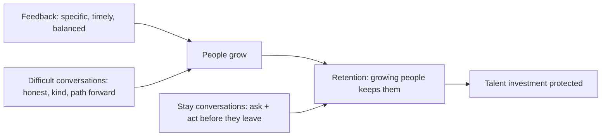

## 89.7 Worked example: an interview loop and rubrics for a senior NestJS/PostgreSQL engineer

This section brings the hiring half of the Part together in one complete artifact: the full interview loop and rubrics for hiring a senior NestJS/PostgreSQL backend engineer. It applies the loop design (89.4), the question-and-rubric writing (89.5), and the interviewer practices (89.6) to a concrete, realistic role.

#### The role and its success signals

QuickBite needs a senior backend engineer for its ordering team: NestJS and PostgreSQL, owning features end to end, operating them in production. Following 89.4, the signals that predict success in this specific role, defined first:

```text
1. Coding: correct, clean TypeScript; reasons about complexity and edge cases.
2. System design: designs under realistic constraints; failure modes, scale,
   tradeoffs, operability. (The critical senior signal.)
3. Backend depth: PostgreSQL (indexes, transactions, locking), NestJS patterns,
   concurrency, API design — the role's technical core.
4. Debugging: methodical diagnosis of a realistic production problem.
5. Ownership & collaboration: operating under ambiguity, production ownership,
   working with and growing others.
```

#### The loop (four stages, one distinct signal each)

```markdown
# Loop: Senior Backend Engineer, ordering team (4 stages, no redundancy)
| Stage | Targets | Format |
|---|---|---|
| 1. Screen | Coding + basic backend depth | 1hr: a realistic coding problem (e.g. an in-memory order-rate limiter) |
| 2. System design | System design | 1hr: "design the order notification system" (57.6) |
| 3. Backend deep-dive | Backend depth + debugging | 1hr: PostgreSQL/NestJS/concurrency Qs + a debug scenario |
| 4. Past-project + behavioural | Ownership + collaboration | 1hr: structured past-project deep-dive |

Coverage check: coding(1), design(2), depth(3), debugging(3), ownership(4).
All signals covered, none redundant. No 3rd coding round, no "culture fit" chat.
```

#### The rubrics (one per stage, strong/mixed/weak by behaviour)

The system design rubric is in 89.5. Here are the other three, abbreviated to their strong/weak poles:

```markdown
# Stage 1 — Coding rubric (order-rate-limiter problem)
STRONG: correct solution; handles edge cases (concurrent requests, window
  boundaries) unprompted; clean, readable TypeScript; reasons about complexity.
WEAK: incorrect or needs heavy hints; misses edge cases even when prompted;
  tangled code; can't reason about complexity.

# Stage 3 — Backend deep-dive rubric
STRONG (PostgreSQL): explains index choice and reads EXPLAIN; knows transaction
  isolation and locking (e.g. SELECT FOR UPDATE for a hot row); understands
  connection pooling. (Concurrency): reasons about race conditions, idempotency.
  (Debugging): methodical — forms hypotheses, checks them, narrows down.
WEAK: vague on indexes and isolation; no idempotency awareness; debugging is
  random guessing rather than hypothesis-driven.

# Stage 4 — Past-project + behavioural rubric (ownership & collaboration)
STRONG: has owned a system in production (alerts, on-call, incidents); defined
  an ambiguous problem and wrote it down; grown another engineer; disagreed and
  committed; explains tradeoffs to non-engineers. (These map to the senior bar,
  Part 59.)
WEAK: only ever implemented specs; no production ownership; no evidence of
  deciding under ambiguity or growing others.
```

#### Running it well and deciding

Each interviewer runs their stage per the 89.6 practices — the system design interviewer steers without leading and probes for depth; the coding interviewer lets the candidate drive; everyone scores against the rubric with evidence-based feedback (89.5). After the loop, a debrief combines the evidence. Because each stage produced a distinct, rubric-based signal, the debrief is a comparison of clear evidence, not a clash of vague impressions: "strong coder (stage 1), strong design instincts but weak scale reasoning (stage 2), solid PostgreSQL but shaky on idempotency (stage 3), clear production ownership and has grown others (stage 4)". A bar raiser holds the senior bar. The decision — say, "hire: the scale-reasoning gap is real but coachable given the strong fundamentals and clear ownership" — rests on combined, comparable, evidence-based signal across all the dimensions that predict success in the role.

#### Why this loop and these rubrics work

Trace it against the Part. The signals were defined *first*, from what predicts success in this specific role (89.4). The loop maps one distinct signal per stage with a coverage check and no redundancy — no three coding rounds, no unstructured "culture fit" chat (89.4). Each stage has a rubric defining strong/mixed/weak by concrete behaviours, so evaluation is against a standard, not gut feel, and feedback is evidence-based (89.5). The questions are realistic (drawn from the actual work — order rate limiter, order notifications, a production debug) rather than trivia (89.5). The interviewers run their stages to elicit the candidate's judgement, not to lecture (89.6). And a bar raiser holds the standard (89.5). The result is a hiring process that is efficient (four focused rounds), comprehensive (all success signals covered), consistent and fair (rubrics and calibration), and produces decisions based on comparable evidence — which is what separates good hiring from the lottery of idiosyncratic, bias-prone impressions that unstructured loops produce.

#### Practical exercise

Design a complete interview loop and rubrics for a role your team hires for. Define the success signals first, design a loop of four to five stages each targeting a distinct signal (with a coverage check showing all signals covered and none redundant), write a rubric for each stage defining strong/mixed/weak by concrete behaviours, and ensure the questions are realistic rather than trivia. Specify how you will run each stage to elicit the candidate's judgement and how a bar raiser will hold the standard.

**Acceptance criteria:** the signals are defined first from what predicts success in the specific role; the loop maps each stage to a distinct signal with an explicit coverage check (all covered, none redundant) and excludes unstructured "culture fit" rounds; each stage has a behaviour-based rubric; the questions are realistic (drawn from the actual work); and the process includes evidence-based feedback and a bar-raiser mechanism — so hiring decisions rest on comparable, fair, standard-based evidence.

## 89.8 Feedback, difficult conversations, and retention

#### Concept

Three aspects of growing engineers that go beyond mentoring and hiring into the harder human territory. **Giving feedback** well — specific, timely, actionable, balanced between reinforcing and corrective — is the everyday mechanism of growth. **Difficult conversations** — telling someone their work is not good enough, that they are not ready for promotion, or that they need to change a behaviour — are where growth leadership is tested, and handling them well (honest, kind, clear, with a path forward) is a distinct skill. **Retention** — keeping the engineers you have grown and hired — is the often-overlooked other half of talent: hiring and growing people is wasted if they leave, so understanding why engineers stay or go, and acting on it, protects the investment.

#### Why does it exist?

Imagine growing engineers with no feedback, avoiding difficult conversations, and ignoring retention. Without feedback, people do not know what to improve or what to keep doing, so growth is slow and random. Without difficult conversations, underperformance festers (nobody told them), promotion disappointments blindside people (nobody set expectations), and bad behaviours continue (nobody addressed them) — until the problems become crises. And without attention to retention, the engineers you painstakingly grew and hired leave, taking the investment with them, often for reasons (lack of growth, bad management, feeling undervalued) that were addressable.

These skills exist because growing people requires honest communication (feedback and difficult conversations) and because the point of growing people is to keep them (retention). Feedback is the everyday growth signal; difficult conversations are the hard honest moments that growth leadership cannot avoid; and retention is the protection of the whole talent investment. A leader who grows people but cannot give feedback, avoids hard conversations, and loses people to addressable causes has a leaky, inefficient talent pipeline.

#### Mental model

Imagine a coach developing athletes. Feedback is the constant, specific guidance after every practice ("your form on that was strong; your timing was off here, try this") — without it, athletes improve slowly and randomly. Difficult conversations are the hard honest moments ("you're not going to make the starting team this season, and here's specifically what you need to work on") — avoided, they let problems fester and blindside people; handled well, they are honest, kind, and give a path forward. And retention is keeping the athletes you developed on the team — a coach who develops great athletes who then leave for other teams has wasted the development. Growing engineers is coaching: constant feedback, honest hard conversations, and keeping the talent you built.

#### How it works

**Giving feedback:**

```text
- Specific, not vague: "your design didn't address the failure mode of a retry"
  not "the design could be better." Specific feedback is actionable.
- Timely: close to the event, while it's fresh and changeable.
- Actionable: the person can do something with it; tied to a behaviour, not a trait.
- Balanced: reinforcing feedback (what to keep doing — "your incident handling
  was excellent") AND corrective feedback. Reinforcing is as important as
  corrective; people grow by doing more of what works, not just fixing what doesn't.
- Kind and direct: honest about the problem, respectful of the person (hard on
  the issue, soft on the person — Part 86.4).
```

**Difficult conversations** (underperformance, promotion disappointment, behaviour):

```text
- Don't avoid them: avoided, problems fester and blindside people; the kindest
  thing is honest, timely clarity.
- Be clear and specific: name the gap/behaviour concretely, with examples.
- Be kind: deliver it respectfully; it's hard for them to hear.
- Give a path forward: what specifically would change the outcome (what to work
  on for the promotion, what behaviour to change). Honest + path forward = growth.
- Own your part: if you failed to give feedback earlier, acknowledge it.
```

**Retention:**

```text
- Understand why engineers stay/leave: growth opportunities, interesting work,
  good management, feeling valued, compensation, autonomy. Most addressable
  reasons are about growth and management, not just pay.
- Growth is retention: engineers who are growing (stretch work, sponsorship —
  57.1/57.2) stay; those who've stagnated leave. Growing people IS retaining them.
- Stay conversations (not just exit interviews): ask people what would make them
  stay/leave BEFORE they're leaving, and act on it.
- Protect the investment: a regretted departure of someone you grew/hired is a
  large loss; retention protects the whole talent pipeline.
```



#### Artifact example

A difficult-conversation structure and a stay-conversation guide — the artifacts for the hardest growth moments and for retention.

```markdown
# Difficult conversation: promotion-not-this-cycle (structure)
DON'T avoid it or soften it into vagueness. Structure:
1. Be clear up front: "You're not going to be promoted to staff this cycle. I
   want to be honest about why and what would change it."
2. Specific gap (with examples): "Staff requires leading a cross-team initiative
   to completion. You've done excellent team-level work, but haven't yet owned a
   cross-team project. That's the gap."
3. Path forward: "Here's the plan — I'm going to sponsor you to lead the
   notification-pipeline project (57.2). That's the cross-team evidence. Let's
   check in monthly."
4. Own my part: "I should have made this expectation clearer earlier — that's on
   me, and we're fixing it now."
RESULT: honest (no false hope), kind (respectful, with a plan), actionable (clear
path). The WRONG version: vague ("maybe next time"), no reason, no path — leaves
them confused, demotivated, and likely to leave.

---
# Stay-conversation guide (retention — BEFORE they're leaving)
Ask, periodically (not just at exit):
- "What's keeping you here? What would make you consider leaving?"
- "Are you growing? Is the work interesting? What would make it more so?"
- "Do you feel valued? What would help?"
Then ACT: if someone says they've stagnated, give them stretch work/sponsorship
(57.1/57.2). If they feel undervalued, address it. Most regretted departures are
about growth and management (addressable), not just pay — and are preventable if
you ask and act BEFORE the exit interview.
```

The difficult-conversation structure's power is that it is honest (clear up front, no false hope), specific (the gap with examples), kind (respectful, with a plan), and forward-looking (a concrete path, including sponsorship) — turning a hard moment into a growth opportunity rather than a demotivating, confusing blindside. The stay-conversation guide's power is that it addresses retention proactively (asking what would make someone stay or leave before they are leaving, then acting), recognising that most regretted departures are about addressable growth and management issues, not just pay. Both handle the human territory where growing engineers is genuinely hard.

#### Real-world scenario

A principal engineer handles the hard human moments of growing people well, and it shows in both development and retention. She gives specific, timely, balanced feedback constantly, so the engineers she works with always know what to improve and what to keep doing, and they grow fast. When a difficult conversation is needed — telling someone they are not ready for promotion this cycle — she does not avoid it or soften it into vagueness; she is clear about the gap, kind in delivery, and concrete about the path forward (including sponsoring the stretch project that would close the gap), so the person leaves the conversation disappointed but motivated and clear, not confused and demoralised. And she attends to retention proactively, having stay conversations that surface what would keep people, and acting on them — giving a stagnating engineer stretch work before they start looking elsewhere. The result is that she both grows people effectively and keeps them, so her talent investment compounds. A peer who avoids difficult conversations (so problems fester and promotion disappointments blindside people) and ignores retention (so grown engineers leave for addressable reasons) has a leaky pipeline — he grows people and then loses them, and his teams are weaker despite comparable hiring and mentoring, because he neglected the hard honest conversations and the retention that protect the investment.

#### How a Senior Backend Engineer thinks about this

They give feedback as a constant, specific, timely, balanced practice — reinforcing what works as much as correcting what does not — because they know feedback is the everyday signal that drives growth, and that vague or absent feedback leaves people improving slowly and randomly. They do not avoid difficult conversations, because they understand that avoidance is unkind in the long run: unaddressed underperformance festers, promotion disappointments blindside people, and bad behaviours continue, until the problems become crises — whereas honest, kind, specific conversations with a path forward turn hard moments into growth. They own their part when they failed to give feedback earlier.

And they treat retention as the other half of talent, because they know that growing and hiring people is wasted if those people leave, and that most regretted departures are about addressable causes — stagnation, bad management, feeling undervalued — not just pay. So they attend to retention proactively: growing people (which is itself retention, since growing engineers stay), having stay conversations before the exit interview, and acting on what they learn. The senior engineer understands that growing engineers requires the hard human skills — honest feedback, difficult conversations, and retention — not just the pleasant parts (mentoring, hiring), and that neglecting the hard parts produces a leaky, inefficient talent pipeline where people are grown and then lost.

#### Common mistakes

- **Vague or absent feedback,** so people don't know what to improve or keep doing.
- **Only corrective feedback, no reinforcing,** so people don't know what's working to do more of.
- **Avoiding difficult conversations,** letting problems fester and blindside people.
- **Difficult conversations with no path forward,** leaving people demotivated and confused rather than clear.
- **Ignoring retention,** so grown and hired engineers leave for addressable reasons, wasting the investment.
- **Only doing exit interviews,** learning why people leave after it's too late, instead of stay conversations.

#### Interview questions

1. **What makes feedback effective for growing engineers?**
   *Expected answer:* specific (tied to a behaviour with examples, not a vague trait), timely (close to the event), actionable (the person can do something with it), and balanced — reinforcing feedback (what to keep doing) as much as corrective, because people grow by doing more of what works, not just fixing what doesn't — delivered kindly and directly (hard on the issue, soft on the person). *Why it matters:* feedback is the everyday mechanism of growth.

2. **How do you handle telling someone they're not getting promoted this cycle?**
   *Expected answer:* don't avoid it or make it vague; be clear up front, name the specific gap with examples, deliver it kindly, give a concrete path forward (including sponsoring the stretch work that would close the gap), and own your part if you failed to set the expectation earlier. Honest + specific + kind + path forward turns a hard moment into growth; vague ("maybe next time") with no reason or path demotivates and loses people. *Why it matters:* difficult conversations are where growth leadership is tested.

3. **Why is retention part of growing engineers, and how do you attend to it?**
   *Expected answer:* growing and hiring people is wasted if they leave, and most regretted departures are about addressable causes (stagnation, bad management, feeling undervalued), not just pay; attend to it proactively — growing people (which is itself retention, since growing engineers stay), having stay conversations (asking what would make them stay/leave before they're leaving) and acting on them, rather than only learning why people left in exit interviews. *Why it matters:* retention protects the whole talent investment.

#### Practical exercise

Practise the three skills. Write out specific, balanced feedback (reinforcing and corrective) for an engineer you work with, tied to concrete behaviours. Structure a difficult conversation you need to have (or might) — clear statement, specific gap with examples, kind delivery, concrete path forward. And prepare a stay conversation for a key engineer: the questions you would ask to learn what keeps them and what might make them leave, and how you would act on likely answers.

**Acceptance criteria:** your feedback is specific (tied to behaviours with examples), timely, and balanced (reinforcing as well as corrective); your difficult conversation is honest and clear (no vagueness or false hope), kind, and includes a concrete path forward; and your stay conversation proactively surfaces what would make the engineer stay or leave with a plan to act on addressable causes (growth, management, feeling valued) before they reach the exit interview — demonstrating that you handle the hard human skills of growing engineers, not just the pleasant ones.

## 89.9 A quick-reference for growing and hiring engineers

A compact reference distilling the Part into the checks that matter most when you develop or select engineers.

#### The growing-engineers checklist

```text
[ ] Am I matching the mode to the need — MENTORING (knowledge), COACHING
    (judgement), SPONSORSHIP (access)? Am I sponsoring enough (the neglected one)?
[ ] Am I using REVIEW to teach (explain the why, ask questions), not just gatekeep?
[ ] Am I growing seniors into staff by GIVING AWAY the interesting work and
    delegating real OWNERSHIP (not tasks)?
[ ] Is ONBOARDING measured (time to first meaningful change) and designed (ready
    access, scripted setup, architecture tour, buddy, full-path starter task)?
[ ] Am I giving FEEDBACK that's specific, timely, balanced (reinforcing + corrective)?
[ ] Am I not avoiding DIFFICULT CONVERSATIONS (honest, kind, with a path forward)?
[ ] Am I attending to RETENTION (stay conversations, growth = retention)?
```

#### The hiring checklist

```text
[ ] Is the LOOP designed backward from the signals that predict role success,
    with each stage a distinct signal and NO redundancy?
[ ] Does every stage have a RUBRIC defining strong/mixed/weak by behaviour?
[ ] Are interviewers CALIBRATED to a shared bar, with a BAR RAISER holding it?
[ ] Is feedback EVIDENCE-BASED and rubric-tied (not "good vibes")?
[ ] Am I running system design interviews to ELICIT the candidate's judgement
    (steer without leading), not lecture?
[ ] Is the process STRUCTURED (a fairness tool, removing where bias operates),
    not an unstructured "culture fit" chat?
[ ] Am I building a BLAMELESS, LEARNING, WRITING culture by modelling it?
```

#### The enduring principle

The whole Part reduces to one idea: **growing and selecting engineers is a principal's highest-leverage work, because a great engineer you grow or hire compounds far beyond any system you build.** Growing people means matching mentoring, coaching, and sponsorship to the need (and not neglecting sponsorship, the multiplier that costs real capital), teaching through review, giving away the interesting work to grow successors, and handling the hard human skills — feedback, difficult conversations, retention. Hiring means engineering the loop around the signals that predict success, with rubrics and calibration that make it consistent and fair, run to elicit the candidate's judgement. And all of it rests on culture, shaped by what senior people model. When you develop or hire, ask: am I spending my capital to grow people (not just advising), am I selecting against a consistent, fair, behaviour-based standard, and am I modelling the learning culture I want? Because the engineers you grow and hire are your most compounding, most lasting impact.

Return to this reference when developing or selecting engineers; the reasoning behind each line is in the sections above.

## Senior Checklist — Part 89

- [ ] I understand the concept
- [ ] I can explain it simply
- [ ] I can implement it
- [ ] I understand its failure modes
- [ ] I understand its scaling limitations
- [ ] I understand its security implications
- [ ] I understand its operational implications
- [ ] I can choose between alternatives
- [ ] I can explain the tradeoffs
- [ ] I can answer senior-level interview questions
- [ ] I develop people deliberately, matching mentoring, coaching, and sponsorship to the need
- [ ] I sponsor people who are ready, spending real capital to create opportunities they can't access alone
- [ ] I use code and design review to teach — explaining the why and asking questions, not just gatekeeping
- [ ] I grow seniors into staff by giving away the interesting work and delegating real ownership
- [ ] I run onboarding as a measured process, driving down time to first meaningful change
- [ ] I design interview loops backward from the signals that predict role success, with no redundant stages
- [ ] I write questions that elicit the signal and rubrics that define strong/mixed/weak by behaviour
- [ ] I calibrate interviewers to a shared bar and use bar raisers to hold it under pressure
- [ ] I run system design interviews to elicit the candidate's judgement, steering without leading
- [ ] I build a blameless, learning, writing culture by modelling those behaviours as a senior person

## Part 89 — Key Takeaways

- Growing and selecting engineers is a principal's highest-leverage work; a great engineer you grow or hire compounds far beyond any system you build.
- Mentoring (give advice), coaching (ask questions to build judgement), and sponsorship (spend capital to create opportunities) are distinct; sponsorship is the most powerful and most neglected because it costs real capital.
- Over-mentoring creates dependence; coach to build judgement and sponsor to create the opportunities that actually advance people.
- Use code and design review to teach — explain the why, ask questions, distinguish blocking from preference, praise good judgement — turning the most frequent interaction into continuous growth.
- Growing seniors into staff requires giving them ambiguous, cross-team, strategic stretch projects, delegating real ownership, and making the hard sacrifice of giving away the interesting work you'd rather keep.
- Onboarding is a measurable, high-leverage process; drive down time to first meaningful change with ready access, scripted setup, a guided architecture tour, a buddy, and a real full-path starter task in week one.
- Design interview loops backward from the signals that predict success in the specific role; cover every important signal, cut redundant stages, and avoid the bias-prone unstructured "culture fit" chat.
- Write questions that elicit the signal and scale in difficulty, and rubrics that define strong/mixed/weak by concrete behaviours, so evaluation is against a standard rather than gut feel.
- Calibrate interviewers to a shared bar, use bar raisers to hold it under hiring pressure, and write evidence-based feedback tied to the rubric — structure improves both quality and fairness by removing the room where bias operates.
- Run system design interviews to elicit the candidate's judgement, not display your own: hand over the wheel, steer without leading, probe for depth, give room, and make it a good experience.
- Build a blameless, learning, writing culture with psychological safety; culture is shaped most by what senior people model and tolerate, so model admitting mistakes, sharing struggles, asking questions, and writing things down.
- A bad hire costs far more than an empty seat, and an unstructured process produces both worse hires and a more homogeneous team; invest in the instruments and process that make hiring fair, consistent, and sound.
