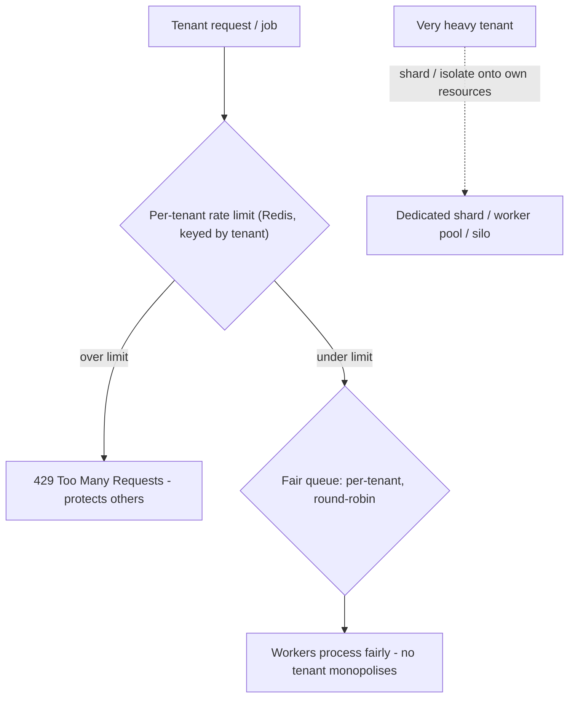

## 90.4 Noisy neighbours: per-tenant rate limits, quotas, and fair queuing

#### Concept

In a pooled multi-tenant system, tenants share resources — CPU, database connections, queue capacity, API throughput. A **noisy neighbour** is a tenant whose heavy usage degrades the experience of other tenants sharing the same resources: one tenant running a huge batch job, or sending a flood of requests, can starve everyone else. The defences are **per-tenant rate limits** (cap how much of a shared resource each tenant can consume), **quotas** (limits on totals like storage or records), **fair queuing** (ensure no tenant monopolises a shared queue), and **tenant-level sharding** (isolate heavy tenants onto their own resources). The goal is fairness: one tenant's behaviour must not harm another's experience.

#### Why does it exist?

Imagine a pooled SaaS where all tenants share one API tier and one database. One tenant writes a buggy script that hammers your API with ten thousand requests per second. Without per-tenant limits, that one tenant consumes all your API capacity and database connections, and *every other tenant* experiences slow responses or outages — they are harmed by a neighbour they do not even know exists. The shared infrastructure that makes pooling economical also makes tenants vulnerable to each other. This is unacceptable: a customer paying for your service should not have their experience ruined by another customer's behaviour.

Noisy-neighbour defences exist to preserve fairness in shared infrastructure: to ensure each tenant gets their fair share of the shared resources and no tenant can monopolise them, whether through malice, a bug, or just heavy legitimate use. They exist because the economics of pooling depend on sharing, but the viability of pooling depends on that sharing being fair — a pooled system where one tenant can ruin everyone else's experience is not a viable product.

#### Mental model

Imagine a shared office kitchen with one coffee machine. Without any rules, one person could run the machine continuously for their whole team's twenty cups, while everyone else waits twenty minutes for coffee — a noisy neighbour monopolising a shared resource. Fairness mechanisms: a limit of two cups per person per visit (per-tenant rate limit), a rule that the office only stocks so much coffee per team per week (quota), a queue where people take turns rather than one person hogging the machine (fair queuing), and, for the team that drinks enormous amounts, giving them their own machine (tenant-level sharding / isolating the heavy user). The shared kitchen (pooled infrastructure) works only if these fairness rules prevent one person from ruining it for everyone. Noisy-neighbour control is the kitchen etiquette, enforced.

#### How it works

The defences, by resource:

**Per-tenant rate limits.** Cap each tenant's request rate (requests per second/minute) so no tenant can consume a disproportionate share of API capacity. Implemented with a rate limiter keyed by `tenant_id` (often in Redis), so each tenant has its own budget. A tenant that exceeds its limit gets `429 Too Many Requests`, protecting the others.

**Quotas.** Limits on cumulative resources: storage per tenant, number of records, number of API calls per billing period, number of users. Quotas prevent a tenant from consuming unbounded shared storage or compute, and they often tie to the tenant's plan (90.5).

**Fair queuing.** For shared background-job queues, ensure one tenant's flood of jobs does not starve others. Instead of a single FIFO queue (where one tenant's 100,000 jobs block everyone behind them), use per-tenant queues with round-robin or weighted processing, so every tenant's jobs make progress regardless of another tenant's volume.

**Tenant-level sharding / isolation.** For a tenant whose load is genuinely large (a big enterprise customer), move them onto their own resources — their own database shard, their own worker pool, or a silo (90.1) — so their load cannot affect the pooled tenants, and vice versa. This is isolating the heavy neighbour.



#### NestJS example

Per-tenant rate limiting using `@nestjs/throttler` keyed by tenant, backed by Redis so limits are shared across instances:

```ts
// A throttler guard that rate-limits per tenant, not per IP.
import { Injectable } from '@nestjs/common';
import { ThrottlerGuard } from '@nestjs/throttler';
import { getTenantId } from './tenant-context';

@Injectable()
export class PerTenantThrottlerGuard extends ThrottlerGuard {
  // Key the rate limit by tenant so each tenant has its own budget.
  protected async getTracker(req: Record<string, any>): Promise<string> {
    return getTenantId();     // from the tenant context (58.3)
  }
}
```

```ts
// Applying different limits per tenant plan (58.5): enterprise gets more.
import { Injectable } from '@nestjs/common';
import { getTenantId } from './tenant-context';
import Redis from 'ioredis';

@Injectable()
export class TenantRateLimiter {
  constructor(private readonly redis: Redis) {}

  // Token-bucket-style check keyed by tenant, with a per-plan limit.
  async check(limitPerMinute: number): Promise<boolean> {
    const tenantId = getTenantId();
    const key = `ratelimit:${tenantId}:${Math.floor(Date.now() / 60000)}`;
    const count = await this.redis.incr(key);
    if (count === 1) await this.redis.expire(key, 60);  // window TTL
    return count <= limitPerMinute;   // false -> caller returns 429
  }
}
```

#### PostgreSQL example

Database-side, a heavy tenant's queries can monopolise connections and I/O. Defences include per-tenant connection limits and statement timeouts so a runaway query cannot hog the database:

```sql
-- Limit how long any single statement can run, so a tenant's runaway query
-- (e.g. a huge unindexed scan) can't monopolise the database for others.
SET statement_timeout = '5s';   -- per session; set for the pooled app role

-- Quota enforcement example: count a tenant's rows against their plan limit
-- before allowing an insert (enforced in app + checked here).
SELECT count(*) FROM products WHERE tenant_id = 'acme';  -- vs plan's max_products

-- For a very heavy tenant, isolate them onto their own database (silo, 58.1)
-- so their load (connections, I/O, locks) cannot affect pooled tenants.
```

Connection management matters too: a connection pooler (like PgBouncer) with per-tenant or per-plan connection limits prevents one tenant from exhausting the shared connection pool.

#### Production scenario

A pooled SaaS has per-tenant rate limits (via Redis, keyed by tenant), per-tenant fair queuing for background jobs, and statement timeouts on the database. One day a tenant deploys a buggy integration that hammers the API at 5,000 requests per second — a classic noisy neighbour. The per-tenant rate limit kicks in immediately: that tenant's requests over their limit get `429`, so they consume only their fair share, and *every other tenant is unaffected* — their API experience is normal, because the noisy tenant was contained to their own budget. The background jobs the noisy tenant also floods are handled by fair queuing: their 50,000 jobs are processed round-robin with other tenants' jobs, so other tenants' jobs keep flowing rather than being stuck behind the flood. The noisy-neighbour defences did exactly their job: one tenant's bad behaviour was contained to that tenant, preserving fairness for everyone else. Without them, that one buggy integration would have caused a platform-wide outage affecting every customer.

#### Failure scenario

A pooled SaaS has no per-tenant rate limiting — it has a global rate limit, but not a per-tenant one. One tenant's integration goes haywire and sends a massive flood of requests. The global rate limit does not help, because it limits total traffic, not per-tenant traffic — so this one tenant consumes nearly all the allowed capacity, and every other tenant's requests are either rejected (hitting the global limit that the noisy tenant filled) or slowed to a crawl as the shared database connections and CPU are monopolised by the noisy tenant's load. Essentially every customer experiences an outage, caused by one customer's bug. The support queue floods with complaints from innocent tenants, the company's reputation takes a hit, and the engineers scramble to manually block the offending tenant. The root cause is the absence of per-tenant isolation of shared resources: a global limit treats all traffic as one pool, so one tenant can fill it and starve the rest. The fix is per-tenant rate limits and fair queuing, so each tenant is contained to their own share and no tenant can monopolise the shared resources. In a pooled multi-tenant system, global limits are insufficient; fairness requires per-tenant limits, because the whole risk is one tenant harming the others. Without per-tenant noisy-neighbour control, a pooled SaaS is one buggy integration away from a platform-wide outage.

#### Edge cases & failure modes

- **Global instead of per-tenant limits.** A global rate limit lets one tenant fill it and starve the rest; fairness requires per-tenant limits.
- **No fair queuing.** A single FIFO queue lets one tenant's flood of jobs block every other tenant's jobs behind it.
- **No statement timeout.** A tenant's runaway query (huge unindexed scan) monopolises the database CPU/I/O for everyone.
- **Connection pool exhaustion.** One tenant opening many connections exhausts the shared pool; needs per-tenant/per-plan connection limits.
- **Not isolating a genuinely heavy tenant.** Keeping a huge enterprise tenant pooled, where their legitimate load degrades the small tenants; shard or silo them.
- **Rate limits not shared across instances.** In-memory per-instance limits let a tenant exceed the intended limit by spreading across instances; use a shared store (Redis).
- **Limits so tight they harm legitimate use,** or so loose they do not protect — tune per plan and monitor.

#### How a Senior Backend Engineer thinks about this

They treat fairness as a core requirement of a pooled multi-tenant system, because they know the economics of pooling depend on sharing but the viability of pooling depends on that sharing being fair — a pooled system where one tenant can ruin everyone else's experience is not a viable product. So they build per-tenant isolation of shared resources: per-tenant rate limits (keyed by tenant, in a shared store so they hold across instances), quotas tied to plans, fair queuing so no tenant's job flood starves others, and statement timeouts and connection limits so no tenant's database load monopolises the shared cluster.

They understand that global limits are insufficient — the whole risk is one tenant harming the others, which only per-tenant limits address — and they are vigilant that a single buggy or malicious tenant integration must be contained to that tenant, never allowed to cascade into a platform-wide outage. For genuinely heavy tenants whose legitimate load is large, they isolate them onto their own resources (shard or silo), protecting both the heavy tenant and the pooled ones. The senior engineer's defining instinct here is that in shared infrastructure, one tenant's behaviour is a threat to all the others, and the architecture must enforce fairness so that threat is contained — because the alternative is a product where every customer is one buggy neighbour away from an outage.

#### Common mistakes

- **Using global rate limits instead of per-tenant ones,** so one tenant can fill the global budget and starve the rest.
- **A single FIFO job queue** that lets one tenant's flood block everyone else.
- **No statement timeouts or connection limits,** letting a tenant's query or connections monopolise the database.
- **In-memory per-instance rate limits** that a tenant can exceed by spreading across instances.
- **Not isolating a genuinely heavy tenant,** whose legitimate load degrades the pooled tenants.

#### Interview questions

1. **What is the noisy-neighbour problem in multi-tenancy, and how do you defend against it?**
   *Expected answer:* in a pooled system tenants share resources, so one tenant's heavy usage (a flood of requests, a huge job, a runaway query) can degrade or starve other tenants' experience. Defend with per-tenant rate limits (keyed by tenant, in a shared store), per-tenant quotas, fair queuing (so one tenant's jobs don't block others), statement timeouts and connection limits on the database, and isolating genuinely heavy tenants onto their own resources. *Why it matters:* fairness is essential to a viable pooled SaaS.

2. **Why is a global rate limit insufficient for multi-tenant fairness?**
   *Expected answer:* a global limit caps total traffic, so one tenant can consume nearly all of it and starve the rest — the global limit even becomes the mechanism of harm (innocent tenants get rejected because the noisy one filled the global budget). The whole risk is one tenant harming the others, which only per-tenant limits address. *Why it matters:* tests whether they understand the limit must be per-tenant.

3. **How do you prevent one tenant's flood of background jobs from starving other tenants?**
   *Expected answer:* fair queuing — instead of a single FIFO queue (where one tenant's 100,000 jobs block everyone behind them), use per-tenant queues processed round-robin or weighted, so every tenant's jobs make progress regardless of another tenant's volume; and for genuinely heavy tenants, give them their own worker pool. *Why it matters:* tests knowledge of fairness in shared async processing.

#### Practical exercise

Design the noisy-neighbour defences for a pooled multi-tenant feature. Implement per-tenant rate limiting (keyed by tenant, backed by a shared store like Redis, with limits that could vary by plan), specify the quotas you would enforce (storage, records, API calls per period), and design fair queuing for a shared background-job queue so no tenant can starve others. Identify the database-side defences (statement timeout, connection limits) and the threshold at which you would isolate a heavy tenant onto their own resources.

**Acceptance criteria:** your rate limiting is per-tenant (not global) and backed by a shared store so it holds across instances; you specify per-tenant quotas tied to plans; your job queue is fair (per-tenant, round-robin or weighted) so one tenant's flood cannot starve others; you include database-side protections (statement timeout, connection limits); and you define a threshold for isolating a genuinely heavy tenant — demonstrating that one tenant's behaviour cannot harm the others.
