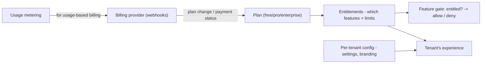

## 90.5 Per-tenant configuration, entitlements, plans, and billing hooks

#### Concept

Tenants are not identical: they are on different plans, have different features enabled, different limits, and different settings. **Per-tenant configuration** is how each tenant customises behaviour (settings, branding, preferences). **Feature entitlements** are which features a tenant is allowed to use, usually determined by their plan. **Plans** are the tiers (free, pro, enterprise) that bundle entitlements and limits. **Billing hooks** connect usage and plan changes to billing (metering usage, handling upgrades/downgrades, enforcing payment status). Together these turn a one-size-fits-all application into a product that serves different tenants differently according to what they have paid for — which is how a SaaS makes money and serves a range of customers.

#### Why does it exist?

Imagine a SaaS where every tenant gets every feature and unlimited usage. There is no way to offer tiered pricing (free vs pro vs enterprise), no way to gate premium features behind higher plans, no way to enforce usage limits, and no connection between what a tenant uses and what they pay. The business model collapses — you cannot monetise differentiated value, and you cannot prevent a free tenant from consuming enterprise-level resources. Entitlements and plans exist to make the product monetizable: to offer different value at different prices, gate features by plan, enforce limits, and bill according to usage.

Per-tenant configuration exists because different tenants genuinely need different behaviour — different settings, integrations, branding — and a SaaS must let each tenant configure their instance without affecting others. Billing hooks exist to connect all of this to money: metering usage for usage-based billing, handling plan changes, and enforcing payment status (a tenant who stops paying should lose access, gracefully). Together they are the machinery that makes a multi-tenant application a viable business rather than a uniform tool.

#### Mental model

Imagine a streaming service. Everyone uses the same app (shared application), but each account has a plan (free with ads, standard, premium 4K), which determines entitlements (how many screens, what quality, downloads or not), per-account settings (language, subtitles, profiles), and billing (monthly charge, metered add-ons, suspension if payment fails). The same app serves a free user and a premium family completely differently, based on their plan's entitlements and their settings, all connected to billing. Per-tenant configuration and entitlements are the streaming service's plan-and-settings machinery applied to a B2B SaaS: one app, many tenants, each experiencing it according to their plan and configuration.

#### How it works

The pieces:

**Plans.** Named tiers (free, pro, enterprise) that bundle entitlements and limits. Each plan defines which features are enabled and what the usage limits are. A tenant is on one plan (which can change).

**Entitlements.** The specific features/capabilities a tenant is allowed to use, derived from their plan (and sometimes custom add-ons). Checked wherever a gated feature is used: "is this tenant entitled to the advanced-reporting feature?". Entitlements are the gate between plans and feature access.

**Per-tenant configuration.** Tenant-specific settings: branding (logo, colours), integrations, preferences, defaults. Stored per tenant and loaded with the tenant context. Distinct from entitlements (what they *can* use) — configuration is how they have *set up* what they use.

**Billing hooks.** The connection to billing: metering usage (recording consumption for usage-based billing), handling plan changes (upgrade grants new entitlements immediately; downgrade removes them, possibly at period end), and enforcing payment status (a past-due tenant is suspended gracefully, data retained per policy). Often integrated with a billing provider (e.g. Stripe) via webhooks that update the tenant's plan/status.



#### NestJS example

An entitlements service and a guard that gates a feature by entitlement:

```ts
// entitlements.service.ts — resolves a tenant's entitlements from their plan.
import { Injectable } from '@nestjs/common';
import { getTenantId } from './tenant-context';

const PLAN_ENTITLEMENTS: Record<string, Set<string>> = {
  free:       new Set(['basic_inventory']),
  pro:        new Set(['basic_inventory', 'advanced_reporting', 'api_access']),
  enterprise: new Set(['basic_inventory', 'advanced_reporting', 'api_access', 'sso', 'audit_export']),
};

@Injectable()
export class EntitlementsService {
  constructor(/* inject tenant plan source: cache/db */) {}

  async isEntitled(feature: string): Promise<boolean> {
    const tenantId = getTenantId();
    const plan = await this.getPlan(tenantId);          // from cache/db
    return PLAN_ENTITLEMENTS[plan]?.has(feature) ?? false;
  }
  private async getPlan(tenantId: string): Promise<string> { /* ... */ return 'pro'; }
}
```

```ts
// entitlement.guard.ts — gate an endpoint behind a required entitlement.
import { Injectable, CanActivate, ExecutionContext, ForbiddenException } from '@nestjs/common';
import { Reflector } from '@nestjs/core';
import { EntitlementsService } from './entitlements.service';

@Injectable()
export class EntitlementGuard implements CanActivate {
  constructor(private reflector: Reflector, private entitlements: EntitlementsService) {}

  async canActivate(ctx: ExecutionContext): Promise<boolean> {
    const required = this.reflector.get<string>('entitlement', ctx.getHandler());
    if (!required) return true;
    if (await this.entitlements.isEntitled(required)) return true;
    throw new ForbiddenException(`Your plan does not include: ${required}`);
  }
}

// Usage on a controller: @RequiresEntitlement('advanced_reporting')
```

A billing webhook handler that updates a tenant's plan on a Stripe event:

```ts
// Billing webhook: update the tenant's plan/status from the billing provider.
import { Controller, Post, Body, Headers } from '@nestjs/common';

@Controller('webhooks/billing')
export class BillingWebhookController {
  constructor(private readonly tenants: TenantService) {}

  @Post()
  async handle(@Body() event: any, @Headers('stripe-signature') sig: string) {
    // VERIFY the webhook signature first (never trust an unverified webhook).
    this.verifySignature(event, sig);
    switch (event.type) {
      case 'customer.subscription.updated':   // plan change
        await this.tenants.setPlan(event.data.tenantId, event.data.plan);
        break;
      case 'invoice.payment_failed':          // enforce payment status
        await this.tenants.markPastDue(event.data.tenantId);  // graceful suspend
        break;
    }
    return { received: true };
  }
  private verifySignature(event: any, sig: string) { /* verify or throw */ }
}
```

#### PostgreSQL example

Storing plans, entitlements, config, and usage:

```sql
-- Tenant plan + status.
CREATE TABLE tenants (
  id          UUID PRIMARY KEY,
  name        TEXT NOT NULL,
  plan        TEXT NOT NULL DEFAULT 'free',     -- free / pro / enterprise
  status      TEXT NOT NULL DEFAULT 'active',   -- active / past_due / suspended
  created_at  TIMESTAMPTZ NOT NULL DEFAULT now()
);

-- Per-tenant configuration (flexible settings as jsonb).
CREATE TABLE tenant_config (
  tenant_id   UUID PRIMARY KEY REFERENCES tenants(id),
  settings    JSONB NOT NULL DEFAULT '{}'       -- branding, preferences, integrations
);

-- Usage metering for usage-based billing (append-only).
CREATE TABLE usage_events (
  id          BIGSERIAL PRIMARY KEY,
  tenant_id   UUID NOT NULL,
  metric      TEXT NOT NULL,                    -- e.g. 'api_calls', 'storage_gb'
  quantity    NUMERIC NOT NULL,
  occurred_at TIMESTAMPTZ NOT NULL DEFAULT now()
);
CREATE INDEX usage_tenant_period ON usage_events (tenant_id, metric, occurred_at);

-- Aggregate a tenant's usage for a billing period:
SELECT metric, sum(quantity)
FROM usage_events
WHERE tenant_id = 'acme' AND occurred_at >= date_trunc('month', now())
GROUP BY metric;
```

#### Production scenario

A SaaS gates its advanced-reporting feature behind the pro and enterprise plans using an entitlement guard. A free-plan tenant who tries to access advanced reporting gets a clear "your plan does not include this" response with an upgrade prompt — which is both correct enforcement and a monetisation path (the gate encourages upgrades). When a tenant upgrades from free to pro (via the billing provider), a webhook updates their plan, and the entitlement check immediately grants access to the newly-included features — no deploy, no manual step, just the plan change flowing through. Usage is metered into `usage_events` for the usage-based portion of billing. When a tenant's payment fails, a webhook marks them past-due and they are gracefully suspended (access restricted, data retained per policy, with a grace period and dunning emails) rather than abruptly cut off. The whole machinery — plans, entitlements, config, billing hooks — runs automatically, letting the product serve free users and enterprise customers differently from one codebase, monetise differentiated value, and connect usage to revenue, which is the business model of the SaaS made concrete in architecture.

#### Failure scenario

A SaaS hard-codes feature availability rather than deriving it from plan entitlements — features are gated by scattered `if` checks referencing plan names directly (`if (tenant.plan === 'pro' || tenant.plan === 'enterprise')`) throughout the codebase. When the company introduces a new plan tier (a "business" plan between pro and enterprise) and wants to adjust which features each plan includes, they have to find and change dozens of scattered plan-name checks across the codebase, and they inevitably miss some — so the new plan grants the wrong features, or an existing plan loses a feature it should have, causing customer complaints and billing disputes. Worse, a bug in one of the scattered checks lets a free tenant access a paid feature (revenue leak) or blocks a paying tenant from a feature they are entitled to (churn risk). The root cause is that entitlements were hard-coded as scattered plan-name comparisons instead of being a centralised, data-driven entitlements layer. Had entitlements been derived from a single source (plan-to-entitlements mapping, checked through one entitlement service), introducing a new plan or changing a plan's features would be a single data change, applied consistently everywhere. Scattering plan logic through the codebase makes the monetisation model rigid, error-prone, and a source of revenue leaks and churn — the entitlements layer exists precisely to centralise this, and skipping it makes every plan change a dangerous, incomplete code hunt.

#### Edge cases & failure modes

- **Hard-coded plan checks scattered through the code.** Makes plan changes a dangerous, incomplete code hunt and causes feature-access bugs (revenue leaks, churn).
- **Entitlements not re-evaluated on plan change.** A tenant upgrades but does not get new features until a deploy or cache expiry; wire plan changes to immediate entitlement updates.
- **Not enforcing payment status.** A past-due tenant keeps full access indefinitely, giving the product away; enforce graceful suspension with a grace period.
- **Abrupt suspension on payment failure.** Cutting a tenant off instantly on one failed payment (which may be a transient card issue) loses customers; use grace periods and dunning.
- **Unverified billing webhooks.** Trusting an unverified webhook lets an attacker upgrade their own plan for free; always verify signatures.
- **Usage metering that loses events.** Under-counting usage loses revenue; over-counting over-charges. Metering must be reliable (append-only, idempotent).
- **Per-tenant config that leaks across tenants,** or config changes affecting other tenants — config must be strictly tenant-scoped.

#### How a Senior Backend Engineer thinks about this

They centralise entitlements into a single, data-driven layer (plan-to-entitlements mapping, checked through one service/guard) rather than scattering plan-name checks through the code, because they know scattered plan logic makes every plan change a dangerous, incomplete code hunt and a source of revenue leaks and churn. They design entitlements to be derived from the plan so that introducing or changing a plan is a data change applied consistently everywhere, and they wire plan changes (via verified billing webhooks) to update entitlements immediately so an upgrade grants access at once.

They treat billing hooks with care: verifying webhook signatures (so no one can upgrade themselves for free), metering usage reliably (append-only, idempotent, since lost events are lost revenue and double-counted events over-charge), and enforcing payment status gracefully (a grace period and dunning for a past-due tenant, not an abrupt cut-off on one transient failure). They keep per-tenant configuration strictly tenant-scoped, loaded with the tenant context, so one tenant's settings never affect another. The senior engineer understands that this machinery — plans, entitlements, config, billing — is the architecture of the business model, so they build it to make the product monetizable, differentiable by plan, and connected to revenue, while being robust against the failure modes (revenue leaks, mis-granted features, lost usage) that directly cost money.

#### Common mistakes

- **Scattering hard-coded plan-name checks** through the code instead of a centralised entitlements layer.
- **Not updating entitlements immediately on a plan change,** so upgrades don't take effect until a deploy.
- **Not enforcing payment status,** giving the product away to past-due tenants.
- **Unverified billing webhooks,** letting attackers change their own plan.
- **Unreliable usage metering,** losing revenue (under-count) or over-charging (double-count).

#### Interview questions

1. **How do you architect feature entitlements and plans in a multi-tenant SaaS?**
   *Expected answer:* a centralised, data-driven entitlements layer — a plan-to-entitlements mapping checked through a single service/guard — so feature access is derived from the tenant's plan, and introducing or changing a plan is a single data change applied consistently everywhere. Avoid scattering plan-name checks through the code, which causes incomplete plan changes and feature-access bugs. Wire plan changes (via verified billing webhooks) to update entitlements immediately. *Why it matters:* entitlements are the architecture of the monetisation model.

2. **What goes wrong if you hard-code plan checks throughout the codebase instead of centralising entitlements?**
   *Expected answer:* every plan change becomes a dangerous, incomplete hunt through scattered checks, so you miss some — granting the wrong features, leaking revenue (free tenant accesses paid feature) or causing churn (paying tenant blocked from an entitled feature) — and introducing a new plan tier requires changing dozens of places. A centralised entitlements layer makes it a single data change. *Why it matters:* tests understanding of why entitlements must be centralised.

3. **How do you handle billing hooks safely — plan changes, payment failures, usage?**
   *Expected answer:* verify webhook signatures (so no one upgrades themselves for free), update entitlements immediately on plan change, enforce payment status gracefully (grace period and dunning for past-due, not abrupt cut-off on one transient failure), and meter usage reliably (append-only, idempotent, since lost events lose revenue and double-counts over-charge). *Why it matters:* these hooks directly handle money and are a common source of revenue leaks.

#### Practical exercise

Design the plans, entitlements, per-tenant config, and billing hooks for a multi-tenant SaaS feature. Define a plan-to-entitlements mapping (which features each plan includes), implement a centralised entitlement check (a service and guard that gate a feature by entitlement, derived from the plan), design the per-tenant config storage (tenant-scoped settings), and design the billing hooks (a verified webhook that updates plan/status on change, graceful payment-status enforcement, and reliable usage metering).

**Acceptance criteria:** entitlements are centralised and derived from the plan (not scattered plan-name checks), so a plan change is a single data change; a plan upgrade immediately grants new entitlements; per-tenant config is strictly tenant-scoped; billing webhooks are signature-verified; payment-status enforcement is graceful (grace period, not abrupt cut-off); and usage metering is append-only and idempotent so it neither loses revenue nor over-charges.
