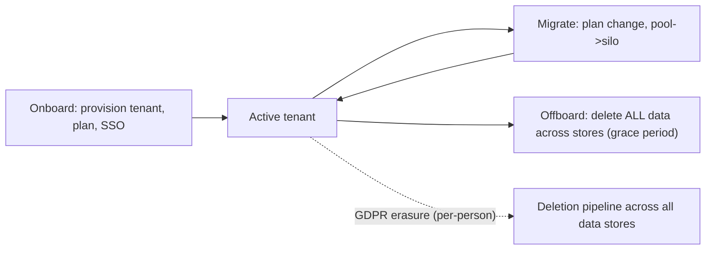

## 90.7 Compliance-driven architecture, integration patterns, and tenant lifecycle

#### Concept

Three topics that complete the enterprise SaaS picture. **Compliance-driven architecture** is how regulations shape your system design: GDPR (right to erasure, data export/portability), PCI DSS (reducing the scope of systems that touch card data), SOC 2 (controls and auditability), and HIPAA (protected health information) each impose concrete architectural requirements. **Enterprise integration patterns** are how customers integrate your SaaS with their systems: webhooks (you notify them of events), connectors, batch import/export, and idempotent bulk APIs. **Tenant lifecycle** is the full arc of a tenant: onboarding, migrating between tiers/models, and offboarding including data deletion. Each turns an external requirement (regulation, integration need, lifecycle event) into concrete architecture.

#### Why does it exist?

Imagine ignoring compliance until an enterprise or regulator demands it. A GDPR erasure request arrives (a user exercising their right to be forgotten) and you discover your architecture cannot actually delete all of a person's data — it is scattered across tables, caches, logs, backups, and a data warehouse, with no mechanism to find and remove it all. Or a PCI audit finds that card data flows through dozens of your services, putting all of them in PCI scope (hugely expensive to audit). Or an enterprise wants to integrate your SaaS with their system and you have no webhooks or bulk API, so integration is impossible. Or a tenant churns and you have no clean way to delete their data, leaving it lingering (a liability and a compliance violation).

These architectural concerns exist because external requirements — regulations, integration needs, lifecycle events — must be *designed into* the system, not bolted on. GDPR erasure must be an architectural capability (knowing where all of a person's data is and being able to delete it). PCI scope reduction must be a design decision (isolating card handling so most systems never touch it). Integration must be a built capability (webhooks, bulk APIs). Tenant deletion must be a designed process. Retrofitting any of these is painful or impossible, so they shape the architecture from the start.

#### Mental model

Imagine building a house that must meet building codes (compliance), connect to utilities (integration), and allow residents to move in and out cleanly (lifecycle). You do not build the house and then try to add fire exits, plumbing connections, and a way to move furniture out — you design the house around these requirements from the start, because retrofitting a fire exit into a finished house is far harder than building it in. Compliance, integration, and lifecycle are the building codes, utility connections, and move-in/move-out design of a SaaS: external requirements that must shape the architecture from the beginning, because they are extremely hard to retrofit into a finished system.

#### How it works

**Compliance-driven architecture:**

```text
GDPR:
  - Right to erasure: you must be able to find and delete ALL of a person's
    data on request — across tables, caches, search indexes, backups, warehouse.
    Architect: a data map (what personal data lives where) + a deletion pipeline.
  - Data export/portability: provide a person's data in a portable format.
  - Consent + purpose: track lawful basis for processing.
PCI DSS (card data):
  - Scope reduction: minimise systems that touch card data. Use a payment
    provider (tokenisation) so YOUR systems store a token, never the card.
    This takes most of your systems OUT of PCI scope — the key design move.
SOC 2:
  - Controls + auditability: access controls, change management, monitoring,
    audit logs (58.6). Architect for evidence — the audit trail IS the control.
HIPAA (health data / PHI):
  - Access controls, encryption, audit logging, BAAs with subprocessors.
    Isolate PHI, log all access, encrypt at rest and in transit.
```

The recurring pattern: **isolation and minimisation**. Isolate the regulated data (card data, PHI, personal data) so that most of your system is out of scope, and minimise what you store. PCI scope reduction via tokenisation is the exemplar: by never storing card data (letting a provider tokenise it), you take almost all your systems out of PCI scope, turning a crushing audit burden into a small one.

**Enterprise integration patterns:**

- **Webhooks:** you notify the customer's system of events (order created, status changed) by POSTing to their endpoint — with retries, signatures (so they trust it is you), and idempotency (so a retried webhook is safe).
- **Connectors:** pre-built integrations with common systems the customer uses.
- **Batch import/export:** bulk data in/out, for migration and reporting.
- **Idempotent bulk APIs:** APIs for creating/updating many records at once, with idempotency keys so a retried bulk operation does not duplicate — critical because bulk operations are big and retries are common.

**Tenant lifecycle:**

- **Onboarding:** provisioning a new tenant (create their data space, apply their plan, set up SSO if enterprise), fast and automated.
- **Migrating between tiers/models:** upgrading a tenant from pool to silo (90.1), or changing plans — a data migration (Part 86 techniques).
- **Offboarding and data deletion:** when a tenant leaves, delete their data cleanly (across all stores), per contract and compliance (GDPR), with a grace period and confirmation. Lingering data of a departed tenant is a liability and a compliance violation.



#### NestJS example

An idempotent bulk API and an outbound webhook with retries and signing:

```ts
// Idempotent bulk create: a retried bulk operation must not duplicate.
import { Controller, Post, Body, Headers, ConflictException } from '@nestjs/common';

@Controller('bulk/products')
export class BulkProductController {
  constructor(private readonly svc: ProductBulkService) {}

  @Post()
  async bulkCreate(
    @Body() items: CreateProductDto[],
    @Headers('idempotency-key') key: string,   // caller-supplied; required
  ) {
    if (!key) throw new ConflictException('Idempotency-Key required for bulk ops');
    // If this key was seen, return the stored result (don't re-execute) — so a
    // client retry of a 5,000-item import doesn't create 10,000 products.
    return this.svc.bulkCreateIdempotent(key, items);  // tenant-scoped (RLS)
  }
}
```

```ts
// Outbound webhook: notify the customer's system, signed + retried + idempotent.
import { Injectable } from '@nestjs/common';
import { createHmac } from 'crypto';

@Injectable()
export class WebhookDispatcher {
  async dispatch(tenantId: string, event: object, url: string, secret: string) {
    const body = JSON.stringify(event);
    // Sign so the customer can verify it's genuinely from us.
    const signature = createHmac('sha256', secret).update(body).digest('hex');
    // Deliver via a durable queue with retries + backoff (not inline), and an
    // event id so the customer can dedupe a retried delivery (idempotency).
    await this.enqueueDelivery({ url, body, signature, eventId: /* uuid */ '', tenantId });
  }
  private async enqueueDelivery(_: any) { /* BullMQ with retry/backoff */ }
}
```

#### PostgreSQL example

A data map for GDPR erasure and a deletion approach, plus PCI scope reduction via tokenisation:

```sql
-- PCI scope reduction: store a TOKEN from the payment provider, NEVER the card.
-- This keeps the card data out of your database -> out of PCI scope.
CREATE TABLE payment_methods (
  id          UUID PRIMARY KEY,
  tenant_id   UUID NOT NULL,
  customer_id UUID NOT NULL,
  provider_token TEXT NOT NULL,     -- e.g. Stripe token; NOT a card number
  last4       TEXT                  -- safe to store for display
);
-- No PAN, no CVV, no expiry stored. The provider holds the card; we hold a token.

-- GDPR erasure: you need to know every place a person's data lives.
-- A deletion pipeline (app-orchestrated) must cover ALL of these:
--   app tables (orders, users, audit where it contains personal data),
--   caches (Redis), search indexes, the data warehouse, and backups (per policy).
-- Example of the app-table deletions (run in a transaction, tenant-scoped):
DELETE FROM order_items WHERE order_id IN (SELECT id FROM orders WHERE customer_id = $1);
DELETE FROM orders WHERE customer_id = $1;
DELETE FROM users WHERE id = $1;
-- Then: purge from Redis, remove from the search index, propagate deletion to
-- the warehouse (Part 39), and handle backups per your documented policy.
```

#### Production scenario

A SaaS handling payments reduced its PCI scope by using a payment provider's tokenisation: card data is entered directly into the provider's hosted field (never touching the SaaS servers), and the SaaS stores only a token. As a result, the vast majority of the SaaS's systems are out of PCI scope — the PCI audit covers only the small, isolated payment-token-handling path, turning what could have been a crushing, expensive, whole-system audit into a manageable one. Separately, when a GDPR erasure request arrives, the SaaS's deletion pipeline — built from a data map of where personal data lives — removes the person's data from the app database, Redis cache, search index, and propagates the deletion to the warehouse, completing a defensible erasure. And when a tenant offboards, an automated deletion process removes all their data across every store after a grace period, leaving no lingering liability. Each of these is compliance designed into the architecture: PCI scope reduction via tokenisation, GDPR erasure via a data map and deletion pipeline, tenant offboarding via a deletion process. The architecture satisfies the regulations because it was built to, not bolted on after an audit failure.

#### Failure scenario

A SaaS stores card data directly in its own database (PANs, encrypted) across its order and payment services, reasoning it is simpler than integrating a provider's tokenisation. When it pursues enterprise deals requiring PCI compliance, the audit scope is catastrophic: because card data flows through and is stored across many services, *all* of those services are in PCI scope, meaning every one must meet the full PCI DSS requirements (access controls, encryption, logging, segmentation, regular audits) — an enormous, ongoing, expensive burden. The audit is costly, the remediation (securing dozens of in-scope systems) is huge, and the ongoing compliance overhead drags on every release to those services. Compare the tokenisation approach, which would have kept card data out of the SaaS entirely, leaving only a tiny isolated path in scope. The root cause is storing regulated data (card numbers) throughout the system instead of isolating and minimising it — the opposite of PCI scope reduction. The SaaS pays, in audit cost and ongoing overhead, for having designed card handling into the heart of the system rather than isolating it to a minimal, tokenised path. The lesson: for regulated data (card data, PHI, personal data), the architectural goal is isolation and minimisation — keep the regulated data out of (or minimally within) your systems, so most of the system is out of compliance scope. Designing regulated data throughout the system turns compliance from a small bounded cost into a crushing system-wide one.

#### Edge cases & failure modes

- **Storing card data throughout the system** instead of tokenising, putting everything in PCI scope — a crushing, expensive audit burden.
- **No data map for GDPR erasure.** You cannot find all of a person's data, so you cannot defensibly delete it (across caches, indexes, warehouse, backups).
- **Deletion that misses stores.** Deleting from the app database but leaving data in Redis, the search index, or the warehouse — an incomplete erasure that violates GDPR.
- **Bulk APIs without idempotency.** A retried bulk import duplicates thousands of records.
- **Webhooks without signing/retries/idempotency.** The customer can't verify they're from you, deliveries are lost on transient failures, or retries cause duplicate processing.
- **Tenant offboarding that leaves data lingering.** A departed tenant's data remaining is a liability and a compliance violation; offboarding must delete across all stores.
- **Compliance bolted on after an audit failure,** when it should have shaped the architecture from the start.

#### How a Senior Backend Engineer thinks about this

They design compliance into the architecture from the start, treating regulations as architectural requirements rather than paperwork, because they know retrofitting compliance after an audit failure is painful or impossible. Their recurring strategy for regulated data (card data, PHI, personal data) is isolation and minimisation: keep the regulated data out of (or minimally within) their systems so most of the system is out of scope — the PCI tokenisation move being the exemplar, turning a system-wide audit burden into a tiny isolated one. For GDPR, they maintain a data map of where personal data lives and build a deletion pipeline that covers all stores (database, caches, indexes, warehouse, backups), because an erasure that misses a store is not a defensible erasure.

They build enterprise integration as real capabilities — webhooks that are signed, retried, and idempotent; bulk APIs that are idempotent (so a retried big import does not duplicate) — because they know customers integrate at scale and retries are inevitable. And they treat tenant lifecycle as a designed process, especially offboarding, ensuring a departed tenant's data is deleted across every store, because lingering data is both a liability and a compliance violation. The senior engineer understands that compliance, integration, and lifecycle are external requirements that must shape the architecture early, and that the unifying principle for regulated data — isolate and minimise — is what keeps compliance a bounded cost rather than a crushing system-wide one.

#### Common mistakes

- **Storing regulated data (card data, PHI) throughout the system** instead of isolating and minimising it, exploding compliance scope.
- **No data map or deletion pipeline for GDPR erasure,** so you cannot defensibly delete all of a person's data.
- **Incomplete deletion** that misses caches, indexes, the warehouse, or backups.
- **Bulk APIs and webhooks without idempotency,** causing duplicates on inevitable retries.
- **Tenant offboarding that leaves data lingering,** a liability and compliance violation.

#### Interview questions

1. **How does PCI DSS scope reduction work, and why is it the key design move for card data?**
   *Expected answer:* use a payment provider's tokenisation so card data is entered directly into the provider (never touching your servers) and you store only a token — which keeps card data out of your systems and takes almost all of them out of PCI scope, turning a crushing system-wide audit into a tiny isolated one. The principle is isolate and minimise regulated data. *Why it matters:* this is the exemplar of compliance-driven architecture.

2. **What does GDPR's right to erasure require architecturally?**
   *Expected answer:* the ability to find and delete all of a person's data on request — which requires a data map (what personal data lives where: app tables, caches, search indexes, warehouse, backups) and a deletion pipeline that removes it from every store. An erasure that misses a store (e.g. leaves data in the warehouse or search index) is not a defensible erasure. *Why it matters:* tests whether they design erasure as an architectural capability.

3. **How do you design enterprise integration (webhooks, bulk APIs) to be robust?**
   *Expected answer:* webhooks should be signed (so the customer can verify they're from you), delivered via a durable queue with retries and backoff (so transient failures don't lose events), and carry an event id for idempotency (so a retried delivery is deduped); bulk APIs should require idempotency keys so a retried large import doesn't duplicate thousands of records. Retries are inevitable at integration scale, so idempotency is essential. *Why it matters:* tests understanding of integration robustness.

#### Practical exercise

Design the compliance, integration, and lifecycle architecture for a multi-tenant SaaS. For compliance: describe your PCI scope-reduction approach (tokenisation), your GDPR data map and deletion pipeline (covering all stores), and the SOC 2 controls (audit logging). For integration: design a signed, retried, idempotent webhook delivery and an idempotent bulk API. For lifecycle: design tenant offboarding with complete data deletion across all stores after a grace period.

**Acceptance criteria:** your card-data handling isolates and minimises (tokenisation keeps card data out of your systems and out of PCI scope); your GDPR erasure is backed by a data map and a deletion pipeline covering all stores (not just the app database); your webhooks are signed, retried, and idempotent, and your bulk API is idempotent; and your tenant offboarding deletes all tenant data across every store after a grace period, leaving no lingering liability — demonstrating that compliance, integration, and lifecycle are designed into the architecture, not bolted on.
