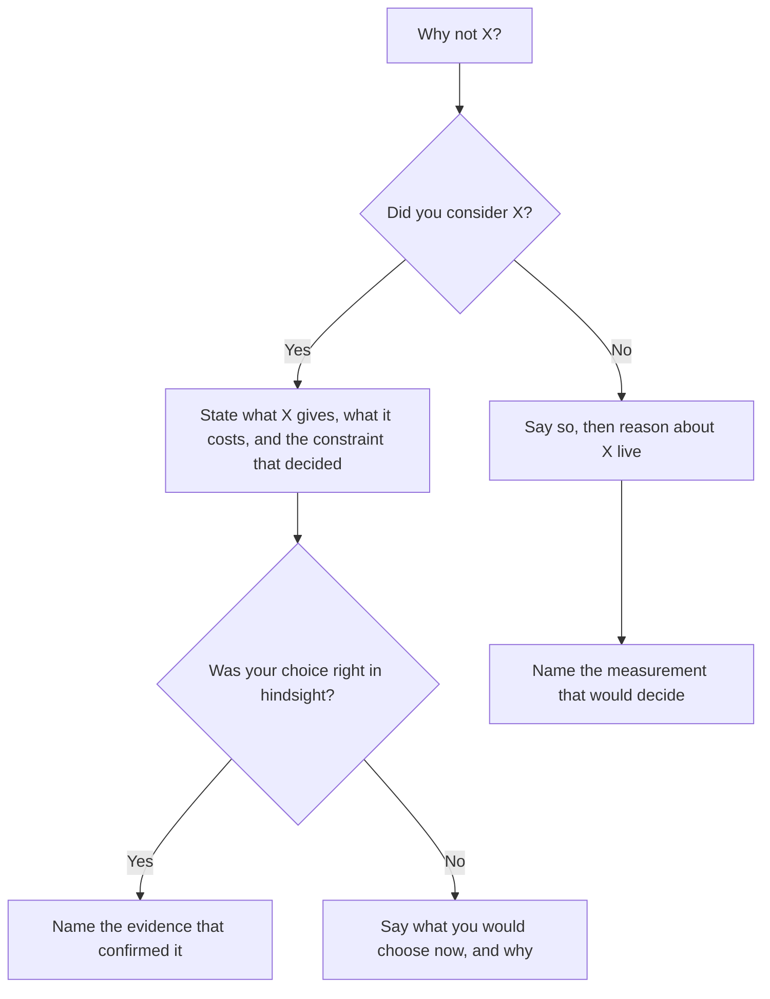
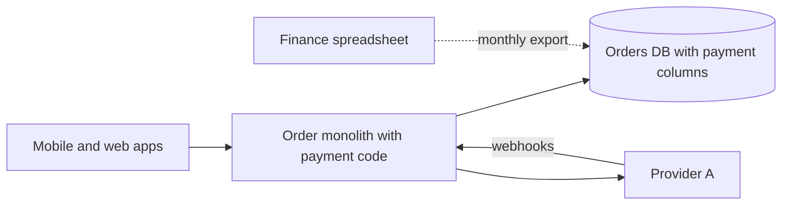
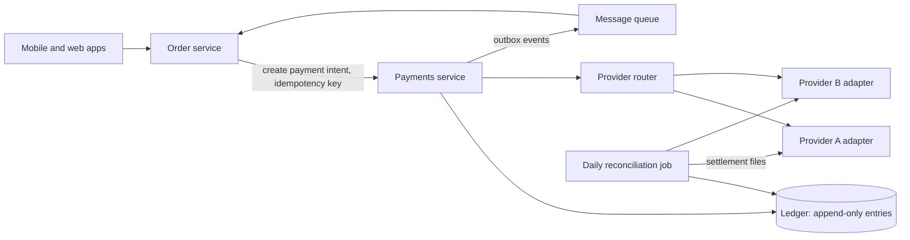

## 91.3 The architecture deep dive round

#### Concept

In the architecture deep dive you present a system you led, usually for 15 to 25 minutes, and the interviewer spends the rest of the hour probing it. Some companies ask for slides or a diagram in advance; others give you a blank whiteboard. It is the most important round in most staff loops, because it is the only one where the evidence is your actual past work rather than a hypothetical.

70.5.1 showed the shape: a story that survives five levels of "why". This section is the full preparation: how to structure 45 minutes, what interviewers probe, how to answer "why not X?", and a complete worked deep dive.

#### Why does it exist?

Hypothetical design rounds measure how you think on a fresh problem. They cannot measure whether you have carried a real system through constraints, politics, failure and time. The deep dive does that, and it is hard to fake: someone who was near a project can describe its architecture, but only someone who led it knows why the second option was rejected, what the finance team objected to, and which assumption broke in month four.

#### Mental model

Imagine showing a building inspector around a house you built. You choose where the tour starts and what you point out, but the inspector may open any wall. A good builder walks them to the walls worth opening: "this beam is larger than code requires, and here is why", "this is where we had damp, and this is the fix". A poor builder hopes the inspector does not open anything.

#### How it works

**Choose the system.** The best deep-dive system is one where you made the important decisions, it crossed team boundaries, it had real constraints (money, correctness, a deadline, a regulator), something went wrong, and you can measure the outcome. A migration or a platform is usually better than a greenfield service, because it has more decisions and more people. Avoid the system with the most impressive technology if your role in it was small.

**Structure 45 minutes.** If the interviewer gives you the floor, use roughly this plan, and stop for questions at each boundary.

| Minutes | Part | What to cover | What it proves |
|---|---|---|---|
| 0–2 | Headline | One sentence: what changed, at what scope, with a number; your role | Scope and ownership, immediately |
| 2–8 | Context and constraints | Business, scale, teams, the forces that made change necessary, the hard constraints | You understand why, not just what |
| 8–20 | Architecture and decisions | Before and after diagrams; three key decisions, each with alternatives and the reason | Judgment and trade-offs |
| 20–27 | Migration and execution | How you got from before to after without stopping the business | Staff-level execution (Part 86) |
| 27–33 | What went wrong | One or two real failures and what you changed | Honesty and learning |
| 33–38 | Outcome | Before and after numbers; what lasted | Impact |
| 38–45 | What I would change | Two or three changes, technical and organisational | Reflection; principal-level thinking |

Many interviewers will interrupt from minute three onward. That is good; it means they are finding evidence. Follow them, and keep a mental list of the parts you have not covered so you can offer them at the end: "We have not talked about the reconciliation design; it is where the hardest failure was, if that is useful."

**Know the probes.** Interviewers draw from a small set of probe types. Prepare an answer for each, for every major decision.

| Probe type | Typical question | What a strong answer contains |
|---|---|---|
| Rationale | "Why did you choose this?" | The constraint that drove it, with a number |
| Alternatives | "Why not X?" | What X would have given, what it would have cost, why the cost was too high here |
| Ownership | "What did you personally do?" | Decisions, documents, code, conversations that were yours |
| Evidence | "How did you know it was working?" | Metrics, dashboards, reconciliation, before and after |
| Failure | "What broke?" | A specific failure, impact in numbers, the change you made |
| People | "Who disagreed?" | Their real constraint and how it was resolved |
| Cost | "What did it cost?" | Engineer-months, infrastructure, opportunity cost |
| Scale | "What breaks at 10x?" | The first bottleneck, and what you would change (Part 56) |
| Reflection | "What would you do differently?" | Something that costs you a little to admit |

**Answer "why not X?" honestly.** There are only four honest answers, and all of them are acceptable if you give the right one.

| Situation | How to answer |
|---|---|
| You considered X and rejected it | "We considered X. It would have given us A. It would have cost B, and B mattered more because of constraint C." |
| You did not consider X | "We did not seriously consider X. Thinking about it now, it would help with A but I would worry about B; I would want to measure C before choosing." |
| X would have been better | "Honestly, X would probably have been better. We chose Y because of D, which turned out to matter less than we thought. Today I would choose X." |
| X was not viable then | "X was not mature or available for us at the time because of E. If we were starting today, I would evaluate it seriously." |

What you must not do is defend a choice you do not believe in, or pretend you considered something you did not. Interviewers at this level often know the domain well, and a defensive answer reads as poor judgment. "We did not consider it, and here is how I would evaluate it" is a strong answer, because it shows how you think on new information.

#### Practical example: a worked deep dive

The candidate is Asha (whose promotion packet appeared in 91.1). The composite company and the numbers are illustrative.

**Headline (minute 0).** "I led the move of our payments from code inside the order monolith to a payments platform with its own ledger and two payment providers. It took fourteen months across four teams. Payment-change lead time went from about eleven days to a day and a half, and checkout payment errors from 0.9% to 0.2%. I was the technical lead: I wrote the RFC and the migration plan, built the ledger core, and ran the cutover."

**Context and constraints (minutes 2–8).** "Food delivery, about two million orders a month, peaks of roughly ten payment attempts a second at dinner. So this was not a throughput problem. There were three real problems. First, coupling: payment code shipped on the monolith's weekly train, so a payment fix waited up to a week, and the median lead time was eleven days. Second, a single provider: when it degraded, which happened four or five times a year for thirty to ninety minutes, checkout failed and we lost those orders. Third, correctness: payment state was three columns on the orders table, refunds were done by hand in the provider's dashboard, and finance reconciled monthly in a spreadsheet, taking six working days. The hard constraints were: no double charges, no lost money, no checkout downtime, and finance had an external audit in month nine."

**Architecture and decisions (minutes 8–20).** Before:

After:

"Three decisions mattered most.

One: an append-only ledger instead of a payment-status column. Every money movement is an entry; a payment's state is derived from its entries. The alternative was a payments table with a status column, which is simpler. We rejected it because refunds, partial captures and chargebacks overwrote each other's history, and audit needed the history.

Two: a provider router with two providers instead of one provider with better retries. Retries do not help when the provider itself is down. The router sends each payment to the preferred provider and fails over on errors or latency above a threshold. The cost was real: two integrations, two settlement formats, and a contract negotiation that took three months, which I would plan for earlier next time.

Three: events from payments to orders through an outbox, not a synchronous callback. A synchronous callback would have re-coupled the services we were trying to separate, and the dual-write problem (30.9) would have produced orders marked paid with no payment, or the reverse."

**Migration (minutes 20–27).** "We did not build the service and switch. First, branch by abstraction (86.3) inside the monolith: I put a payment interface in front of all payment code, so every call went through one seam. Second, the ledger ran in shadow: the monolith kept writing its columns, and the new ledger wrote entries for the same events; a comparison job ran hourly on amounts per order, not row counts. We ran shadow for six weeks, until mismatches were zero for fourteen days. Third, new orders moved to the payments service behind a flag, 1%, 10%, 50%, 100% over five weeks, while existing orders finished on the old path. Fourth, the second provider went live for 5% of traffic after the cutover, not during it. We had one change in flight at a time."

**What went wrong (minutes 27–33).** "Two things. Technical: provider B sometimes sent the refund webhook before the capture webhook. Our ledger state machine rejected a refund for an uncaptured payment, so about 0.4% of provider B refunds were stuck for up to three days until the reconciliation job flagged them. I changed the design to accept out-of-order events into a pending state that resolves when the missing event arrives, and added an alert on pending age above one hour. Organisational: I brought finance in at month three, not month one. Their reconciliation format needed fields we had not stored, which cost us about a month of rework. That one was my mistake."

**Outcome (minutes 33–38).** "Lead time for payment changes: about eleven days to a day and a half, measured from merge to production in the deploy logs. Checkout payment errors: 0.9% to 0.2%, mostly from failover during provider incidents; we had three provider-A incidents in the following year and lost almost no orders. Month-end close for payments: six days to two. The audit passed with the ledger as evidence. And provider routing let finance negotiate better rates, though I would not claim that number as engineering's."

**What I would change (minutes 38–45).** "Bring finance in at the RFC stage. Build reconciliation first, before the ledger, because reconciliation is how you know everything else is right. And write the exit criteria for shadow mode before starting it; we argued about 'done' for a week."

**Likely probes and strong answers.**

| Probe | Strong answer (summary) | What a principal-level answer adds |
|---|---|---|
| "Why not just improve the monolith's release process?" | "We tried: a payments-only release lane cut lead time to about six days, but payment state on the orders table still coupled the schemas. Deploys were half the problem; ownership of the data was the other half." | Names the organisational cost: two teams were editing the same tables, so every payment change needed an Orders review (Conway's Law, 87.1). |
| "Why build a ledger instead of buying one?" | "We evaluated two products. Both were strong on accounting but would have added a third system in the checkout hot path, at about 10 extra milliseconds and a new vendor dependency. The ledger core was about 1,500 lines; the hard part is the rules, which we had to own anyway." | Frames it as build versus buy with total cost of ownership and a revisit date (84.5, 63.19). |
| "How did you guarantee no double charges during cutover?" | "Idempotency keys created by the order service per checkout attempt, enforced at the payments service and passed to the provider's own idempotency field. Each order lived on exactly one path; the flag decided at order creation." | Explains why the single-path rule mattered more than any clever code: it removed a whole class of states. |
| "What did you personally build?" | "The payment interface in the monolith, the ledger core and its state machine, and the comparison job. Two engineers built the provider adapters; the Orders team built the consumer." | Separates "I" and "we" without being asked twice. |
| "What breaks at 10x?" | "At 100 attempts a second, the ledger is fine. The first problem is the reconciliation job, which reads a whole day; I would partition by settlement date and run it incrementally." | Adds that the real 10x risk is a third provider and the routing rules becoming a product of their own. |
| "Who disagreed most?" | "The Orders lead, who wanted payments to stay a module inside the monolith. His constraint was that his team was on call for checkout and feared a new network hop. We agreed on a latency budget of 150 ms p99 for the payment call and a fallback queue, and he signed the RFC." | Shows the disagreement improved the design. |

#### Failure scenario

A candidate presented a beautifully drawn event-driven architecture for a logistics platform. Probe: "Why Kafka rather than a queue?" "It is the industry standard for event-driven systems." Probe: "What volume did you have?" "A few hundred messages a minute." Probe: "So what did Kafka give you at that volume?" A long pause. Probe: "Who made that choice?" "It had been decided before I joined the project." The interviewer's note: "Presented someone else's architecture; could not explain the key decision; defended rather than evaluated." The system was a fine choice for the deep dive only if the candidate had been willing to say, "I inherited that decision; at our volume a queue would have been enough, and here is what it cost us."

#### Edge cases & failure modes

- **The interviewer knows your domain better than you.** Welcome it. Ask what they would have done; it turns a probe into a design conversation, which is good signal.
- **The system is confidential.** Abstract the names, keep the numbers' order of magnitude, and say what you have changed.
- **Your best system is old.** Present it, then spend the last five minutes on what you would do differently with today's tools, which shows you kept learning.
- **Time runs short.** Skip to "what went wrong" and "outcome"; they carry more signal than the full diagram.
- **Whiteboard tool trouble in a remote round.** Have a simple diagram ready to paste, and be able to describe it in words.

#### How a Principal Engineer thinks about this

A principal chooses the deep-dive system for the decisions it contains, not the technology it uses. They present constraints before architecture, because a design is only good relative to its constraints. They volunteer the failures and the walls worth opening, because they know the interviewer will find them anyway and honesty scores. And they treat "why not X?" as an invitation to reason, not an attack, which is exactly how they want the people they lead to treat their own reviews.

#### Common mistakes

- Spending 20 minutes on the diagram and 2 on decisions and failures.
- Presenting the system's architecture rather than your decisions in it.
- Defending a decision you no longer believe in.
- No numbers for the "before", so the "after" means nothing.
- A failure section that is really a success ("the hardest thing was that we were too successful").

#### Interview questions

1. **"Walk me through a system you are proud of."** Use the 45-minute plan; start with the headline and offer the interviewer a choice of where to go deep.
2. **"What was the most important decision, and what was the runner-up option?"** One decision, its alternative, the constraint that decided it.
3. **"What would have happened if you had not been there?"** A strong answer is specific and modest: "The migration would probably still have happened, but as a rewrite, and I think it would have stalled at 80%" (86.1).
4. **"If you started again tomorrow, what would you do first?"** Something that changes the plan, not a polish item.

#### Practical exercise

Prepare your deep dive: a one-sentence headline, before and after diagrams, three decisions each with a rejected alternative, the migration steps, two failures, the outcome numbers, and three changes. Present it to a peer in 20 minutes and let them probe for 25 using the probe table. Acceptance criteria: you answered at least one "why not X?" with an honest "we did not consider it" or "X would have been better" where that was true; every decision had a constraint with a number; your peer can state what you personally did in one sentence.
