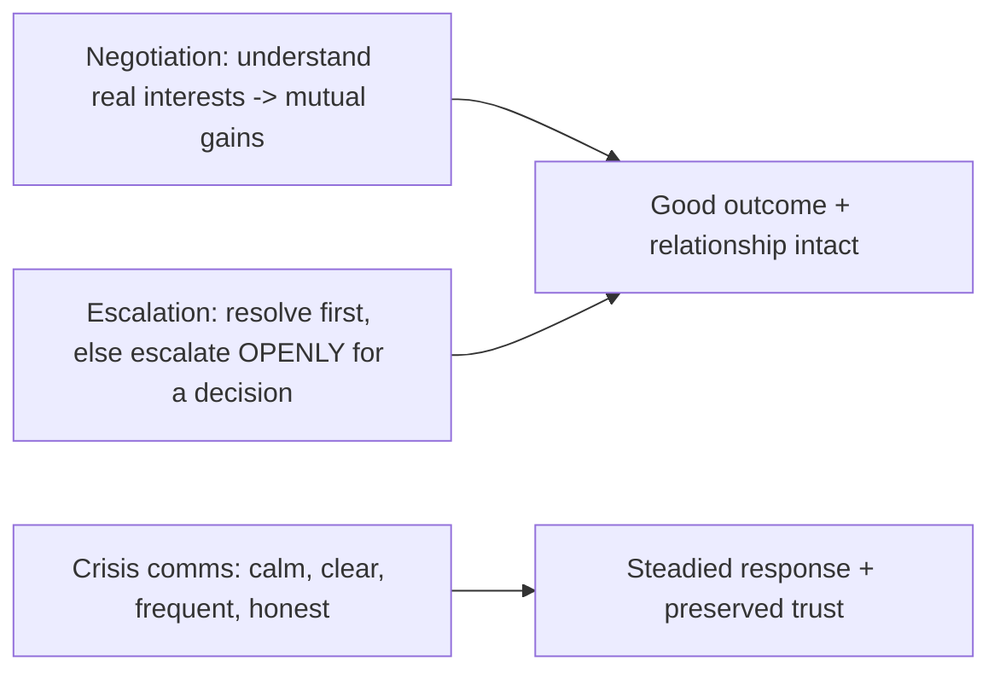

## 93.6 Worked examples: funding a reliability program, and an exec update for a slipping migration

This section brings the Part together in two worked artifacts: getting funding for a two-quarter reliability program after three payment outages (which uses stakeholder mapping, the business case, and executive communication together), and an executive update email for a migration that is slipping (which uses BLUF, business translation, and honest communication under bad news).

#### Worked example 1: funding a reliability program

We have built the pieces of this across 93.2 and 93.3. Here it is as the complete campaign a principal engineer runs.

**The situation.** Three payment outages this quarter, worsening. The principal believes a two-quarter, two-engineer reliability program is needed. She has no authority to allocate the engineers or the budget.

**Stakeholder mapping (93.2).** Decider: VP Eng (headcount) + CFO (budget). Blocker: the Product VP, who fears losing feature capacity. Influencer: the VP Eng's trusted staff engineer.

**The campaign:**

1. **Pre-wire the blocker first (93.1).** She meets the Product VP privately, framing the program not as "stop features" but as "protect the revenue features generate — a peak-season payment outage would cost far more than any feature earns". The Product VP, reframed, moves from blocker to neutral.
2. **Win the influencer.** She walks the staff engineer through the technical case; he becomes an advocate who the VP Eng trusts.
3. **Build the business case (93.3).** Risk reduction value: ~$620k expected outage cost over two quarters without the program, ~$124k with it, ~$496k avoided; ROI ~175%; payback after ~1.5 prevented outages; cost of delay ~$310k/quarter, worsening; opportunity cost honestly named (a ~$500k feature) and argued past; sensitivity analysis showing it holds even at half the benefit.
4. **Present to the decider (93.2).** The one-page BLUF executive update from 93.2: bottom line first, business risk in dollars, the fix in one line each, the ROI table, and what she is NOT asking for (no rewrite, no roadmap pause). The blocker is already neutralised and the influencer already supportive.
5. **Outcome.** The VP Eng and CFO approve, because the case is in their language, the numbers are credible (sensitivity-tested), and the one blocker was pre-wired. The campaign succeeded because it combined all the Part's skills: influence mechanics (pre-wire the blocker, win the influencer), stakeholder mapping (effort on the decider and blocker), a quantified business case (visible value), and executive communication (BLUF, business translation). Any one alone would likely have failed — a great business case presented cold to an ambushed Product VP blocker would have died; influence without a quantified case would have lost to the feature's number.

#### Worked example 2: an exec update for a slipping migration

Bad news is the hardest communication, and executives judge you by how you deliver it. Here is the migration from Part 91, now slipping, communicated well.

```markdown
# Exec update: order-system migration — slipping, and the plan (1 page)

## BOTTOM LINE (the honest headline)
The migration will slip ~6 weeks, from month 18 to ~month 19.5. The cause is
a single orphaned legacy caller we couldn't get an owner for in time. We have
a plan to close it and a hard new date. Cost of the slip: ~$60k extra (two
systems running 6 extra weeks). No customer impact. I need ONE thing from you:
help assigning an owner to the orphaned caller by Friday.

## What slipped and why (no spin)
- 95% complete: 138/140 endpoints migrated, data fully migrated and reconciled.
- The blocker: 1 orphaned legacy caller (an export used by a partner) whose
  owning team was disbanded in a reorg. Nobody will claim it, so we can't turn
  the legacy system off, which is the definition of done.
- This is a classic last-5% orphan problem (not a technical failure — the
  hard technical work is done and verified).

## The plan to close it
1. Assign an owner to the orphaned caller (YOUR help needed — a director to
   assign it, by Friday).
2. That team migrates it (2 weeks) OR we migrate it for them (we've offered).
3. Brownout + shutdown + delete legacy system. New hard date: month 19.5.

## What I'm doing to prevent recurrence
Flagging the remaining orphan risk early on future migrations, and keeping a
named owner for every component from day one (we had one gap; fixing the process).

## The ask (one thing)
A director to assign an owner to the orphaned export by Friday. Without it,
the date slips further. With it, we hit month 19.5.
```

What makes this good bad-news communication: it leads with the honest bottom line (slipping, by how much, why, cost, no spin), it does not hide or minimise (the orphan is named plainly), it quantifies the impact ($60k, no customer impact) so the executive can calibrate, it has a concrete plan and a hard new date, it shows what is being done to prevent recurrence (which builds trust), and it has exactly one specific ask. Executives trust engineers who deliver bad news straight, with a plan and an ask, far more than those who hide slips until they are catastrophic or who report green until the last moment. Delivering bad news well — honestly, early, with a plan — is one of the strongest trust-builders a principal has, and this update does it textbook-perfectly.

#### Why these examples matter together

The first example shows influence and communication building something (funding a program); the second shows them handling adversity (a slipping migration). Both rest on the same foundations: honesty (credible numbers, straight bad news), translation into the audience's language (business terms, BLUF), stakeholder awareness (pre-wiring the blocker, knowing the exec wants the bottom line), and a clear ask. A principal engineer who masters these does not just get their correct ideas funded; they maintain the trust that makes the *next* idea easier to fund, because they are known as someone whose numbers are credible and whose bad news is straight. That reputation — built through consistent, honest, well-translated communication — is the compounding asset at the heart of influence without authority.

#### Practical exercise

Run both exercises. First, build a complete funding campaign for an engineering investment you believe in: the stakeholder map, the pre-wiring plan for the blocker, the quantified business case, and the one-page executive update. Second, write an exec update for a piece of work that is slipping or at risk: lead with the honest bottom line, quantify the impact, give a concrete plan and new date, show recurrence prevention, and make one clear ask.

**Acceptance criteria:** your funding campaign combines influence mechanics (pre-wire the blocker, win the influencer), a credible sensitivity-tested business case, and a BLUF executive update in business terms; and your slipping-work update leads with honest bad news (no spin), quantifies the impact, provides a concrete plan with a hard new date, and ends with exactly one specific ask — demonstrating that you can build trust by delivering bad news straight.

## 93.7 A field guide to difficult communication situations

The skills in this Part show up most in a handful of recurring hard situations. This section is a field guide to them — each a common moment where influence and communication are tested, with how a principal engineer handles it. Treat it as a quick-reference companion to the deeper sections.

#### Concept

Certain communication situations recur in every principal's career and are reliably mishandled by people relying on being right: delivering bad news, pushing back on an executive, breaking a deadlock, correcting a senior person in public, defending a decision under pressure, and advocating for unglamorous work. Each has a known good pattern, drawn from the Part's skills. Knowing the pattern in advance means you handle the moment well rather than improvising under stress.

#### Why does it exist?

Imagine facing, for the first time and unprepared, a VP who has just told the room something technically wrong that will lead to a bad decision. In the moment, the untrained responses are all bad: publicly contradict them (damages the relationship and your standing), stay silent (the bad decision proceeds), or argue defensively (makes it a conflict). A principal who has a pattern for this situation handles it smoothly — redirecting privately or reframing without contradiction. The field guide exists because these situations are predictable, so the patterns can be learned in advance rather than improvised badly under pressure. Preparation converts a dreaded moment into a routine one.

#### Mental model

Imagine a pilot's emergency checklist. Emergencies are stressful and rare, so pilots do not improvise — they drill the patterns in advance (engine failure: do these steps) so that when the rare, high-stakes moment comes, they execute a known procedure calmly rather than panicking. Difficult communication situations are a principal's emergencies: rare enough to be unpractised, stressful enough to be mishandled if improvised, and predictable enough to have a checklist. The field guide is the emergency checklist for communication.

#### Artifact example

A field guide to six recurring difficult situations and the pattern for each:

```markdown
# Difficult communication field guide

## 1. Delivering bad news (a slip, an outage, a missed target)
PATTERN: Lead with the honest bottom line. No spin, no burying. Quantify the
impact. Bring a plan and a specific ask. Early + straight + with-a-plan builds
trust; hiding until it's a crisis destroys it. (See 93.6 slipping-migration update.)
WRONG: report green until the last moment, then surprise everyone.

## 2. Pushing back on an executive's direction
PATTERN: Agree on the goal first ("we both want X"), then present the risk in
THEIR terms (business impact, 93.2), offer options not just objections, and —
if overruled — disagree and commit (93.4). Never make it a public contradiction.
WRONG: flatly contradict them in the room in engineering terms.

## 3. The executive said something technically wrong
PATTERN: Don't publicly correct them (damages both of you). Reframe gently
("one thing to check is...") or catch them privately after. Preserve their
standing while steering the decision. 
WRONG: "Actually, that's wrong" in front of the room.

## 4. Breaking a deadlock between two strong engineers
PATTERN: Make the tradeoffs visible (options paper, 93.4), ensure both feel
heard (understand first), set a decision date, and escalate openly to a decider
if still stuck. Then disagree-and-commit. 
WRONG: let it fester, or decide by who argued loudest.

## 5. Defending a decision under pressure (after something went wrong)
PATTERN: Own it without defensiveness, separate the decision (reasonable given
what was known) from the outcome (bad), show what you learned. Blameless
framing (Part 53). 
WRONG: get defensive, assign blame, or pretend it was fine.

## 6. Advocating for unglamorous work (debt, reliability, platform)
PATTERN: Quantify it as a business case (93.3) — ROI, cost of delay, risk
value — so it competes with features in the same currency. 
WRONG: argue for it qualitatively ("we really should...") and lose to a feature.
```

#### Real-world scenario

A principal engineer keeps this field guide, mentally, and it shows in how smoothly she handles the hard moments that fluster others. When a migration slips, she delivers the bad news early, straight, with a plan — and her credibility rises rather than falls, because leadership trusts someone who surfaces problems honestly. When a VP says something technically wrong in a meeting, she does not contradict him publicly; she says "one thing worth checking is..." and reframes, steering the decision while preserving his standing, and catches the detail privately after. When two senior engineers deadlock, she makes the tradeoffs visible, ensures both feel heard, and forces a decision date. Each situation, which a less-prepared engineer would handle badly under stress, she handles with a known pattern — and the cumulative effect is a reputation as someone who is good in exactly the hard moments, which is a large part of what influence without authority is built on.

#### How a Principal Engineer thinks about this

They recognise these situations as predictable and prepare patterns for them in advance, so they execute calmly rather than improvising under stress. They hold, as a core principle across all of them, that the relationship and the trust matter as much as the immediate outcome — they deliver bad news straight because it builds long-term trust, they correct executives privately to preserve the relationship, they own mistakes without defensiveness because that is what maintains credibility. They understand that how they handle the hard moments defines their reputation more than how they handle the easy ones, and that a reputation for being good in difficult situations is itself a source of influence.

#### Common mistakes

- **Improvising high-stakes situations under stress** instead of having a prepared pattern.
- **Prioritising the immediate outcome over the relationship,** winning the moment and losing the trust.
- **Publicly contradicting an executive** instead of reframing or correcting privately.
- **Delivering bad news late and spun** instead of early and straight.
- **Getting defensive when a decision is questioned** instead of owning it blamelessly.

#### Practical exercise

Pick two of the six situations you are most likely to face soon. For each, write out the pattern you would use, adapted to your specific context and the actual people involved. Rehearse the opening sentence you would say.

**Acceptance criteria:** for each situation, your pattern preserves the relationship and the trust alongside the immediate outcome, follows the Part's skills (business translation, options, disagree-and-commit, blameless ownership), and you have a concrete opening line prepared rather than planning to improvise under stress.

## 93.8 Influence anti-patterns and the trust ledger

#### Concept

A final lens on the Part: the recurring anti-patterns that destroy influence, and the idea of a **trust ledger** — the running balance of credibility and goodwill you hold with each person, which every interaction deposits into or withdraws from. Influence without authority runs entirely on this ledger: you spend trust when you ask for something, and you earn it by being right, delivering, and acting in good faith. Understanding the ledger, and the anti-patterns that drain it, is how you sustain influence over a career rather than burning it out.

#### Why does it exist?

Imagine treating every interaction as independent, with no memory. You push hard on a trivial point today, are wrong loudly tomorrow, take credit for a colleague's work the day after — and then, when you genuinely need to influence a critical decision, you find nobody extends you the benefit of the doubt. You did not realise that each of those interactions was a withdrawal from a shared ledger, and by the time you needed the balance, it was empty. The trust ledger exists as a model because influence is cumulative and has a memory: people's willingness to be influenced by you is the accumulated result of every past interaction, and the anti-patterns are the withdrawals that drain the account. Understanding this lets you manage your influence as the finite, accumulated, spendable resource it actually is.

#### Mental model

Imagine a bank account you hold with every colleague. Deposits: being right, delivering what you promised, giving them credit, helping them, admitting when you are wrong, disagreeing respectfully. Withdrawals: being wrong after being loud, missing commitments, taking credit, fighting trivia as hard as substance, making it personal. When you ask someone to do something, you make a withdrawal — you are spending accumulated trust. If your balance is high, they say yes readily; if it is overdrawn, they resist even reasonable asks. You cannot influence from an overdrawn account. The trust ledger is this account, held separately with every person, and influence is spending from it wisely while keeping it topped up.

#### How it works

The ledger's dynamics:

```text
DEPOSITS (build the balance):
  - Being right, especially about hard calls (credibility, 93.1).
  - Delivering what you promised (reliability renews credibility, Part 63).
  - Giving credit away (trust, 93.1).
  - Helping others / advocating their interests (good-faith trust).
  - Admitting when you're wrong (paradoxically a deposit — shows honesty).
  - Disagreeing respectfully and committing after (93.4).

WITHDRAWALS (drain the balance):
  - Being loudly wrong (credibility withdrawal).
  - Missing commitments (reliability withdrawal).
  - Taking credit (trust withdrawal).
  - Fighting trivia as hard as substance (people discount you, 93.1).
  - Making disagreement personal.
  - Asking for things (every ask spends some balance — spend wisely).

SPENDING: when you ask someone to change what they do, you withdraw. High
balance -> they say yes readily. Overdrawn -> they resist even reasonable asks.
```

The anti-patterns that drain the ledger fastest, from across the Part:

```markdown
# Influence anti-patterns (ledger-draining)
- The person who is right but insufferable: correct and loud and tireless,
  fights everything, so people stop listening despite being right (93.1).
- The credit-taker: hogs credit, so nobody wants to work with them again (93.1).
- The ambusher: brings proposals cold to public forums, so people feel
  attacked and resist (93.1 pre-wiring).
- The engineering-speaker-to-executives: never translates to business terms,
  so leadership can't act on their input (93.2).
- The qualitative-arguer: argues for work with feelings not numbers, so it
  always loses to quantified features (93.3).
- The never-committer: re-litigates settled decisions, draining goodwill (93.4).
- The yes-person: says yes to everything, so their team is thrashed and their
  own commitments become unreliable (93.5).
```

#### Artifact example

A trust-ledger self-assessment — an honest look at your balance with the people whose influence you need.

```markdown
# Trust ledger self-assessment (for an upcoming initiative)
For each key stakeholder, what's my current balance and why?

| Person | Balance | Recent deposits | Recent withdrawals | Action |
|---|---|---|---|---|
| VP Eng | HIGH | shipped the last reliability fix I promised; was right about the DB risk | none recent | can make a big ask |
| Product VP | LOW | — | pushed back hard on 3 of her asks recently; took credit on the API project | DEPOSIT FIRST: give her credit publicly, help with her priority, before asking |
| Platform lead | MEDIUM | helped debug their outage | was loudly wrong about their mesh decision | rebuild: acknowledge I was wrong about the mesh |

## The plan
Before the big ask (the reliability program), I must DEPOSIT with the Product
VP (overdrawn with her) — give credit, help with her priority — or my ask will
hit an overdrawn account and she'll block it. The VP Eng balance is high enough
to spend. Admitting I was wrong to the platform lead is a deposit, not a loss.
```

The self-assessment's power is that it treats influence as the accumulated, person-specific resource it is: it honestly assesses the balance with each key person, identifies where the account is overdrawn (the Product VP), and plans deposits before withdrawals. The insight that admitting you were wrong is a *deposit*, not a loss, is one many engineers get backwards. Managing the ledger deliberately — depositing before you need to spend, not asking from overdrawn accounts — is how you sustain influence over a career.

#### Real-world scenario

A principal engineer manages her trust ledgers deliberately. Before a major cross-team initiative, she assesses her balance with each key stakeholder and notices she is overdrawn with one team lead (she had pushed back hard on several of his recent proposals). Rather than making her ask into an overdrawn account, she spends a few weeks depositing: she helps his team with a problem, she publicly credits his recent good work, she acknowledges where she had been wrong in an earlier disagreement. By the time she makes her ask, the balance has recovered and he supports her. A peer, oblivious to the ledger, makes the same kind of ask from an overdrawn account (having recently taken credit and been loudly wrong around the person) and is surprised when they resist a perfectly reasonable request. The difference is that she manages influence as an accumulated resource, depositing before spending, while he treats each ask as independent and wonders why his "obviously correct" requests keep getting resisted. Over a career, the ledger compounds: she becomes someone people readily say yes to, because she keeps her accounts in credit; he becomes someone people resist, because his are chronically overdrawn.

#### How a Principal Engineer thinks about this

They understand influence as an accumulated, person-specific resource — a trust ledger held with each colleague — and they manage it deliberately: depositing consistently (being right, delivering, giving credit, admitting mistakes, helping) and spending wisely (not asking from overdrawn accounts, not wasting balance on trivia). They know that admitting they were wrong is a deposit, not a loss, and that taking credit, missing commitments, and being loudly wrong are the fastest withdrawals. Before a significant ask, they assess their balance with the key people and, if overdrawn, deposit before they spend.

They avoid the influence anti-patterns because each one drains the ledger: being right-but-insufferable, taking credit, ambushing, speaking engineering to executives, arguing qualitatively, never committing, saying yes to everything. They recognise that influence without authority runs entirely on this ledger, that it compounds over a career (a well-managed ledger makes each future ask easier), and that the engineers who are mysteriously influential are usually the ones who, consciously or not, keep their accounts in credit. The principal treats trust as the capital it is: finite, accumulated, spendable, and worth managing with the same care as any scarce resource.

#### Practical exercise

For an upcoming ask, do a trust-ledger self-assessment: for each key stakeholder, honestly assess your current balance (high/medium/low/overdrawn), what recent deposits and withdrawals produced it, and what action you should take before asking. Identify anyone you are overdrawn with and plan the deposits (giving credit, helping, admitting a past error) you will make before spending.

**Acceptance criteria:** you honestly assess the balance with each key stakeholder (including recognising where you are overdrawn); you identify the deposits and withdrawals that produced each balance; and for any overdrawn account, you plan concrete deposits before making your ask — demonstrating that you manage influence as an accumulated resource, depositing before spending rather than asking from an empty account.

## 93.9 Negotiation, escalation, and communicating in a crisis

#### Concept

Three higher-stakes communication skills that complete the Part. **Negotiation** is reaching an agreement where parties have different interests — negotiating scope, resources, deadlines, or priorities, in a way that finds a good outcome rather than a win-lose fight. **Escalation** done well is raising an unresolved issue to a higher decision-maker constructively (not as a hostile "going over someone's head") so that genuine deadlocks get decided. **Communicating in a crisis** — an outage, a security incident, a major failure — is a distinct, high-pressure skill: clear, calm, frequent, honest communication under stress, to the team, to leadership, and sometimes to customers. Each is a moment where communication skill directly determines the outcome.

#### Why does it exist?

Imagine negotiating scope as a pure win-lose fight (you demand, they refuse, someone loses), escalating by angrily going over a colleague's head (destroying the relationship), and communicating in a crisis with silence or panic (leaving everyone confused and anxious). Each mishandling produces a bad outcome: a scope negotiation that damages a relationship and reaches a worse deal than a collaborative one would; an escalation that resolves the issue but makes an enemy; a crisis made worse by poor communication (confusion, duplicated effort, eroded trust, customers left in the dark). These skills exist because negotiation, escalation, and crisis communication are high-stakes moments where the communication approach directly determines whether you get a good outcome and preserve relationships, or a bad outcome and broken ones.

Negotiation exists because interests genuinely differ and a collaborative approach (finding mutual gains, understanding the other side's real interests) reaches better outcomes than a positional fight. Escalation done well exists because real deadlocks need a decider, and raising them constructively gets the decision without the relationship damage. And crisis communication exists because crises are exactly when clear, calm, frequent communication matters most and is hardest — and poor crisis communication turns a bad situation into a worse one.

#### Mental model

For negotiation, imagine two people dividing an orange, both wanting it. The positional fight splits it 50/50 (both half-satisfied). But if they understand each other's *interests* — one wants the juice, the other wants the peel for baking — they can both get everything they want. Good negotiation is finding the juice-and-peel solution by understanding real interests, not fighting over positions. For escalation, imagine two colleagues who genuinely cannot agree, going together to their manager and saying "we've each made our case, we need you to decide" — constructive, not a betrayal. For crisis communication, imagine an air-traffic controller during an emergency: clear, calm, frequent, factual communication that keeps everyone coordinated and prevents panic — the opposite of silence or chaos.

#### How it works

**Negotiation:**

```text
- Understand their real interests, not just their stated position (the juice vs
  the peel). The stated position ("we need it by Friday") often hides a flexible
  real interest ("we need to show progress to our stakeholder").
- Look for mutual gains: solutions where both get their real interests met, not
  just a split-the-difference compromise.
- Know your BATNA (best alternative to a negotiated agreement): what you'll do if
  there's no deal. It sets your walk-away point.
- Separate the people from the problem (Part 93.4): hard on the problem, soft on
  the relationship. You'll negotiate with these people again.
- For scope specifically: the iron triangle (93.5) — make the tradeoff explicit.
```

**Escalation done well:**

```text
- Try to resolve it first (disagree well, 93.4). Escalate genuine deadlocks, not
  everything.
- Escalate TRANSPARENTLY, together where possible: "we disagree, we've each made
  our case, we need a decision" — not secretly going over someone's head.
- Frame it as needing a decision, not as "I'm right and they're wrong."
- Accept the decision and commit (disagree and commit, 93.4).
- Escalation is a legitimate tool for deadlocks, not a betrayal — when done openly.
```

**Communicating in a crisis:**

```text
- Be calm: your calm (or panic) is contagious. Calm communication steadies the
  response.
- Be clear and factual: what we know, what we don't, what we're doing. No spin,
  no speculation presented as fact.
- Be frequent: regular updates on a schedule (Part 62.10), even "no change yet,"
  because silence breeds anxiety and speculation.
- Separate roles: an incident commander coordinates; a communications lead keeps
  stakeholders/customers informed (Part 62.10) — so responders can focus.
- Be honest: don't minimise or hide; honest crisis communication builds trust
  (93.6 bad-news lesson), spin destroys it.
- After: the blameless PIR (Part 88.9, 49.10) communicates the lesson.
```



#### Artifact example

A crisis communication update and a negotiation prep — the artifacts for two high-stakes moments.

```markdown
# Crisis communication: ongoing incident update (to leadership + stakeholders)
[Every 30 min during the incident, on a schedule — silence breeds anxiety]

SEV-1 UPDATE 14:30 UTC — payment processing degraded
- STATUS: ongoing. ~40% of payments failing since 14:02.
- IMPACT: ~$X/min in failed payments; customers see checkout errors.
- WHAT WE KNOW: the payment service is saturated; root cause under investigation.
- WHAT WE'RE DOING: failing over to the backup processor (ETA 10 min); scaling
  the payment service.
- WHAT WE DON'T KNOW YET: root cause. Not speculating.
- NEXT UPDATE: 15:00 UTC (or sooner if status changes).
- Incident commander: [name]. Comms lead (me): [name].
[Calm, clear, factual, frequent, honest. No spin. This steadies everyone.]

---
# Negotiation prep: product wants a feature in a sprint we can't fit
THEIR STATED POSITION: "We need feature X this sprint."
THEIR REAL INTEREST (dig for it): they need to show progress to a key customer
  by month-end — not literally this sprint.
MUTUAL-GAINS SOLUTION: ship a smaller slice of X this sprint (enough to demo to
  the customer) + the rest next sprint. They get their real interest (customer
  demo), we don't blow up our commitments.
MY BATNA: if no agreement, I hold the sprint commitment and X waits — a worse
  outcome for them, so they're motivated to find the mutual-gains solution.
APPROACH: hard on the problem (the capacity reality), soft on the relationship.
```

The crisis update's power is that it is calm, clear, factual, frequent (scheduled, with a next-update time so silence doesn't breed anxiety), and honest (states what is not known rather than speculating), with roles separated — steadying the response and preserving trust during a high-stress moment. The negotiation prep's power is that it digs for the *real interest* behind the stated position (customer demo, not literally this sprint), finds a mutual-gains solution (a smaller slice that meets the real interest), knows its BATNA, and stays hard-on-problem/soft-on-relationship — reaching a better outcome than a positional fight while preserving the relationship.

#### Real-world scenario

A principal engineer handles the high-stakes communication moments with skill that visibly changes outcomes. In a negotiation over scope, instead of a positional fight, she digs for the other side's real interest (a customer demo, not literally the sprint deadline) and finds a mutual-gains solution (a demo-able slice now, the rest later) that meets their real need without blowing up her team's commitments — a better outcome than splitting the difference, with the relationship intact. When she and a colleague genuinely deadlock on a decision that matters, she escalates openly — they go together to the decision-maker, each presents their case, and she commits to whatever is decided — resolving the deadlock without making an enemy. And during a SEV-1 payment incident, she communicates calmly, clearly, and frequently (scheduled updates, honest about what is and is not known, roles separated), which steadies the whole response and preserves leadership's and customers' trust, in contrast to incidents she has seen handled with silence and panic that compounded the technical problem with a communication crisis. Each high-stakes moment, handled with communication skill, produces a better outcome and preserves relationships and trust — which is the compounding asset at the heart of influence.

#### How a Principal Engineer thinks about this

They approach negotiation by digging for the other side's real interests rather than fighting over stated positions, because they know that understanding the real interest (the juice vs the peel) usually reveals a mutual-gains solution better than any split-the-difference compromise, and they stay hard-on-problem/soft-on-relationship because they will negotiate with these people again. They know their BATNA so they negotiate from a clear walk-away point.

They treat escalation as a legitimate tool for genuine deadlocks, used after trying to resolve the issue and done transparently (openly, together, framed as needing a decision), because they know that secret or hostile escalation resolves the issue but makes an enemy, while open escalation gets the decision and preserves the relationship. And they communicate in a crisis with calm, clarity, frequency, and honesty, separating roles so responders can focus, because they understand that a crisis is exactly when communication matters most and is hardest, that their calm is contagious, and that honest, frequent crisis communication preserves trust while silence and spin destroy it. The principal knows these high-stakes moments are where communication skill most directly determines outcomes and most tests the trust that underpins all their influence, so they bring their full craft to them.

#### Common mistakes

- **Negotiating positions instead of interests,** reaching a worse win-lose outcome than a mutual-gains solution.
- **Not knowing your BATNA,** so you negotiate without a clear walk-away point.
- **Escalating hostilely or secretly,** resolving the issue but making an enemy.
- **Escalating everything** instead of resolving most issues first and escalating only genuine deadlocks.
- **Crisis communication that is silent, panicked, or spun,** compounding the technical problem with a communication crisis and eroding trust.

#### Interview questions

1. **How do you approach a negotiation over scope or resources to get a good outcome?**
   *Expected answer:* dig for the other side's real interests behind their stated position (the real need is often more flexible than the stated demand), look for mutual-gains solutions that meet both sides' real interests rather than splitting the difference, know your BATNA (walk-away point), and stay hard-on-problem/soft-on-relationship since you'll negotiate with them again. *Why it matters:* interest-based negotiation reaches better outcomes and preserves relationships.

2. **How do you escalate a deadlock without damaging the relationship?**
   *Expected answer:* try to resolve it first (escalate genuine deadlocks, not everything); escalate transparently and ideally together ("we disagree, we've each made our case, we need a decision"), framed as needing a decision rather than "I'm right"; and commit to the decision (disagree and commit). Open escalation gets the decision and preserves the relationship; secret or hostile escalation makes an enemy. *Why it matters:* escalation is a legitimate tool when done well.

3. **What makes crisis communication effective?**
   *Expected answer:* calm (your calm is contagious), clear and factual (what we know, what we don't, what we're doing — no spin, no speculation as fact), frequent (scheduled updates with a next-update time, since silence breeds anxiety), honest (don't minimise or hide — honesty preserves trust), with roles separated (incident commander vs comms lead) so responders can focus. Poor crisis communication compounds the technical problem with a communication crisis. *Why it matters:* crises are when communication matters most and is hardest.

#### Practical exercise

Prepare for the three high-stakes situations. For a negotiation you face, dig for the other party's real interest behind their stated position, design a mutual-gains solution, and identify your BATNA. For a deadlock, write how you would escalate it openly and constructively. And draft a crisis communication update template (calm, clear, factual, frequent, honest, roles separated) you could use during an incident.

**Acceptance criteria:** your negotiation prep identifies the real interest behind the stated position and proposes a mutual-gains solution (not a split-the-difference compromise), with a known BATNA; your escalation approach is transparent and constructive (resolve-first, escalate-openly-for-a-decision, commit after); and your crisis update template is calm, clear, factual, frequent (with a next-update time), honest (stating what is unknown rather than speculating), and separates roles — demonstrating that you bring communication craft to the highest-stakes moments.

## 93.10 A quick-reference for influence and communication

A compact reference distilling the Part into the moves that matter most when you need to influence a decision or communicate something important.

#### The influence checklist (before any consequential ask)

```text
[ ] Am I treating being right as ~1/3 of this, and working the other two-thirds?
[ ] Have I mapped stakeholders (decider, blockers, affected, influencers) and
    concentrated effort on the ones who determine the outcome?
[ ] Have I PRE-WIRED the key reviewers/blockers privately? (No public ambush.)
[ ] Am I framing it in THEIR terms (their pain, business numbers) — not my
    architectural ideals?
[ ] Have I built a COALITION so it's not just my voice?
[ ] Is my TRUST LEDGER with the key people in credit? (Deposit before asking if
    overdrawn.)
```

#### The communication checklist

```text
[ ] For executives: BOTTOM LINE first, one page, technical risk -> business risk
    with specific numbers.
[ ] For a decision: an OPTIONS PAPER (2-3 real options + a recommendation), not
    one option or ten.
[ ] For a business case: ROI, cost of delay, risk reduction value, opportunity
    cost, and a SENSITIVITY analysis (so it's credible, not cherry-picked).
[ ] For bad news: early, straight, quantified, with a plan and ONE clear ask.
[ ] For a mixed audience: main narrative for the least-technical, depth layered
    for experts, translated for each concern.
[ ] For a meeting: state the decision up front, pre-read, named decider, time-box,
    end with a decision + owner.
```

#### The enduring principle

The whole Part reduces to one idea: **at the principal level, your impact depends on moving people who don't have to listen to you and translating value into the language of those who decide.** Being right is necessary and nowhere near sufficient; the rest is credibility, trust, pre-wiring, coalitions, business translation, honest communication, and the disciplined handling of the hard moments (bad news, disagreement, negotiation, escalation, crisis). Underpinning all of it is trust — the compounding asset, built by being right, delivering, giving credit, and being straight — which determines whether people say yes to you. When you need to influence or communicate something important, ask: who decides, what's their language, have I pre-wired them, is my trust with them in credit, and what's the one clear thing I want them to do? Master that, and your correct ideas get funded, your bad news builds rather than erodes trust, and your influence compounds over a career.

Return to this reference when you need to influence a decision or communicate something important; the reasoning behind each line is in the sections above.

#### The one habit that compounds most

If you take one thing from this Part, make it this: **pre-wire everything that matters, and never bring a consequential proposal cold to a public forum.** It is the single highest-return influence habit, because it works on every one of the Part's mechanics at once. Pre-wiring builds the coalition (you gather allies before going public), it resolves objections where nobody loses face (so the public discussion is a ratification, not a battle), it lets you reframe in the stakeholder's terms (you learn their real concern privately and address it), it makes deposits into the trust ledger (people feel consulted, not ambushed), and it turns potential blockers into supporters. The engineers who are mysteriously effective at getting cross-team things done are, almost always, the ones who do this reflexively — a week of quiet one-on-ones before any big proposal. The engineers who are mysteriously ineffective, despite being right, are almost always the ones who skip it and get ambushed in the open. Pre-wiring is unglamorous, invisible, and the closest thing to a universal influence superpower there is. Start there, and the rest of the Part's skills compound on top of it.

## Senior Checklist — Part 93

- [ ] I understand the concept
- [ ] I can explain it simply
- [ ] I can implement it
- [ ] I understand its failure modes
- [ ] I understand its scaling limitations
- [ ] I understand its security implications
- [ ] I understand its operational implications
- [ ] I can choose between alternatives
- [ ] I can explain the tradeoffs
- [ ] I can answer senior-level interview questions
- [ ] I understand that being right is only about a third of influence, and I practise the other two-thirds
- [ ] I pre-wire key stakeholders privately before any consequential public proposal
- [ ] I map stakeholders (decider, blockers, affected, influencers) and concentrate effort on the ones who determine the outcome
- [ ] I communicate with executives using BLUF, one page, and technical risk translated into business risk
- [ ] I build quantified business cases with ROI, cost of delay, risk reduction value, opportunity cost, and a sensitivity analysis
- [ ] I present decisions as options papers with real alternatives and a clear recommendation
- [ ] I disagree on the problem not the person, escalate openly when stuck, and commit after a decision
- [ ] I say no with alternatives, name which of scope/time/quality moves, and protect my team from thrash
- [ ] I present to mixed audiences by serving every level and translating for each concern
- [ ] I run decision forums that state the decision up front and end with a decision and an owner

## Part 93 — Key Takeaways

- A principal's power is influence, not authority; the problems worth solving span teams you do not control, so you must move people who do not have to listen to you.
- Being right is only about a third of influence; the other two-thirds is credibility, trust, framing, timing, pre-wiring, and coalitions — engineers who think correctness is sufficient stay frustrated and ignored.
- Pre-wire key people privately before going public; cold proposals get ambushed and die, while pre-wired ones arrive with a coalition and resolved objections.
- Map stakeholders and concentrate your finite influence on the decider and the blockers, not evenly across everyone.
- Communicate with executives using bottom-line-up-front, one page, and every technical risk translated into business risk with specific numbers — a worse case in business language beats a better case in engineering language.
- Build quantified business cases: engineering work is underfunded not because it is less valuable but because its value is left unquantified; convert reliability into risk reduction value, platform into avoided cost, and include a sensitivity analysis so the numbers are credible.
- Present decisions as options papers — two or three real options with visible tradeoffs and a clear recommendation — not as a single preordained answer or an overwhelming menu.
- Disagree well: on the problem not the person, understand the other's constraint first, pick your battles, escalate openly when stuck, and commit fully once a decision is made.
- Say no with alternatives and name which of scope, time, or quality moves; protecting the team from thrash is one of a principal's highest-leverage responsibilities.
- Present to mixed audiences by pitching the main narrative so the least-technical person follows, layering depth for experts, and translating for each audience's concern.
- Run decision forums that state the decision up front, use a pre-read, name the decider, are time-boxed, and end with a decision and an owner — a meeting that decides nothing is a waste.
- Deliver bad news straight, early, with a plan and an ask; it is one of the strongest trust-builders a principal has, and trust is the compounding asset at the heart of influence.
