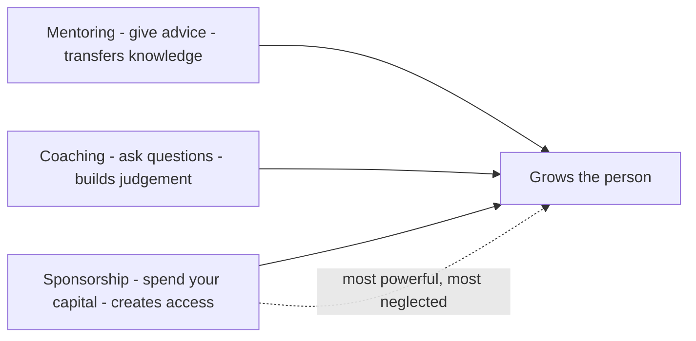

# Part 94 — Growing Engineers: Mentoring, Hiring and Technical Interviewing

The highest-leverage thing a principal engineer does is not the system they build; it is the engineers they grow and the engineers they hire. A great system you built decays and is replaced. A great engineer you grew compounds — they grow others, they make good decisions for years, they raise the bar of everyone around them. And a great hire changes a team's trajectory, while a bad hire costs the team dearly and takes months to resolve. Growing and selecting engineers is where a principal's impact multiplies beyond anything they could do with their own hands.

Part 63 covered the levels (what senior, staff, and principal mean). Part 64 covered the candidate side of interviewing (how to prepare as a candidate). This Part is the other side: how to grow engineers (mentoring, coaching, sponsorship, using code and design review as teaching, growing seniors into staff, onboarding), and how to select them (designing an interview loop, writing questions and rubrics, calibration and bias, running a system design interview as the interviewer, and building a technical culture that makes all of this work).

The reader this Part assumes is a senior or staff engineer who is starting to be responsible for others' growth and for hiring decisions, and wants to do both deliberately rather than by instinct.

## 94.1 Mentoring, coaching, and sponsorship

#### Concept

Three distinct ways of developing people that are often confused. **Mentoring** is sharing your experience and advice — "here is how I would approach this, here is what I learned". **Coaching** is helping someone find their own answer through questions, without giving it to them — "what options do you see, what would happen if...". **Sponsorship** is using your own credibility and position to create opportunities for someone — putting their name forward, giving them a stretch project, advocating for their promotion. All three grow people, but they do different things, and the most impactful of the three (sponsorship) is the one most people neglect.

#### Why does it exist?

Imagine trying to grow an engineer using only one of these. Pure mentoring (always giving advice) creates dependence — the person learns to come to you for answers rather than developing their own judgement. Pure coaching (never giving advice) can frustrate someone who genuinely needs knowledge they do not have — asking "what do you think" about a thing they have no basis to reason about is unhelpful. And neither mentoring nor coaching, however good, puts the person in the room where opportunities happen — that requires sponsorship, spending your own capital on their behalf.

The distinction exists because each tool fits a different need: mentoring transfers knowledge the person lacks, coaching develops judgement the person can build, and sponsorship creates access the person cannot get alone. Using the wrong one — coaching when they need knowledge, mentoring when they need to build judgement, or neither when they need an opportunity — wastes the development effort. And sponsorship exists as a named thing because it is the most powerful and most neglected: advice is cheap, but spending your credibility to open a door for someone changes their trajectory.

#### Mental model

Imagine teaching someone to find their way around a city. **Mentoring** is giving them directions: "to get to the market, go left then right" — fast, useful when they genuinely do not know the way. **Coaching** is teaching them to read a map and asking "how would you get to the market?" — slower, but it builds the skill to navigate anywhere, not just to the market. **Sponsorship** is introducing them to the people who run the market, so they get opportunities a tourist never would. A great developer of people uses all three: directions when the person is lost and needs to move, map-reading to build lasting navigation skill, and introductions to open doors. Relying only on directions creates a person who always needs directions; relying only on map-reading frustrates someone who urgently needs to get somewhere now; and neither gets them through the doors that sponsorship opens.

#### How it works

The three, and when to use each:

| Mode | What it is | When to use it | Risk if overused |
|---|---|---|---|
| Mentoring | Sharing your experience/advice | They lack knowledge they can't derive | Creates dependence |
| Coaching | Helping them find their own answer via questions | They can build the judgement themselves | Frustrates when they genuinely need knowledge |
| Sponsorship | Spending your capital to create opportunities | They're ready for more than they can access alone | (Rarely overused; usually under-used) |

**Mentoring** works by transferring hard-won experience: patterns, pitfalls, mental models, "here is what I wish I'd known". It is most valuable for knowledge the mentee cannot easily derive themselves — the lessons of experience. The skill is knowing when to give the answer (they are stuck on something they cannot reason out) versus when to hold back and coach.

**Coaching** works by asking questions that help the person reason to their own conclusion: "what options do you see? what would happen if the service was down? what does your gut say and why?". It builds the person's own judgement, which is more durable than any answer you could give, because they can apply the reasoning to future problems. It is most valuable when the person *can* get there with help — when the goal is building their judgement, not transferring facts.

**Sponsorship** works by the sponsor spending their own credibility and position: recommending the person for a stretch project, naming them in rooms they are not in, advocating for their promotion, connecting them to opportunities. It is the most powerful because it creates access the person cannot create alone, and it is the most neglected because it costs the sponsor something real (their capital, their reputation riding on the person's success). Mentoring and coaching cost time; sponsorship costs capital, which is why people do less of it and why it matters more.



#### Practical example

A principal engineer develops a mid-level engineer using all three deliberately. When the engineer hits something they genuinely lack knowledge of — say, how database replication lag affects read consistency — the principal *mentors*: shares the mental model and the pitfalls, because the engineer cannot derive this from first principles quickly. When the engineer faces a design decision they *can* reason about — choosing between two caching strategies — the principal *coaches*: "what happens to each under a cache stampede? what does your gut say?", building the engineer's own design judgement rather than handing them the answer. And when the engineer is ready for more than their current role offers, the principal *sponsors*: recommends them to lead a cross-team project, names them to the director as a rising talent, and advocates for the stretch assignment. A year later the engineer has grown faster than peers who got only advice, because the principal matched the mode to the need and, crucially, spent real capital on sponsorship rather than stopping at free advice.

#### Artifact example

A development plan that distinguishes the three modes — the artifact a principal uses to grow someone deliberately rather than ad hoc.

```markdown
# Development plan: growing [mid-level engineer] toward senior

## Where they are
Strong coder, owns features well. Gaps (vs senior, Part 63): production
ownership, deciding under ambiguity, writing things down, influence.

## Mentoring (knowledge to transfer — things they can't derive alone)
- Production failure modes: pair with me on the next incident; I'll share the
  mental models (replication lag, retry storms, idempotency).
- How to read EXPLAIN ANALYZE: I'll walk through real slow queries with them.

## Coaching (judgement to build — I ask, they answer)
- Design decisions: on their next design, I won't give answers; I'll ask
  "can it time out / duplicate / partially succeed?" until they reason it out.
- Ambiguity: hand them an ambiguous problem and coach them to define it
  themselves rather than defining it for them.

## Sponsorship (capital I'll spend — opportunities they can't access alone)
- Recommend them to lead the notification-pipeline project (stretch, visible).
- Name them to the director as a senior candidate this cycle.
- Have them present their design at the review guild (visibility + practice).

## The balance
Mentor the knowledge gaps, coach the judgement gaps, sponsor the access gap.
Sponsorship is the one I must not skip — it's where I spend real capital and
it's what actually accelerates their trajectory.
```

The plan's value is that it explicitly separates the three modes and matches each to a specific gap: mentoring for knowledge the engineer cannot derive, coaching for judgement they can build, and sponsorship for access they cannot get alone. And it flags the discipline that matters most — not skipping sponsorship, the mode that costs the mentor real capital and does the most to accelerate the engineer. A development plan that is all mentoring (advice) grows someone slowly and dependently; one that balances all three, including the costly sponsorship, grows them fast.

#### Real-world scenario

A principal engineer is known for the number of engineers who credit her with their growth into senior and staff roles. The pattern, when you look closely, is that she sponsors heavily — she spends her considerable credibility creating opportunities for people, recommending them for stretch projects, naming them in promotion discussions, putting their work in front of leadership. This costs her something real: her reputation rides on their success, and championing someone who then stumbles reflects on her judgement. But it is exactly this willingness to spend capital that accelerates the people she develops, because it gives them access to the career-making opportunities that advice alone cannot provide. Her peers who are equally good mentors but who never sponsor — who give great advice but never spend their capital to open doors — grow people more slowly, because knowledge and judgement without opportunity only go so far. The engineers remember the sponsorship most, because being recommended for the project that made their career is more transformative than any piece of advice. Sponsorship is the multiplier, and she multiplies.

#### Failure scenario

A well-meaning senior engineer mentors heavily but never coaches or sponsors. He loves giving advice and is generous with it, so the engineers around him constantly come to him with questions, and he always answers. Over time, this creates a dependency problem: the engineers have learned to bring him their problems rather than develop their own judgement, because it is faster to ask him than to reason it out. They are not growing their decision-making, because he does it for them every time. And because he never sponsors — never spends his capital to create opportunities — none of them are getting the stretch assignments or visibility that would advance their careers. The result is a cluster of engineers who are knowledgeable (from his mentoring) but not independent (no coaching) and not advancing (no sponsorship). They plateau, dependent on him, while engineers developed by someone who coaches and sponsors move up around them. His pure-mentoring approach, though generous and well-intentioned, grew dependent people rather than independent, advancing ones — because he used only one of the three modes, and the wrong one for building the judgement and access that actually make a senior engineer. Over-mentoring creates dependence; the fix is to coach (build their judgement) and sponsor (create their opportunities), not just advise.

#### Edge cases & failure modes

- **Over-mentoring (always giving answers).** Creates dependence; the person learns to ask rather than to reason.
- **Over-coaching (never giving answers).** Frustrates someone who genuinely lacks the knowledge and needs it transferred, not drawn out.
- **Never sponsoring.** The most common failure; advice and judgement without opportunity only go so far, and sponsorship is where real acceleration happens.
- **Sponsoring someone not ready.** Spending capital on someone who then stumbles badly damages both them and your credibility; sponsor people who are ready for the stretch.
- **Mentoring/coaching only your favourites,** so development (and especially sponsorship) is distributed by bias rather than by who would benefit.
- **Confusing the modes,** coaching when they need knowledge or mentoring when they need to build judgement, wasting the effort.

#### How a Principal Engineer thinks about this

They develop people deliberately, matching the mode to the need rather than defaulting to their comfortable mode (usually mentoring, because giving advice feels good and is easy). They mentor to transfer knowledge the person cannot derive, coach to build judgement the person can develop, and above all they sponsor — because they know sponsorship is the most powerful and most neglected mode, the one that costs real capital and creates the access that advice alone cannot. They are willing to spend their credibility on people who are ready, because they understand that growing engineers is their highest-leverage activity and that sponsorship is its multiplier.

They guard against over-mentoring, because they have seen it create dependent people who never build their own judgement, and they coach deliberately to force people to reason for themselves. And they distribute their development effort — especially sponsorship — by who would benefit and who is ready, not by who is most like them, because they know bias in sponsorship perpetuates bias in who advances. The principal measures part of their own impact by the engineers they have grown, and they know that number is driven by sponsorship more than by any amount of advice.

#### Common mistakes

- **Over-mentoring,** creating dependence instead of building independent judgement.
- **Over-coaching,** frustrating people who genuinely need knowledge transferred.
- **Never sponsoring,** so people get advice but not the opportunities that actually advance them.
- **Sponsoring by bias,** spending capital on people most like you rather than who is ready and would benefit.
- **Defaulting to one mode** rather than matching the mode to the person's actual need.

#### Interview questions

1. **What is the difference between mentoring, coaching, and sponsorship, and which is most neglected?**
   *Expected answer:* mentoring shares your experience/advice (transfers knowledge), coaching helps someone find their own answer via questions (builds judgement), sponsorship spends your capital to create opportunities (creates access). Sponsorship is the most powerful and most neglected because it costs real capital — your reputation rides on the person — while advice is cheap. *Follow-up:* when would you coach rather than mentor.

2. **A senior engineer gives great advice but the people around him aren't growing into independent engineers. What's likely wrong?**
   *Expected answer:* he is over-mentoring (always giving answers), which creates dependence — people learn to ask rather than reason — and probably not coaching (building their judgement) or sponsoring (creating opportunities). The fix is to coach so they build their own judgement and to sponsor so they get the stretch assignments that advance them. *Why it matters:* tests understanding that the right mode depends on the need.

3. **Why is sponsorship so important for growing engineers, and what makes it costly?**
   *Expected answer:* it creates access to career-making opportunities (stretch projects, visibility, promotion advocacy) that advice and judgement alone cannot provide, so it is the multiplier that accelerates people; it is costly because the sponsor spends their own credibility — their reputation rides on the person's success — which is why people do less of it and why it matters more. *Why it matters:* tests whether they understand the highest-leverage, most-neglected development mode.

#### Practical exercise

Pick an engineer you are helping grow (or could). Write their development plan distinguishing the three modes: what knowledge you will *mentor* (transfer things they cannot derive), what judgement you will *coach* (build via questions, not answers), and what opportunity you will *sponsor* (spend your capital to create access — a stretch project, a recommendation, visibility). Be honest about whether you currently default to one mode and neglect sponsorship.

**Acceptance criteria:** your plan matches each mode to a specific, different need (mentoring for a knowledge gap, coaching for a judgement gap, sponsorship for an access gap); it includes at least one concrete sponsorship action that costs you real capital (a recommendation, a stretch assignment, naming them in a room); and you have honestly assessed whether you over-rely on your comfortable mode and under-invest in sponsorship.
