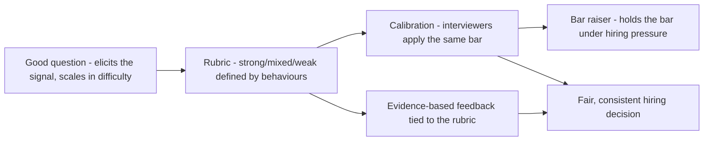

## 94.5 Writing questions and rubrics, calibration, and avoiding bias

#### Concept

Good interviewing depends on good instruments and good process. **Writing interview questions and rubrics** means crafting questions that elicit the target signal and rubrics that define what a strong, mixed, and weak answer looks like, so evaluation is consistent rather than based on gut feeling. **Calibration** is getting interviewers to apply the same bar, so a "hire" from one interviewer means the same as a "hire" from another. **Bar raising** is the practice of ensuring each hire raises the average, not lowers it. And **avoiding bias** plus **writing useful feedback** are the disciplines that make the evidence fair and the decision sound. Without rubrics and calibration, interviews measure the interviewer's mood and biases more than the candidate's ability.

#### Why does it exist?

Imagine two interviewers evaluating the same candidate's system design answer. One, who happens to value depth, scores it strong because the candidate went deep on the database. The other, who values breadth, scores it weak because the candidate missed the caching layer. Same answer, opposite scores, because there is no shared definition of what a strong answer is. The hiring decision becomes a coin flip weighted by which interviewers the candidate drew. And across many candidates, the lack of a shared bar means the company's hires are inconsistent and the decisions are driven by interviewer idiosyncrasy and bias rather than candidate ability.

Rubrics exist to define what good looks like, so evaluation is against a standard, not a mood. Calibration exists to align interviewers on that standard. Bar raising exists to prevent the slow drift of standards downward under hiring pressure. Bias mitigation exists because unstructured evaluation systematically disadvantages some candidates for reasons unrelated to ability. And useful feedback exists so the hiring decision rests on clear evidence, not vague impressions. Together they make hiring a fair, consistent process rather than a lottery of interviewer idiosyncrasy.

#### Mental model

Imagine judging a diving competition. Without rubrics, each judge scores by gut, and the same dive gets wildly different scores depending on which judge watched it — unfair and inconsistent. With rubrics (defined criteria for entry, form, difficulty) and calibration (judges trained to apply them the same way), the same dive gets consistent scores from any judge, because they are measuring against a shared standard, not their personal taste. Interview rubrics and calibration are the diving competition's scoring system: they make the evaluation about the performance against a standard, not about which judge you happened to get. And bias mitigation is ensuring the judges score the dive, not the diver's nationality or how much they like them.

#### How it works

**Writing questions.** A good interview question: elicits the target signal, is open enough to differentiate strong from weak candidates (not a trivia question with one right answer), is realistic (drawn from the actual work — orders, payments, not toy puzzles), and scales in difficulty (so a strong candidate can go deep and a weaker one can still engage). Avoid questions that mainly test whether the candidate has seen that specific puzzle before.

**Writing rubrics.** A rubric defines what strong, mixed, and weak answers look like for each signal, with concrete behaviours:

```text
Rubric for a system design question (e.g. design an order notification system):
STRONG (strong hire):
  - Clarifies requirements and constraints before designing.
  - Proposes a sound design and reasons about tradeoffs explicitly.
  - Addresses failure modes unprompted (can it timeout, duplicate, lose data?).
  - Reasons about scale with rough numbers.
  - Considers operability (how do we know it works, how do we roll back).
MIXED (lean hire / no-hire):
  - Produces a workable design but misses tradeoffs or failure modes until prompted.
  - Reasons about scale only when asked.
WEAK (no hire):
  - Jumps to a solution without clarifying requirements.
  - Misses obvious failure modes even when prompted.
  - Cannot reason about tradeoffs or scale.
```

The rubric makes evaluation concrete: the interviewer scores against defined behaviours, not against a vague sense of "they seemed good". This is what makes two interviewers' scores comparable.

**Calibration.** Align interviewers on the bar: run calibration sessions where interviewers score the same (recorded or role-played) interview and discuss discrepancies, so they converge on what "strong" means. New interviewers shadow experienced ones before interviewing solo. The goal: a "hire" from any interviewer means the same thing.

**Bar raising.** Ensure each hire raises the average quality, not lowers it. A common mechanism is a "bar raiser" — an experienced interviewer, often from outside the hiring team, whose job is to hold the bar and resist the pressure to lower it when a team is desperate to fill a role. The bar raiser prevents the slow erosion of standards under hiring pressure.

**Avoiding bias.** Structured interviews (same questions, same rubric for all candidates) reduce bias far more than unstructured ones. Other mitigations: diverse interview panels, evaluating against the rubric rather than "fit" or "likeability", being aware of common biases (affinity bias — favouring people like you; halo effect — one strong trait colouring everything), and writing feedback based on specific evidence rather than vague impressions.

**Writing useful feedback.** Feedback should be specific, evidence-based, and tied to the rubric: "Strong on failure modes — identified the dual-write risk unprompted and proposed an outbox. Weak on scale — could not estimate throughput or reason about the bottleneck even when prompted. Lean no-hire for senior: the design judgement is there but the scale reasoning isn't yet." Not "seemed smart, good vibes" (useless) or "didn't like them" (bias, not evidence).



#### Practical example

A team writes a system design question (design an order notification system, drawn from real work) and a rubric defining strong/mixed/weak answers by concrete behaviours (clarifies requirements, addresses failure modes unprompted, reasons about scale). They run a calibration session: three interviewers score a recorded candidate independently, then compare — initially they disagree (one scored strong, two mixed), and the discussion reveals that the "strong" scorer gave credit for depth the rubric does not actually require, while the rubric weights addressing failure modes, which the candidate missed. They converge on the rubric's standard. Now when any of them interviews, a "strong" score means the same thing. A bar raiser from outside the team sits on the loop to hold the bar even though the team is eager to fill the role. Feedback is written against the rubric with specific evidence. The result: hiring decisions driven by candidate ability against a shared standard, not by interviewer idiosyncrasy — and the decisions are better and fairer because the instruments (question, rubric) and process (calibration, bar raiser, evidence-based feedback) are sound.

#### Artifact example

A filled-in interview rubric and feedback — the artifacts that make evaluation consistent and evidence-based.

```markdown
# Rubric: System Design round — "Design order notifications" (Senior Backend)

## What we're assessing: system design judgement under realistic constraints.

| Dimension | Strong (hire+) | Mixed (lean) | Weak (no) |
|---|---|---|---|
| Requirements | Clarifies scale, consistency, delivery needs first | Asks some, assumes others | Jumps straight to a solution |
| Design soundness | Clean, justified design | Workable, some gaps | Confused or broken |
| Failure modes | Raises timeout/duplicate/loss UNPROMPTED | Raises when prompted | Misses even when prompted |
| Scale reasoning | Rough numbers, finds the bottleneck | Reasons when asked | Can't reason about scale |
| Tradeoffs | Names tradeoffs explicitly (e.g. sync vs async) | Some tradeoffs | No tradeoff awareness |
| Operability | Considers observability + rollback | Mentions if asked | Not considered |

## Scoring: strong hire / hire / lean hire / lean no-hire / no-hire.
Senior bar: STRONG on design soundness + failure modes, at least MIXED on scale.

---
# Filled-in feedback (evidence-based, tied to rubric) — candidate X
RECOMMENDATION: Lean no-hire for Senior (would be a hire for Mid).
- Requirements: MIXED — clarified delivery semantics but assumed scale.
- Design: STRONG — proposed outbox + queue, clean and justified.
- Failure modes: STRONG — raised the dual-write problem UNPROMPTED and
  solved it with an outbox. Excellent instinct.
- Scale: WEAK — could not estimate throughput or identify the bottleneck
  even when I prompted twice. This is the gap for senior.
- Tradeoffs: MIXED — discussed sync vs async when asked.
- Operability: not reached (ran out of time).
RATIONALE: Strong design instincts and failure-mode judgement (mid-to-senior),
but the scale reasoning isn't yet at the senior bar. Specific gap, not a vibe.
```

The rubric's power is that it defines each dimension's strong/mixed/weak by *concrete behaviours* (e.g. "raises failure modes unprompted" vs "when prompted" vs "misses even when prompted"), so two interviewers evaluate the same thing. The filled-in feedback is tied to the rubric, cites specific evidence (raised the dual-write problem unprompted; could not estimate throughput after two prompts), and reaches a reasoned recommendation with a named, specific gap — not "good vibes" or "didn't like them". This is what makes a hiring decision fair, consistent, and defensible rather than a lottery of interviewer mood and bias.

#### Real-world scenario

A company introduces rubrics and calibration after noticing its hires are inconsistent — some teams hire well, others poorly, and the same candidate might get opposite outcomes depending on the interviewers. The change is transformative. With rubrics, interviewers evaluate against defined behaviours instead of gut feel; with calibration sessions, they converge on a shared bar; with a bar-raiser program, standards hold even when teams are desperate to fill roles. The measurable effects: inter-interviewer agreement rises (the same candidate gets consistent scores), hiring quality improves (because the bar is consistent and high), and — notably — bias decreases, because structured evaluation against a rubric gives far less room for affinity bias and the halo effect than unstructured "do I like them" judgement. A peer company that interviews without rubrics continues to have inconsistent, idiosyncratic, bias-prone hiring, where outcomes depend heavily on which interviewers a candidate drew and how much they resembled the interviewers. The difference is treating interviewing as a measurement process with instruments and calibration, versus treating it as interviewers forming impressions. Rubrics and calibration do not just improve consistency; they improve fairness and quality together, because a shared, behaviour-based standard is both more consistent and less biased than individual gut feeling.

#### Failure scenario

A team interviews without rubrics, relying on each interviewer's gut sense of whether a candidate is "good". This produces a cascade of problems. First, inconsistency: the same candidate gets wildly different scores depending on the interviewer's personal values and mood, so hiring is a lottery. Second, bias: with no rubric to anchor evaluation, interviewers fall back on "fit" and "likeability", which are heavily influenced by affinity bias (favouring candidates like themselves) and the halo effect (one impressive trait colouring everything) — so the process systematically favours candidates who resemble the existing team and disadvantages others for reasons unrelated to ability. Third, useless feedback: debriefs are full of "seemed smart", "good energy", "not sure, something felt off" — vague impressions that cannot be examined or combined into a sound decision, and that often encode bias ("something felt off" is frequently affinity bias in disguise). The hiring decisions are inconsistent, biased, and indefensible, and the team cannot even tell that they are, because without rubrics there is no standard to measure against. The absence of rubrics and calibration does not just make hiring inconsistent; it makes it a vehicle for bias and a source of homogeneity, because gut-feel evaluation is exactly where bias operates. The fix — rubrics, calibration, evidence-based feedback — is the single most effective intervention for both hiring quality and hiring fairness.

#### Edge cases & failure modes

- **No rubric.** Evaluation by gut feel, which is inconsistent and bias-prone (affinity, halo effect).
- **Trivia questions.** Questions that test whether a candidate has seen that specific puzzle, not their actual ability.
- **No calibration.** Interviewers apply different bars, so a "hire" means different things from different people.
- **Bar erosion under pressure.** Lowering the bar when desperate to fill a role, without a bar raiser to hold it, leading to bad hires that cost more than the empty seat.
- **Vague feedback.** "Good vibes" or "didn't like them" — unexaminable, often bias in disguise, useless for the decision.
- **Evaluating "fit" instead of the rubric.** "Culture fit" judgments are a common vector for affinity bias; evaluate against defined, job-relevant behaviours instead.

#### How a Principal Engineer thinks about this

They treat interviewing as a measurement process that requires sound instruments and process, not as interviewers forming impressions, because they know unstructured evaluation measures the interviewer's mood and biases more than the candidate's ability. They write questions that elicit the target signal and scale in difficulty, and they insist on rubrics that define strong/mixed/weak by concrete behaviours, so evaluation is against a standard rather than gut feel. They drive calibration so a "hire" means the same thing from any interviewer, and they support bar-raiser mechanisms to hold the standard against the pressure to lower it when a team is desperate.

They are acutely aware that unstructured interviewing and "culture fit" judgments are primary vectors for bias — affinity bias and the halo effect operate exactly where there is no rubric — so they push for structured, rubric-based evaluation as both a quality and a fairness measure. And they demand evidence-based feedback tied to the rubric, refusing "good vibes" and "something felt off" as the bias-in-disguise they often are. The principal knows that a bad hire costs far more than an empty seat and that an unfair, inconsistent process produces both worse hires and a more homogeneous team, so they invest in the instruments and process that make hiring fair, consistent, and sound.

#### Common mistakes

- **No rubric,** evaluating by gut feel, which is inconsistent and bias-prone.
- **Trivia questions** that test puzzle-recognition, not ability.
- **No calibration,** so interviewers apply different bars.
- **Eroding the bar under hiring pressure** with no bar raiser to hold it.
- **Vague, impression-based feedback** ("good vibes", "didn't like them") that is useless and often bias in disguise.

#### Interview questions

1. **Why are rubrics and calibration essential to good interviewing?**
   *Expected answer:* without a rubric, interviewers evaluate by gut feel, so the same candidate gets inconsistent scores driven by the interviewer's values, mood, and biases (affinity, halo effect); a rubric defines strong/mixed/weak by concrete behaviours so evaluation is against a standard, and calibration aligns interviewers so a "hire" means the same from anyone. Together they make hiring consistent, fair, and based on ability. *Why it matters:* this is the core of fair, quality hiring.

2. **How does structured interviewing reduce bias?**
   *Expected answer:* unstructured evaluation and "culture fit" judgments are primary vectors for affinity bias (favouring people like you) and the halo effect; evaluating every candidate against the same rubric of job-relevant behaviours removes much of the room for those biases to operate, and evidence-based feedback (vs "something felt off", often bias in disguise) keeps the decision anchored to ability. *Why it matters:* tests awareness that structure is a fairness tool, not just a consistency tool.

3. **What makes interview feedback useful versus useless?**
   *Expected answer:* useful feedback is specific, evidence-based, and tied to the rubric ("raised the dual-write risk unprompted; could not estimate throughput after two prompts — lean no-hire for senior, scale is the gap"); useless feedback is vague impressions ("seemed smart", "good vibes", "didn't like them") that cannot be examined, cannot be combined into a sound decision, and often encode bias. *Why it matters:* tests whether they can produce decision-grade evidence.

#### Practical exercise

Write one interview question for a signal your team hires for (coding, system design, backend depth), drawn from realistic work and scaling in difficulty. Then write its rubric: define strong, mixed, and weak answers by concrete behaviours for each dimension you are assessing. Finally, take a recent interview you did (or imagine one) and write the feedback in the evidence-based, rubric-tied style — specific evidence, a reasoned recommendation, a named gap — and compare it to how feedback is usually written on your team.

**Acceptance criteria:** your question elicits the target signal and can differentiate strong from weak candidates (not trivia); your rubric defines strong/mixed/weak by concrete, observable behaviours (not "seemed good") for each dimension; and your feedback cites specific evidence tied to the rubric and reaches a reasoned recommendation with a named gap, demonstrably more useful and less bias-prone than vague impression-based feedback.
