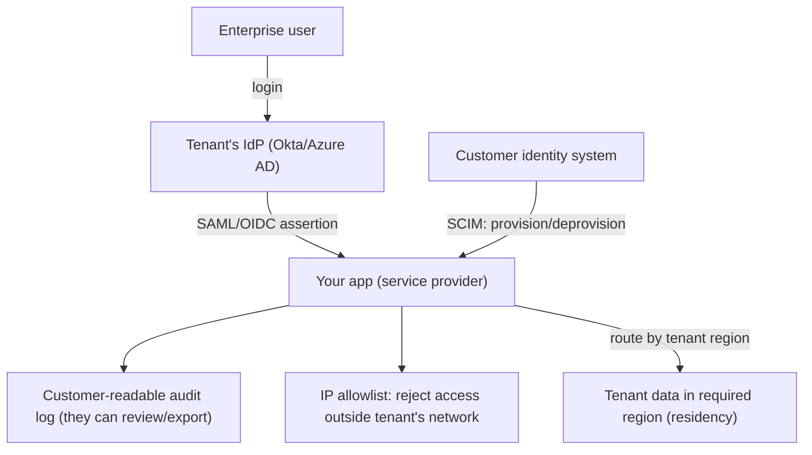

## 95.6 Enterprise B2B features and data residency

#### Concept

Enterprise customers demand features that consumer and small-business SaaS do not need, and lacking them blocks enterprise deals entirely. The core enterprise B2B features are: **SSO** (single sign-on via SAML or OIDC, so enterprise users log in with their corporate identity provider), **SCIM** (automated user provisioning and deprovisioning from the customer's identity system), **customer-readable audit logs** (so the customer's security team can see what happened in their tenant), and **IP allowlists** (so a tenant can restrict access to their corporate network). **Data residency and regional tenancy** is the requirement that a tenant's data live in a specific geographic region, for legal or policy reasons. These are the table-stakes features that gate enterprise revenue.

#### Why does it exist?

Imagine trying to sell your SaaS to a large enterprise. Their security team reviews it and finds: users must create separate passwords (no SSO integration with their identity provider), so the enterprise cannot enforce its security policies or offboard employees centrally; there is no automated way to provision or deprovision users (no SCIM), so when an employee leaves, their access lingers; the security team cannot audit what happened in their account (no customer-readable audit log); and there is no way to restrict access to their corporate network (no IP allowlist). The deal is dead — the enterprise's security requirements are unmet. And if the enterprise is in the EU with GDPR data-residency requirements and your SaaS stores everything in the US, that is a legal blocker.

These features exist because enterprises have security, compliance, and governance requirements that are non-negotiable, and a SaaS without them simply cannot sell to enterprises. They are not nice-to-haves; they are the gate to enterprise revenue, which is usually where the largest deals are. Building them is what moves a SaaS from serving small businesses to serving large enterprises.

#### Mental model

Imagine a building that wants to rent space to a government agency. The agency has requirements: employees must badge in with the agency's own ID system (SSO), access must be automatically revoked when an employee leaves the agency (SCIM deprovisioning), the agency's security team must be able to review the entry logs for their floor (customer-readable audit logs), access must be restricted to people coming from the agency's network (IP allowlist), and sensitive operations must happen within the agency's jurisdiction (data residency). A building without these cannot host the agency, no matter how nice it is. Enterprise B2B features are these building requirements for enterprise tenants: without them, you cannot host the enterprise, however good your product is otherwise.

#### How it works

**SSO (SAML / OIDC).** Enterprise users authenticate through their corporate identity provider (IdP) — Okta, Azure AD, etc. — rather than a password in your system. **SAML** is the older XML-based standard, still common in enterprise; **OIDC** (OpenID Connect, built on OAuth 2) is the modern JSON-based one. Your app becomes a service provider that trusts the tenant's IdP: the user logs in at their IdP, which asserts their identity to your app. This lets the enterprise control authentication centrally (enforce MFA, password policies, offboarding). Each enterprise tenant configures their own IdP connection.

**SCIM (System for Cross-domain Identity Management).** A standard protocol by which the customer's identity system automatically creates, updates, and deactivates users in your app. When the enterprise hires someone, SCIM provisions their account; when they leave, SCIM deprovisions it — so access management is automated and offboarding is immediate, which is a critical security requirement.

**Customer-readable audit logs.** A log of significant actions within a tenant (who did what, when) that the *customer's* security/compliance team can access — via a UI or an export/API. Distinct from your internal logs; these are for the customer to audit their own tenant. Essential for the customer's own compliance (SOC 2, etc.).

**IP allowlists.** Per-tenant configuration restricting access to specified IP ranges (the tenant's corporate network/VPN), so even a stolen credential cannot be used from outside the allowed network.

**Data residency / regional tenancy.** A tenant's data is stored (and often processed) in a specific region (EU, US, etc.) to meet legal requirements (GDPR, data-sovereignty laws) or policy. This usually means regional deployments and routing a tenant to their designated region — often implemented with silo or regional-pool models (95.1), since data residency and shared-global-pool are hard to reconcile.



#### NestJS example

An SSO (OIDC) strategy per tenant and an audit-log interceptor:

```ts
// Multi-tenant OIDC: each tenant has its own IdP config. A guard resolves the
// tenant's IdP from the login request and validates the token against it.
import { Injectable } from '@nestjs/common';
import { PassportStrategy } from '@nestjs/passport';
import { Strategy } from 'passport-openidconnect';

// Per-tenant config is loaded dynamically; shown here conceptually.
@Injectable()
export class TenantOidcStrategy extends PassportStrategy(Strategy, 'tenant-oidc') {
  constructor(/* tenant IdP config provider */) {
    super({
      // issuer, clientID, clientSecret, callbackURL resolved PER TENANT
      // from the tenant's stored IdP configuration.
    });
  }
  // validate() maps the IdP assertion to your user + tenant, creating/linking
  // the user (JIT provisioning) if SCIM hasn't already.
  async validate(issuer: string, profile: any) {
    return { tenantId: /* from issuer->tenant map */ '', userId: profile.id };
  }
}
```

```ts
// Audit-log interceptor: records significant actions for the customer to review.
import { Injectable, NestInterceptor, ExecutionContext, CallHandler } from '@nestjs/common';
import { Observable } from 'rxjs';
import { tap } from 'rxjs/operators';
import { getTenantId } from './tenant-context';

@Injectable()
export class AuditLogInterceptor implements NestInterceptor {
  constructor(private readonly audit: AuditService) {}
  intercept(ctx: ExecutionContext, next: CallHandler): Observable<any> {
    const req = ctx.switchToHttp().getRequest();
    return next.handle().pipe(tap(() => {
      // Record who did what, when, in which tenant — for the CUSTOMER to audit.
      this.audit.record({
        tenantId: getTenantId(),
        actor: req.user?.id,
        action: `${req.method} ${req.route?.path}`,
        at: new Date(),
        ip: req.ip,
      });
    }));
  }
}
```

An IP-allowlist guard:

```ts
// Reject requests from outside the tenant's configured IP allowlist.
import { Injectable, CanActivate, ExecutionContext, ForbiddenException } from '@nestjs/common';
import { getTenantId } from './tenant-context';

@Injectable()
export class IpAllowlistGuard implements CanActivate {
  constructor(private readonly config: TenantConfigService) {}
  async canActivate(ctx: ExecutionContext): Promise<boolean> {
    const req = ctx.switchToHttp().getRequest();
    const allowlist = await this.config.getIpAllowlist(getTenantId());
    if (!allowlist?.length) return true;               // no allowlist configured
    if (this.ipInRanges(req.ip, allowlist)) return true;
    throw new ForbiddenException('Access denied from this network');
  }
  private ipInRanges(ip: string, ranges: string[]): boolean { /* CIDR match */ return true; }
}
```

#### PostgreSQL example

Storing per-tenant IdP config, audit logs, and residency, plus an audit log the customer can query:

```sql
-- Per-tenant SSO/IdP config (secrets stored in a secret manager, not here).
CREATE TABLE tenant_idp (
  tenant_id   UUID PRIMARY KEY REFERENCES tenants(id),
  protocol    TEXT NOT NULL,            -- 'saml' | 'oidc'
  issuer      TEXT NOT NULL,
  config_ref  TEXT NOT NULL             -- reference to secret-manager entry
);

-- Customer-readable audit log (RLS-scoped so each customer sees only their own).
CREATE TABLE audit_log (
  id          BIGSERIAL PRIMARY KEY,
  tenant_id   UUID NOT NULL,
  actor_id    UUID,
  action      TEXT NOT NULL,
  target      TEXT,
  ip          INET,
  occurred_at TIMESTAMPTZ NOT NULL DEFAULT now()
);
ALTER TABLE audit_log ENABLE ROW LEVEL SECURITY;
CREATE POLICY audit_tenant ON audit_log
  USING (tenant_id = current_setting('app.current_tenant')::uuid);  -- customer sees own only
CREATE INDEX audit_tenant_time ON audit_log (tenant_id, occurred_at DESC);

-- Residency: which region a tenant's data lives in (for routing).
ALTER TABLE tenants ADD COLUMN region TEXT NOT NULL DEFAULT 'us';  -- 'us' | 'eu' | ...
```

#### Production scenario

A SaaS lands a large enterprise deal that was contingent on enterprise features. The enterprise's users log in via SSO through the company's Okta (SAML), so the enterprise controls authentication and can enforce its MFA policy. SCIM automatically provisions new employees and, critically, deprovisions departing ones immediately — so when an employee leaves the enterprise, their SaaS access is revoked automatically, satisfying the enterprise's offboarding security requirement. The enterprise's security team reviews the customer-readable audit log quarterly for their own SOC 2 compliance. The enterprise restricts SaaS access to their corporate network via an IP allowlist. And because the enterprise is in the EU, their tenant data lives in the EU region (residency), satisfying GDPR. Each of these features was a hard requirement in the security review; collectively they unlocked a deal worth far more than any number of small-business customers. The enterprise features are the gate to enterprise revenue, and this deal is the concrete payoff of having built them.

#### Failure scenario

A SaaS built for small businesses tries to move upmarket to enterprise without building enterprise features — it has password-based login only, manual user management, no customer-readable audit log, no IP allowlist, and a single US region. It gets into a promising enterprise sales cycle, and then hits the security review. The enterprise's security team produces a checklist: SSO via our IdP (not supported), SCIM provisioning (not supported), audit logs we can review (not supported), IP restrictions (not supported), EU data residency (not supported). Every item is a blocker. The deal dies, not because the product is bad but because it lacks the table-stakes enterprise features, and the enterprise cannot adopt a product that fails its security requirements no matter how good the core functionality is. The company realises too late that enterprise features are not optional add-ons to build "when we have time" but prerequisites for enterprise deals, and that they are significant engineering investments (SSO and SCIM especially) that cannot be bolted on in a sales cycle's timeframe. They lose the deal and spend the next two quarters building what they should have built before pursuing enterprise. The lesson: enterprise features gate enterprise revenue, so if the strategy is to sell to enterprises, these features must be built proactively, not reactively in a dying sales cycle — and retrofitting them (especially multi-tenant SSO and data residency) is a substantial project, not a quick addition.

#### Edge cases & failure modes

- **No SSO/SCIM.** Blocks enterprise deals; the enterprise cannot centrally control authentication or offboarding.
- **SSO that isn't per-tenant.** A single global IdP config cannot serve multiple enterprise tenants each with their own IdP; SSO must be per-tenant.
- **SCIM deprovisioning that doesn't revoke access immediately.** A departed employee retaining access is a serious security gap.
- **Audit logs that leak across tenants.** A customer-readable audit log must be strictly tenant-scoped (RLS), or one customer sees another's actions — a breach.
- **Data residency as an afterthought.** Residency is hard to retrofit into a global pool; it usually requires regional deployments and tenant-to-region routing, often silo/regional-pool models.
- **Treating enterprise features as quick add-ons.** SSO, SCIM, and residency are substantial projects; building them reactively in a sales cycle fails.
- **Audit logs that aren't comprehensive or tamper-evident,** failing the customer's compliance needs.

#### How a Senior Backend Engineer thinks about this

They treat enterprise B2B features as the gate to enterprise revenue, not as optional add-ons, and if the product strategy includes selling to enterprises, they build SSO, SCIM, customer-readable audit logs, IP allowlists, and data residency proactively — because they know these are hard requirements in every enterprise security review, that a single unmet one kills a deal, and that they are substantial engineering projects (especially multi-tenant SSO and residency) that cannot be bolted on reactively in a sales cycle. They design SSO per-tenant (each enterprise configures its own IdP) and SCIM to deprovision immediately (a departed employee's access must be revoked at once), because these map directly to the enterprise's non-negotiable security and offboarding requirements.

They build customer-readable audit logs as strictly tenant-scoped (RLS-enforced, 95.2), comprehensive, and ideally tamper-evident, because the customer's own compliance depends on them and a cross-tenant leak in the audit log is itself a breach. And they plan data residency into the architecture early — usually via regional deployments and tenant-to-region routing (silo or regional-pool, 95.1) — because residency is extremely hard to retrofit into a global shared pool. The senior engineer understands that enterprise features are where the architecture meets the sales motion: they are the technical prerequisites that unlock the largest deals, so building them well and proactively is a strategic investment, not a reactive scramble.

#### Common mistakes

- **Not building enterprise features** when pursuing enterprise deals, so deals die in security review.
- **A single global SSO config** instead of per-tenant IdP configuration.
- **SCIM that doesn't deprovision immediately,** leaving departed employees with access.
- **Customer-readable audit logs that leak across tenants** (not tenant-scoped), which is itself a breach.
- **Treating data residency as an afterthought,** then finding it near-impossible to retrofit into a global pool.

#### Interview questions

1. **What enterprise B2B features gate enterprise SaaS deals, and why?**
   *Expected answer:* SSO (SAML/OIDC, so the enterprise controls authentication via its own IdP), SCIM (automated provisioning/deprovisioning, so offboarding is immediate), customer-readable audit logs (so the customer's security team can audit their tenant), IP allowlists (restrict access to the corporate network), and data residency (data in the required region). They gate deals because enterprise security reviews treat them as non-negotiable requirements — a single unmet one kills the deal. *Why it matters:* these are the technical prerequisites for enterprise revenue.

2. **Why must SSO be per-tenant and SCIM deprovisioning immediate?**
   *Expected answer:* each enterprise tenant uses its own identity provider, so a single global SSO config cannot serve them — SSO must be configurable per tenant. SCIM deprovisioning must revoke access immediately because a departed employee retaining access is a serious security gap that the enterprise's offboarding process depends on closing automatically. *Why it matters:* tests understanding of the enterprise security model.

3. **Why is data residency hard to retrofit, and how do you architect for it?**
   *Expected answer:* residency requires a tenant's data to live (and often be processed) in a specific region, which is incompatible with a single global shared pool; retrofitting it means re-architecting to regional deployments and tenant-to-region routing, often via silo or regional-pool models. So you architect for it early — regional deployments, tenant-region mapping, routing — rather than trying to add it to a global pool later. *Why it matters:* tests whether they plan residency into the architecture proactively.

#### Practical exercise

Design the enterprise feature set for a SaaS moving upmarket. Specify how you would implement per-tenant SSO (SAML/OIDC with per-tenant IdP config), SCIM provisioning/deprovisioning (with immediate access revocation), a customer-readable audit log (tenant-scoped via RLS, comprehensive), IP allowlists (per-tenant config), and data residency (regional deployments and tenant-to-region routing). Identify which of these are the largest engineering investments and must be started earliest.

**Acceptance criteria:** SSO is per-tenant (each enterprise configures its own IdP); SCIM deprovisioning revokes access immediately; the audit log is strictly tenant-scoped (RLS) and readable by the customer; IP allowlists are per-tenant; data residency is architected via regional deployments and routing (not retrofitted into a global pool); and you identify SSO, SCIM, and residency as substantial investments to build proactively rather than reactively in a sales cycle.
