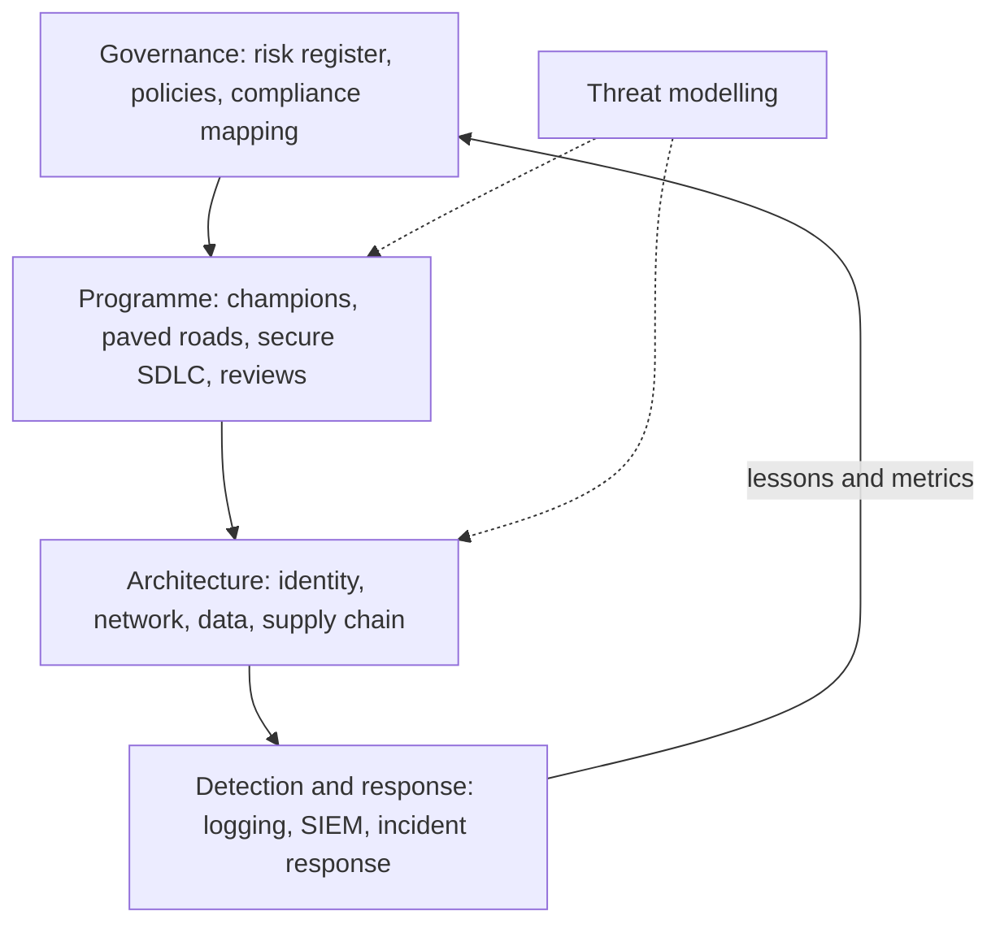
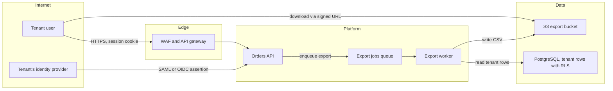
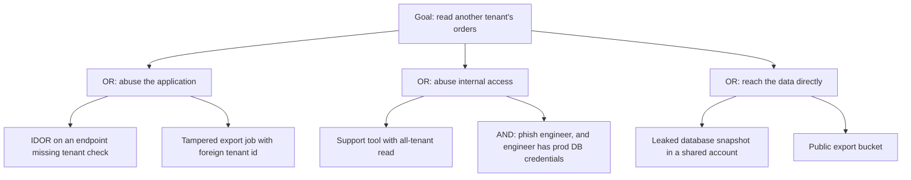
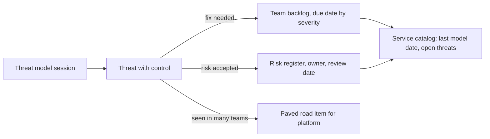

# Part 96 — Security Architecture

Part 44 — Security taught the mechanics an engineer needs: authentication and sessions, OAuth and OIDC, RBAC and ABAC, hashing and encryption, key management and mTLS, the OWASP classes of vulnerability, secrets, audit logs, supply-chain hygiene, and threat modelling in one page (44.37). Part 81 — Auth and Security in the Browser did the same for the frontend. Those Parts answer "how do I build this feature securely?"

This Part answers the questions that come after: how do we make **a whole organisation's systems** secure by design, not by heroics? How do we decide which threats matter most across fifty services? What does zero trust actually require us to build? Who holds which keys? How do we know we are under attack, and what happens in the first hour? How do we run security across twenty teams without becoming the department of no? And how do we explain all of this to a board that wants one number? It is written for the staff or principal engineer, the security architect, and the engineering leader who owns the risk.

The running example is a multi-tenant B2B SaaS for inventory and order management, the kind built in Part 95 — Enterprise and Multi-Tenant SaaS Architecture: about 1,200 tenant companies, an enterprise tier with SSO and customer-managed keys, customers in India and the EU, 40 services on Kubernetes in AWS, and 120 engineers in 15 teams. Section 96.13 designs its security architecture end to end.

## 96.1 What a security architect owns

#### Concept

**Security architecture** is the design of the controls, boundaries and processes that protect an organisation's systems and data, chosen deliberately against the threats that matter and arranged so that no single failure leads to a disaster. The security architect owns the **shape** of that protection across the organisation: which identities exist and how they prove themselves, where the trust boundaries are, how data is classified and protected, how software is built and shipped safely, how attacks are detected and handled, and how all of it is governed and explained.

#### Why does it exist?

Engineer-level security is necessary and not sufficient. Every team can validate inputs, hash passwords and check object ownership correctly, and the organisation can still be breached through a long-lived CI token with administrator rights, a forgotten S3 bucket in an old account, a support tool that can read every tenant's data, or a phished engineer whose laptop has production database credentials. These are **architectural** failures: properties of how the pieces fit, which no single pull request review can see. Someone has to own the whole.

#### Mental model

Imagine the security of a large hospital. Each department locks its drug cabinet and checks patient wristbands (engineer-level controls). The hospital's security architect decides which doors need badges, which badges open which doors, where the cameras go, who may enter the pharmacy at night, what happens when a badge is lost, how a fire evacuation works without opening every door to strangers, and how the board is told which risks remain. Departments doing their part well does not make the building safe if the loading dock is open.

#### How it works

The architect's work divides into areas, each covered by a section of this Part:

| Area | The question | Section |
|---|---|---|
| Threat modelling | Which threats matter most, and what are we doing about them? | 96.2 |
| Principles | What rules shape every design? | 96.3 |
| Zero trust | How do we stop trusting the network? | 96.4 |
| Identity | Who and what can act, and how do they prove it? | 96.5 |
| Network and cloud | What can reach what? | 96.6 |
| Data | How is data classified, encrypted and owned? | 96.7 |
| Supply chain | Can we trust what we build and run? | 96.8 |
| Detection and response | Will we notice, and what do we do? | 96.9 |
| Programme | How does security scale across teams? | 96.10, 96.11 |
| Communication | How do leaders understand and decide on risk? | 96.12 |

#### How a Senior Backend Engineer thinks about this

At this level, a senior thinks in **attack paths**, not vulnerabilities: how would an attacker get from the internet, or from one compromised laptop, to the data that matters, and which controls break each step? They also accept that the goal is not zero risk but **known, owned and proportionate** risk, decided by the people accountable for the business, with security's job being to make the risk visible and the secure path cheap.

## 96.2 Threat modelling as a practice

#### Concept

Part 44.37 taught threat modelling in one page: four questions (what are we building, what can go wrong, what are we doing about it, did we do a good job?), a flow diagram with trust boundaries, and STRIDE at each boundary. At the architect level, threat modelling becomes a **practice**: a repeatable activity with a trigger, a format, a facilitator, outputs that land in the backlog, and a portfolio view across the organisation. This section adds the tools for that: **data-flow diagrams** done properly, **STRIDE per element**, **attack trees**, and the mechanics of running sessions and turning threats into work.

#### Why does it exist?

Without a practice, threat modelling happens when a security-minded engineer happens to be in the room, produces a document nobody reads, and finds the same classes of threat over and over without fixing their root causes. A practice makes it happen at the right moments (new systems, new trust boundaries, sensitive data), keeps sessions short and useful, and turns findings into tracked work, patterns and paved-road improvements.

#### Mental model

Imagine a building inspector who visits not once at the end, but at the plans stage, again when a new wing is added, and whenever the use of a room changes (an office becomes a server room). Each visit is short and uses a standard checklist, findings go into the builder's task list with owners, and the inspector also notices when every builder makes the same mistake and gets the building code changed.

#### How it works

**1. Data-flow diagrams with trust boundaries.** A **data-flow diagram (DFD)** has four element types: **external entities** (people or systems outside your control), **processes** (code that runs), **data stores** (databases, queues, buckets, caches) and **data flows** (arrows), plus **trust boundaries** (dashed lines where the level of trust changes: internet to edge, tenant to platform, application to database, your account to a vendor's). Draw at the level where decisions are made: for an architecture review, services and stores, not classes.

**2. STRIDE per element.** Rather than asking all six STRIDE questions everywhere, ask the ones that apply to each element type. This keeps sessions focused and makes coverage checkable.

| Element | S | T | R | I | D | E |
|---|---|---|---|---|---|---|
| External entity | Yes | | Yes | | | |
| Process | Yes | Yes | Yes | Yes | Yes | Yes |
| Data store | | Yes | Yes, for logs | Yes | Yes | |
| Data flow | | Yes | | Yes | Yes | |

For the export feature above, the session produces threats such as: export worker processes jobs for tenant A using tenant B's ID from a tampered queue message (T, E on the process); signed URL for an export is shared or guessed (I on the flow); export bucket made public by a misconfiguration (I on the store); a huge export starves other tenants (D on the process); the tenant's IdP assertion is replayed (S on the external entity). Each gets a control and an owner.

**3. Attack trees for high-value goals.** STRIDE is breadth-first: it finds many threats across a design. An **attack tree** is depth-first: it starts from one attacker goal ("read another tenant's orders") and breaks it into the ways to achieve it, with **OR** nodes (any child suffices) and **AND** nodes (all children are needed). Attack trees are the right tool for the few goals that would be existential, and for checking that defence in depth really is in depth.

Annotate each leaf with the controls that block it and a rough cost or likelihood for the attacker. A leaf with no control, or a path where every node depends on the same single control (for example, all application paths depending only on the code's `WHERE tenant_id = ...`), is your priority. In the tree above, the answer for the application branch is row-level security in PostgreSQL as a second layer (see Part 95 — Enterprise and Multi-Tenant SaaS Architecture, 95.2), and for the internal branch, just-in-time, audited, tenant-scoped support access (96.5).

**4. When to run a session.** Not for every change. Use triggers:

| Trigger | Depth |
|---|---|
| New service or system | Full session, 60 to 90 minutes |
| New trust boundary (new external integration, new tenant-facing surface, new vendor) | Full session on the new boundary |
| New category of sensitive data (payment, health, biometrics, children) | Full session plus privacy review |
| Significant change to authentication or authorisation | Focused session |
| Routine feature inside existing boundaries | Checklist in the design doc (96.11), no session |

**5. How to run it.** Keep the group small: the engineers who build it (they know the design), a facilitator (a security engineer or a trained security champion), and sometimes a product owner (to judge impact). Send the diagram ahead. In the session: confirm the diagram (20% of findings come from discovering the diagram is wrong), walk STRIDE per element across each boundary, build an attack tree for the one or two goals that would be worst, and agree controls and owners. Time-box it. Write down only the threat table and decisions.

**6. Turn threats into backlog.** Every accepted threat becomes one of: a ticket in the owning team's backlog with a severity-based due date; an accepted risk recorded in the risk register with an owner and a review date (96.10); or a pattern finding ("every service builds its own export signing") that becomes a paved-road item for the platform team. Track threat-model coverage per service in the service catalog: date of last model, open threats by severity.

**Other frameworks, briefly.** **LINDDUN** applies the same per-element idea to privacy threats (linking, identifying, non-repudiation, detecting, data disclosure, unawareness, non-compliance) and pairs well with STRIDE for systems handling personal data. **PASTA** is a heavier, risk-centric process for organisations that want threat modelling tied closely to business impact analysis. Use whichever your teams will actually run; the four questions matter more than the acronym.

#### Practical example

A team proposes letting enterprise tenants connect their own SFTP server so the platform can push nightly order exports. The trigger is a new trust boundary (outbound connections to customer-controlled hosts). In a 60-minute session they find: SSRF-like risk (a tenant configures `10.0.0.5` or the cloud metadata address as their SFTP host; see Part 44 — Security, 44.23), credentials for tenants' servers stored in plain configuration, an export job that could be pointed at another tenant's data if the tenant ID came from the job payload, and no rate limit on retries to a dead host. Controls agreed: an egress proxy that only allows public addresses and logs every connection (96.6), credentials in the secrets manager scoped per tenant (96.5), tenant ID taken from the job's signed envelope and enforced by RLS, and exponential backoff with a per-tenant cap. One pattern finding: "egress to customer hosts" will recur (webhooks, SFTP, custom integrations), so the platform team builds a shared egress gateway.

#### Failure scenario

A company ran threat modelling as a compliance artefact: a 30-page template filled in by the team lead after the system was built, reviewed by security, filed. A year later a breach came through a webhook-delivery service that fetched arbitrary tenant-supplied URLs from inside the VPC, reaching the instance metadata service and taking its role credentials. The threat model existed; the SSRF threat was listed on page 22 with "mitigation: input validation", unowned, unticketed, never built. The fix was to replace the template with a short session, a threat table, and a rule that every "fix needed" threat becomes a ticket before the review is closed.

#### How a Senior Backend Engineer thinks about this

A senior treats threat modelling as a design activity that is short, early and repeated, not a document. They pick the depth from triggers, facilitate rather than lecture, use STRIDE per element for breadth and attack trees for the few goals that would end the company, and measure the practice by threats closed and patterns paved, not by models written.

#### Common mistakes

- Threat modelling after the build, when the cheap fixes are gone.
- Sessions without the engineers who built the system, so the diagram is wrong.
- Long reports instead of a threat table with owners and tickets.
- Fixing the same class of threat team by team instead of making a paved-road fix once.

#### Practical exercise

Draw a DFD for "tenant admins can invite users by email, and invited users join via a magic link". Run STRIDE per element and build an attack tree for the goal "join a tenant I was not invited to". Produce a threat table with at least six threats, controls and owners, and say which threats become tickets, which become accepted risks and which point to a paved-road fix.

#### Worked answer to the exercise

Elements: tenant admin and invited user (external entities), invitations API and email worker (processes), invitations table and email provider (store and external entity), flows for invite creation, email delivery and link redemption. Threats: (S) attacker redeems a link sent to someone else, for example a forwarded email; control: link bound to the invited email, user must authenticate as that email (or via the tenant's SSO) before joining. (T) attacker changes the tenant ID or role in the redemption request; control: tenant and role read from the server-side invitation record, never from the request. (R) admin denies inviting someone; control: audit event with actor and target. (I) invitation tokens guessable or logged; control: 128-bit random tokens stored hashed, never logged (Part 44.15), short expiry, single use. (D) invite endpoint used to spam arbitrary addresses through your email domain; control: per-tenant rate limits and caps. (E) a regular member invites someone as admin; control: authorisation check on the role being granted. Attack tree for "join a tenant uninvited": OR (steal a valid link: email compromise, logs, referrer leakage) OR (forge or guess a link: weak tokens) OR (tamper redemption: change tenant or role) OR (abuse SSO just-in-time provisioning with an email domain you control). The log and referrer leaks, weak tokens, redemption tampering and SSO provisioning abuse map to tickets; email account compromise of an invitee is an accepted risk mitigated by expiry and SSO enforcement for enterprise tenants; "random, hashed, single-use tokens" recurs across password reset, magic links and invitations, so it becomes a shared library on the paved road.
