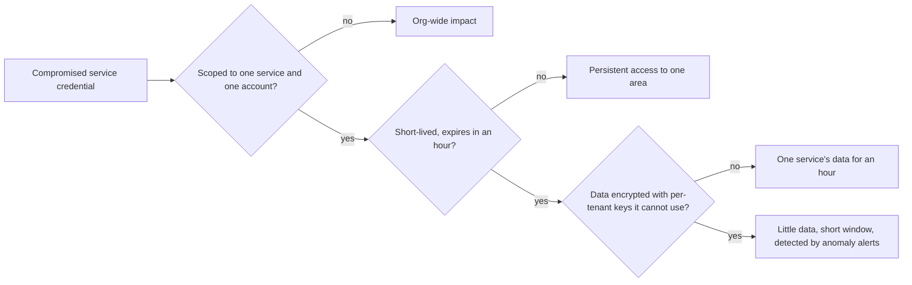
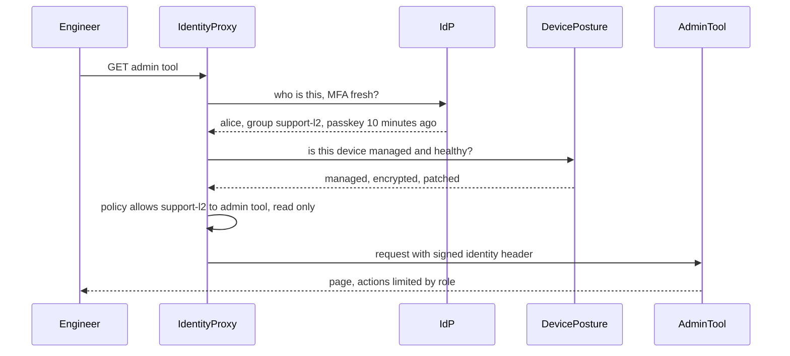

## 96.3 Security architecture principles

#### Concept

A small set of principles shapes every good security design. They are old (several go back to Saltzer and Schroeder's 1975 paper on protection in computer systems) and they still decide most architecture arguments: **least privilege**, **defence in depth**, **secure defaults**, **fail closed**, and **blast-radius reduction**. Others follow from them: separation of duties, complete mediation (check every access, not just the first), economy of mechanism (simple designs are easier to secure) and no security through obscurity.

#### Why does it exist?

Architects make hundreds of decisions that no checklist anticipates. Principles let them decide consistently: should the export worker have read access to all tenants or one at a time? Should the feature flag service default to "allow" when it cannot reach its store? Should the platform team's CI role be able to delete production databases? A principle answers in seconds what a meeting would argue about for an hour.

#### Mental model

Imagine a bank branch. Tellers can open their own drawer, not the vault (least privilege). The vault has a door, a time lock, cameras and an alarm, so a single failure does not empty it (defence in depth). New staff get no keys until they are granted (secure defaults). If the power fails, the vault stays locked, not open (fail closed). Each branch holds only a day's cash, so robbing one branch is not robbing the bank (blast radius).

#### How it works

**Least privilege.** Every identity, human or machine, gets the minimum access for its job, for the minimum time. In practice: scoped roles per service rather than shared administrator credentials; database users per service with only the grants it needs; time-bound elevation for humans (just-in-time access, 96.5); and permission boundaries in the cloud so that even an administrator role cannot remove the audit trail. The hard part is not granting less; it is **keeping** access small as systems change, which needs tooling: access analysers that find unused permissions, and regular automated pruning.

**Defence in depth.** Layer independent controls so that any single failure is caught by another. The key word is **independent**: three checks that all rely on the same tenant ID from the same JWT are one control, not three. For tenant isolation, independent layers are: authorisation in the application, row-level security in the database keyed to a session setting set by trusted middleware, per-tenant encryption keys for the most sensitive data, and anomaly detection on cross-tenant access patterns.

**Secure defaults.** The easiest configuration must be the safe one: new buckets private, new services deny-by-default in the mesh, new API routes authenticated unless explicitly marked public, new columns classified as sensitive until reviewed (as in Part 43 — Data Platform Architecture, 43.9). Paved-road templates (see Part 90 — Architecture Governance, Standards and Paved Roads, 90.2) are how secure defaults reach every team.

**Fail closed.** When a security control cannot decide (the policy service is down, the token cannot be verified, the feature flag store is unreachable), deny rather than allow. The trade-off is availability, so design for it: cache policy decisions and public keys with sensible lifetimes, run the policy engine as a local sidecar or library rather than a remote dependency on every request, and decide explicitly, per control, what failure means. Some controls deliberately fail open (a fraud score timeout at checkout may allow and review, see Part 43 — Data Platform Architecture, 43.12); that decision must be written down and monitored, not discovered.

**Blast-radius reduction.** Assume something will be compromised, and limit what it can reach: separate cloud accounts per environment and per sensitive workload; cells or shards so that one compromised component touches a fraction of tenants; short-lived credentials so stolen ones expire; per-tenant keys so one leaked key exposes one tenant; and no single human or machine identity that can both change production and erase the evidence.



#### Decision table: applying the principles to common choices

| Choice | Weak option | Strong option | Principle |
|---|---|---|---|
| CI deploys to production | Long-lived cloud keys with admin rights in CI secrets | Short-lived credentials via OIDC federation, role limited to deploy actions for one account | Least privilege, blast radius |
| Support access to tenant data | Support tool with read access to all tenants | Just-in-time, tenant-scoped, ticket-linked, audited access with customer-visible log | Least privilege, separation of duties |
| Policy engine unavailable | Allow and log | Deny, with local cached decisions and a sidecar to avoid the dependency | Fail closed |
| Tenant isolation | Application `WHERE` clause only | Application check plus RLS plus per-tenant keys for sensitive fields | Defence in depth |
| New storage buckets | Created by hand, settings vary | Created from a template: private, encrypted, logged, tagged | Secure defaults |

#### Practical example

The SaaS's export worker originally ran with one database role that could read every tenant's rows, one IAM role that could write anywhere in the export bucket, and a default of "continue" when the tenant context was missing. Applying the principles took a week: the worker's database session now sets the tenant from the job's signed envelope so RLS limits it to one tenant per job (least privilege, defence in depth); its IAM policy allows writes only under the `exports/` prefix (blast radius); a missing tenant context aborts the job (fail closed); and the job template for new workers ships with all three (secure defaults).

#### How a Senior Backend Engineer thinks about this

A senior uses the principles as questions in every design review: what is the least this needs; what is the second control if the first fails, and is it independent; what happens by default; what happens when the control is down; and if this is compromised, what else falls? They do not chase perfect least privilege by hand; they invest in tools that measure unused access and in templates that make the right default automatic.

#### Common mistakes

- "Defence in depth" that is several copies of the same control.
- Fail-open decisions made implicitly by a timeout and a `catch` block.
- One shared cloud account for all environments and all teams.
- Granting broad access "temporarily" with no expiry mechanism.

## 96.4 Zero trust without the hype

#### Concept

**Zero trust** is a security model in which **no request is trusted because of where it comes from on the network**. Every access, by a person or a workload, is authenticated, authorised against policy and encrypted, every time, based on **identity** and **context** (device health, location, time, sensitivity of the resource) rather than on being "inside" the corporate network or VPC. NIST describes it in Special Publication 800-207 (2020); Google's BeyondCorp papers from 2014 onwards described one large implementation. It is a direction of travel and a set of architectural properties, not a product you buy.

#### Why does it exist?

The older **perimeter** model said: build a strong wall (firewall, VPN), and trust whatever is inside. It fails in three ways that every breach report repeats. Attackers get inside, through a phished laptop, a vulnerable VPN appliance or a compromised dependency, and then move laterally because everything inside trusts everything else. The perimeter dissolved anyway: staff work from home, services run in several clouds and SaaS vendors, partners connect directly. And "inside" was never a meaningful identity: knowing that a request came from `10.0.4.17` tells you nothing about which service or person sent it.

#### Mental model

Imagine two office buildings. In the first, a guard checks badges at the front door, and once inside you can walk into any room, including the server room and the finance office. In the second, every door has a badge reader that checks who you are, whether your role allows this room, and whether it is a normal time for you to be here; the front door matters much less. Zero trust is the second building. It costs more badge readers; it means a stolen visitor badge opens the lobby and nothing else.

#### How it works

Zero trust has four architectural pieces. You can adopt them incrementally.

**1. Strong identity for people.** A central identity provider (IdP) with single sign-on for every internal tool and cloud console, phishing-resistant multi-factor authentication (FIDO2 security keys or passkeys, which are bound to the site's origin and cannot be replayed by a fake login page), and short sessions for sensitive tools (96.5).

**2. Strong identity for workloads.** Every service gets a cryptographic identity issued by the platform, not a shared secret. Examples: **SPIFFE** (Secure Production Identity Framework for Everyone) defines identities like `spiffe://prod.example.internal/ns/orders/sa/orders-api` and short-lived certificates or JWTs that prove them (SVIDs), with **SPIRE** as a reference implementation; service meshes such as Istio and Linkerd issue similar identities to every pod automatically; cloud platforms bind cloud IAM roles to Kubernetes service accounts (on AWS, IAM Roles for Service Accounts or EKS Pod Identity) so pods get short-lived cloud credentials without stored keys.

**3. Mutual TLS and per-request authorisation between services.** With **mTLS**, both sides of every connection present certificates, so the server knows exactly which workload is calling (see Part 44 — Security, 44.19, for the mechanics). Identity alone is not enough; each service (or the mesh on its behalf) also authorises: "the orders API may call the payments API's `POST /charges`; the reporting service may not." Policies live in code, reviewed and versioned.

```yaml
# Istio AuthorizationPolicy as an example: only the orders API may call payments, and only these paths.
apiVersion: security.istio.io/v1
kind: AuthorizationPolicy
metadata:
  name: payments-allow-orders
  namespace: payments
spec:
  selector:
    matchLabels:
      app: payments-api
  action: ALLOW
  rules:
    - from:
        - source:
            principals: ["cluster.local/ns/orders/sa/orders-api"]   # workload identity, not an IP
      to:
        - operation:
            methods: ["POST"]
            paths: ["/charges", "/refunds"]
# With a namespace-wide default-deny policy in place, anything not allowed here is rejected.
```

Above the transport layer, the **end user's** identity should also travel: the orders API calls payments on behalf of a specific user and tenant, carried in a signed token, so payments can make its own authorisation decision instead of trusting the caller blindly (token exchange, or a short-lived internal token minted at the edge).

**4. Context-aware access for people to internal tools.** Instead of a VPN that puts a laptop "inside", an **identity-aware proxy** sits in front of each internal application, checks the user's identity and the device's posture (managed, disk encrypted, OS patched, endpoint agent running) on every request, and allows only the applications the role needs. Device posture comes from the device management and endpoint security tools; at concept level, the proxy asks "is this a known, healthy company device?" and treats the answer as one more input to the decision.



#### What zero trust is not

- **Not a product.** Vendors sell components (identity providers, proxies, meshes, device management). The architecture is how you combine them and the policies you write.
- **Not the end of network controls.** Segmentation and egress control (96.6) still reduce blast radius and stop data leaving; zero trust stops treating them as the **only** control.
- **Not all or nothing.** Most organisations move in steps over years, and the CISA Zero Trust Maturity Model is one public way to describe the steps across identity, devices, networks, applications and data.

#### A pragmatic sequence

| Step | What you build | Removes the risk of |
|---|---|---|
| 1 | SSO plus phishing-resistant MFA for all staff on every internal tool and cloud console | Password reuse and phishing as the main entry |
| 2 | Remove long-lived cloud keys; workload identity for services and CI | Stolen static credentials |
| 3 | Identity-aware proxy for internal tools; retire broad VPN access | "Inside the VPN means trusted" |
| 4 | mTLS in the mesh with default-deny service policies | Lateral movement between services |
| 5 | End-user identity propagated to downstream services, per-request authorisation | Confused-deputy calls between services |
| 6 | Device posture and risk signals in access decisions for sensitive actions | Access from compromised or unmanaged devices |

#### Failure scenario

A company rolled out a service mesh with mTLS everywhere and announced "zero trust achieved". Six months later an attacker who compromised a low-value marketing service called the billing service's internal API and exported invoices for every tenant. Every connection had been encrypted and mutually authenticated; there were simply no authorisation policies, so any authenticated workload could call any endpoint. mTLS answered "who is calling?" and nobody had asked "should they be allowed to?". The fix was default-deny authorisation per namespace and explicit allow rules per caller and path, introduced in audit mode first to discover the real call graph.

#### How a Senior Backend Engineer thinks about this

A senior explains zero trust in one sentence ("every request proves who it is and is checked against policy, wherever it comes from") and then sequences it by risk: people's identity and MFA first, static credentials out next, then service-to-service authorisation. They insist that identity is paired with authorisation, that policies are code with owners, and that each step is measured (share of tools behind SSO, share of workloads without static keys, share of service calls covered by explicit policy).

#### Common mistakes

- Buying a "zero trust" product and declaring the programme done, while long-lived cloud keys and standing admin access remain.
- Turning on default-deny service policies in enforce mode on day one, breaking calls nobody knew existed; run in audit mode first and build the allow-list from observed traffic.
- Authenticating services but passing the end user's tenant and role as plain headers that any caller can set, which recreates the confused deputy one layer down.
- Making the policy engine or identity provider a remote, synchronous dependency of every request without caching, so its outage becomes everyone's outage and the pressure to fail open grows.
- Treating device posture as a one-time check at login rather than a signal that is re-evaluated for sensitive actions.

#### Interview questions

1. **What does zero trust change about service-to-service calls?** Calls are authenticated by workload identity (mTLS, SPIFFE-style IDs), authorised per caller and operation by policy, and carry end-user context; network location grants nothing.
2. **Is a service mesh with mTLS zero trust?** It provides identity and encryption; without default-deny authorisation policies and end-user context it does not stop lateral movement.
3. **Where would you start a zero-trust programme?** SSO and phishing-resistant MFA everywhere, then removing long-lived credentials, because those are the most common entry points.
4. **What is a confused deputy, and how does propagating user identity help?** A trusted service tricked into acting with its own broad privileges for a caller who lacks them; carrying the user's identity lets the downstream service authorise the actual user.
