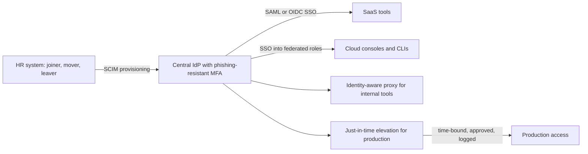
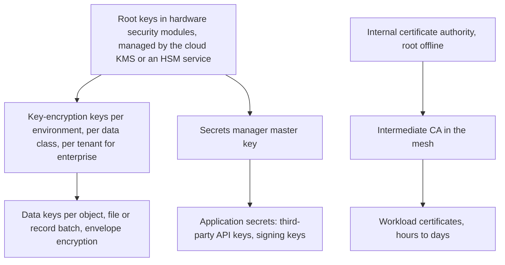
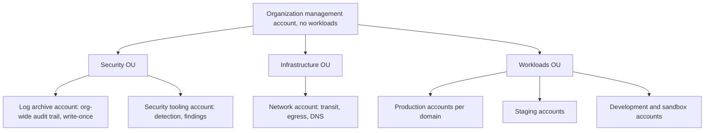
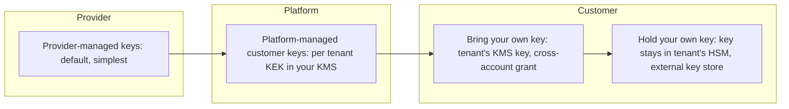

## 96.5 Identity architecture across an organisation

#### Concept

**Identity architecture** is the design of every kind of identity in the organisation, human and machine, and how each is created, authenticated, authorised, reviewed and removed: employees and contractors through a **central identity provider (IdP)** with **SSO**; customers through the product's own identity system or their enterprise IdP; **service accounts** and workloads through platform-issued, short-lived credentials; and the **secrets and keys** that remain, organised in a hierarchy with rotation. Part 44 — Security covered the protocols (44.4 to 44.7 for OAuth, OIDC, SSO and MFA; 44.32 for secrets); this section is about the organisation-wide design.

#### Why does it exist?

Most serious breaches involve a credential: a phished password, a long-lived access key in a repository, a former employee's account that was never disabled, a CI token with far more power than it needed. Identity is the new perimeter (96.4), so its architecture decides how hard the organisation is to break into and how far an attacker gets.

#### Mental model

Imagine a large company's badge office. Every person gets one badge from one office (the IdP), it opens only what their role needs, it is disabled the day they leave, and lost badges are cancelled in minutes. Delivery robots (services) get their own machine badges that expire every hour and are reissued automatically. The few physical master keys (root secrets) are kept in a safe, logged when used, and changed on a schedule.

#### How it works

**Workforce identity.**



1. **One IdP, HR-driven lifecycle.** The HR system is the source of truth for who works here. Joiners, movers and leavers flow automatically to the IdP and, through **SCIM** provisioning, to every connected SaaS tool, so a leaver loses access everywhere within minutes, not when someone remembers.
2. **SSO everywhere, no local accounts.** Every tool that supports SAML or OIDC uses the IdP; tools that do not are on a replacement list. Cloud consoles are accessed by federating IdP groups to cloud roles, not by individual cloud users with passwords and keys.
3. **Phishing-resistant MFA.** FIDO2 security keys or platform passkeys for all staff, mandatory for administrators. SMS and push-approval codes are better than nothing but are phishable and vulnerable to fatigue attacks.
4. **No standing production access.** Engineers request time-bound elevation (for example, one hour of read access to one tenant's data for a support ticket), approved by a peer or automatically for low-risk scopes, with every session logged. **Break-glass** accounts exist for when the IdP itself is down: stored offline, protected by hardware keys, alerting loudly when used.
5. **Access reviews driven by data.** Quarterly reviews where managers confirm group memberships are tedious and rubber-stamped; better to auto-expire unused access (for example, cloud roles not used in 90 days) and review only exceptions.

**Customer identity.** For a B2B SaaS, customer identity is a product feature with its own architecture: local accounts with MFA for small tenants; SAML or OIDC federation to each enterprise tenant's IdP; SCIM so enterprise tenants provision and deprovision their users; and tenant-level policies (enforce SSO, session length, allowed domains). Part 95 — Enterprise and Multi-Tenant SaaS Architecture, 95.6, covers these as enterprise features; the security architect makes sure tenant identity is isolated (one tenant's IdP cannot assert users into another tenant).

**Machine identity.** Services, jobs and CI pipelines should have **no long-lived secrets** wherever the platform can avoid it:

| Caller | Credential | How |
|---|---|---|
| Pod calling cloud APIs | Short-lived cloud credentials | Workload identity binding (for example IAM Roles for Service Accounts or EKS Pod Identity on AWS) |
| Service calling service | mTLS certificate, rotated automatically | Service mesh or SPIFFE/SPIRE (96.4) |
| CI pipeline deploying | Short-lived token per job | OIDC federation from the CI provider to the cloud, with the trust policy restricted to one repository and branch |
| Service calling a database | Short-lived generated credentials, or IAM database authentication | A secrets manager's dynamic secrets (HashiCorp Vault's database secrets engine) or the cloud's IAM auth for the database |
| Call to a third-party API | API key, unavoidable | Stored in the secrets manager, scoped, rotated, owned |

```json
{
  "Version": "2012-10-17",
  "Statement": [{
    "Effect": "Allow",
    "Principal": { "Federated": "arn:aws:iam::111122223333:oidc-provider/token.actions.githubusercontent.com" },
    "Action": "sts:AssumeRoleWithWebIdentity",
    "Condition": {
      "StringEquals": {
        "token.actions.githubusercontent.com:aud": "sts.amazonaws.com",
        "token.actions.githubusercontent.com:sub": "repo:example-org/orders-api:ref:refs/heads/main"
      }
    }
  }]
}
```

This AWS trust policy (an example; the account ID is a placeholder) lets only workflows on the `main` branch of one repository assume the deploy role, with credentials that expire within the hour. There is nothing to leak from the repository's secrets.

**Secrets and keys: the hierarchy.** What remains is organised so that the most powerful keys are the fewest, the best protected and the least used:



- **Root keys** never leave hardware (cloud KMS keys are backed by FIPS 140-validated HSMs); humans cannot export them; their use is logged.
- **Key-encryption keys (KEKs)** are separated by environment, data class and, for enterprise tenants, by tenant (96.7); access to each is granted to specific roles.
- **Data keys** are generated per object or batch and stored encrypted next to the data (envelope encryption; see Part 44 — Security, 44.16).
- **Rotation** is automated: KMS keys rotate on a schedule (in AWS KMS, automatic rotation is enabled per customer-managed key and then defaults to yearly, with a configurable period); application secrets rotate through the secrets manager's rotation functions; workload certificates are short-lived enough that rotation is continuous. A secret that cannot be rotated without an outage is an architecture bug.

#### Failure scenario

An engineer left the company; their IdP account was disabled the same day. Five months later, unusual API calls from an overseas address were traced to a personal access token they had created on the source-code host two years earlier, with organisation-wide repository read access. The source-code host was connected to the IdP for SSO login, but tokens created before SSO enforcement were not tied to the IdP session and survived the deprovisioning. The fixes: enforce SSO authorisation for all tokens, set maximum token lifetimes, inventory and revoke all existing long-lived tokens, and add "tokens and keys owned by leavers" to the automated offboarding checks.

#### How a Senior Backend Engineer thinks about this

A senior designs identity so that the common case needs no secret at all: people through SSO with passkeys, workloads through platform-issued short-lived credentials, CI through federation. What remains is inventoried, owned, stored in one place and rotated by machines. They measure the programme by numbers that matter: share of tools on SSO, count of long-lived cloud keys (target zero), time from HR leaver event to last access removed, and count of standing production grants.

## 96.6 Network and cloud security architecture

#### Concept

Even in a zero-trust design, the network and the cloud account structure remain powerful controls for **blast radius** and **data exfiltration**. **Segmentation** divides the environment so a compromise in one area cannot reach others; **private connectivity** keeps traffic to cloud services and partners off the public internet; **egress control** decides what may leave; and a **landing zone** is the pre-built, governed multi-account cloud foundation that every team deploys into. AWS terms are used below as examples; the other major clouds have equivalents.

#### Why does it exist?

Identity controls stop unauthorised requests; network controls limit what an attacker can do with an authorised foothold. Most data theft ends with data leaving over the network to an attacker's server; a workload that can reach only its dependencies and an approved list of external hosts is far harder to exfiltrate from. And cloud accounts are the strongest isolation boundary the cloud offers: a misconfiguration or compromised role in the development account cannot touch production if they are separate accounts with separate permissions.

#### How it works

**Landing zone and account structure.** On AWS, AWS Organizations with an account per environment and per sensitive workload, organised in organisational units, with **service control policies (SCPs)** as guardrails that even account administrators cannot bypass (for example: deny disabling CloudTrail, deny leaving the organisation, deny regions you do not use, deny creating IAM users with access keys). AWS Control Tower is one way to set this up; Terraform-based landing zones are another (see Part 56 — Infrastructure as Code).



**Segmentation inside an account.** VPCs with private subnets for workloads and data stores, public subnets only for load balancers; security groups that reference other security groups (not wide CIDR ranges); databases reachable only from the services that own them; Kubernetes network policies with default deny per namespace. Segment by sensitivity: the payment and key-management components get their own accounts or at least their own VPCs.

**Private connectivity.** VPC endpoints let workloads reach cloud services (S3, KMS, Secrets Manager, ECR) without crossing the internet; **AWS PrivateLink** exposes services privately to other VPCs, including customers' (useful for enterprise tenants who require private connectivity to your SaaS). Endpoint policies restrict which buckets or keys can be reached through the endpoint, which also blocks a classic exfiltration path: copying your data to the attacker's own bucket in the same region.

**Egress control.** Default-deny outbound from workload subnets; route the allowed traffic through a central egress point with a domain allow-list (AWS Network Firewall, or a forward proxy), log every outbound connection, and give user-supplied destinations (webhooks, SFTP, integrations) their own egress path that only reaches public addresses and never the metadata service or internal ranges (the SSRF defence from Part 44 — Security, 44.23, at the architecture level).

**Cloud-native detection and posture.** Organisation-wide audit logging (CloudTrail) delivered to the log archive account; threat detection (GuardDuty) and posture findings (Security Hub, AWS Config rules) aggregated in the security account; findings routed to owning teams (96.9).

#### Production scenario

The SaaS runs 15 AWS accounts: management, log archive, security tooling, network, shared services, and production, staging and development accounts for its three domains plus a separate production account for the key and payment services. Workload subnets have no internet gateway route; outbound traffic goes through the network account's egress firewall, which allows 37 domains and logs everything. The SCP set includes a deny on `cloudtrail:StopLogging`, `cloudtrail:DeleteTrail` and on all regions except the two in use.

#### Failure scenario

An attacker obtained a developer's session through a malicious browser extension and used it in the development account, which shared a VPC peering connection and an IAM trust relationship with production "for convenience during a migration". From development they assumed a role in production that had been granted for the migration and never removed, and read a database snapshot. Two separate accounts had been made effectively one by a peering link and a forgotten trust. The fixes: remove peering between environments, an SCP preventing cross-environment role trust except through approved roles, expiry dates on migration-time grants, and an access analyser report on cross-account trust reviewed weekly.

#### How a Senior Backend Engineer thinks about this

A senior uses accounts as the primary blast-radius boundary, guardrails (SCPs) for the rules nobody may break, private connectivity for cloud services, and default-deny egress with a central exit as the last line against exfiltration. They watch for convenience links (peering, cross-account trusts, shared roles) that quietly merge boundaries, and they make the landing zone a paved road so new teams start inside it.

## 96.7 Data security architecture

#### Concept

**Data security architecture** decides how data is protected according to its sensitivity across its whole life: **classification** (what kind of data it is), **encryption in transit, at rest and in use**, **tokenisation** (replacing sensitive values with substitutes), **key ownership** (who controls the keys, including customers), and **residency** (where it may live). Part 44 — Security covered the cryptography (44.16, 44.19) and Part 43 — Data Platform Architecture, 43.9, covered classification-driven governance in analytics; this section ties them into one design for the organisation.

#### Why does it exist?

Encryption everywhere with one key held by everyone protects against stolen disks and little else. What matters is **who can decrypt what**, and whether the most sensitive data is protected even from most of your own systems and staff. Customers, regulators and auditors increasingly ask exactly that: which people and services can see card numbers, health data or a tenant's records, and can the customer revoke access?

#### How it works

**1. Classify, then protect by class.**

| Class | Examples | In transit | At rest | Additional |
|---|---|---|---|---|
| Restricted | Card numbers, bank details, government IDs, secrets | TLS 1.2+ everywhere, mTLS internally | Field-level encryption or tokenisation; dedicated keys | Separate service and account; minimal access; full audit |
| Confidential | Tenant business data, personal data | TLS, mTLS internally | Storage encryption with per-tenant keys for enterprise | RLS, access logging, erasure support |
| Internal | Operational metrics, internal docs | TLS | Storage encryption | Standard access control |
| Public | Marketing pages, public catalogue | TLS | Optional | Integrity controls |

**2. Encryption at rest, in layers.** Storage-level encryption (disk, database, object storage with KMS keys) protects against lost media and some provider-side access, and is on by default in most clouds. It does not protect against anyone or anything that can query the database. **Application-level (field-level) encryption** of the most sensitive fields, with keys only the owning service can use, does: a database dump, a read replica in analytics or an over-privileged support query reveals ciphertext.

**3. Tokenisation.** Replace a sensitive value with a token (random or format-preserving) and keep the mapping in a separate, tightly controlled vault service. Most systems handle only tokens; only the vault and the few services that truly need the real value can detokenise. For card data, the usual architecture is to let the payment provider tokenise: your systems store the provider's token and never see the card number, which keeps them out of most PCI DSS scope.

**4. Encryption in use.** Data is normally decrypted in memory while processed. **Confidential computing** (hardware-isolated environments such as AWS Nitro Enclaves, AMD SEV-SNP and Intel TDX based confidential VMs) keeps data encrypted from the host and operators while it is processed. At concept level: valuable for a small number of high-sensitivity processing steps (key handling, processing on regulated data shared between parties), not a general default.

**5. Key ownership.** Who holds the keys is an architecture and a commercial decision:



With **per-tenant KEKs** in your own KMS, one key compromise exposes one tenant, and deleting the key crypto-shreds that tenant's data at offboarding. With **bring your own key (BYOK)**, the enterprise tenant creates the key in their own cloud account and grants your service permission to use it; they can revoke the grant and your systems can no longer decrypt their data, which is exactly the control they want and an operational risk you must design for (revocation must produce clear errors and alerts, not corrupted jobs). **Hold your own key (HYOK)**, via external key stores, keeps the key outside your cloud entirely, at a cost in latency and availability.

**6. Residency.** Data classes with residency requirements are stored and processed in-region, with keys in the same region, and with replication, backups, logs and analytics copies following the same rule (see Part 95 — Enterprise and Multi-Tenant SaaS Architecture, 95.6, and Part 43 — Data Platform Architecture, 43.13).

#### Failure scenario

A company encrypted every database with KMS and told customers their data was "encrypted at rest". A read replica created for a reporting project was attached to an analytics tool whose service account had broad query rights; a misconfigured dashboard shared publicly by link exposed customer names and order histories. The storage encryption was working perfectly; it was simply irrelevant to an authorised query path. The remediation: classification of columns, field-level encryption for personal fields with keys the analytics role could not use, masked views for analytics, and an end to sharing by public link. The lesson: encryption at rest protects media; access design protects data.

#### How a Senior Backend Engineer thinks about this

A senior asks "who can decrypt this, and through which path?" for each data class, rather than "is it encrypted?". They concentrate restricted data in few services, tokenise wherever possible (especially card data, by letting the provider hold it), use per-tenant keys where customers or blast radius justify them, and design key revocation and loss as normal operational events with runbooks.

#### Interview questions

1. **Why is storage encryption alone not enough for a multi-tenant SaaS?** It protects against media theft, not against authorised query paths; field-level encryption, per-tenant keys and access design protect against those.
2. **What does BYOK give a customer, and what does it cost you?** The ability to revoke your access to their data; you must handle revocation and key unavailability gracefully and accept added latency and operational complexity.
3. **How do you keep most systems out of PCI scope?** Let the payment provider tokenise card data in its hosted fields so card numbers never touch your systems; store only tokens.
4. **What is crypto-shredding and when is it useful?** Deleting the key that encrypts data to make all copies unreadable, useful for tenant offboarding and erasure across backups and immutable stores.
