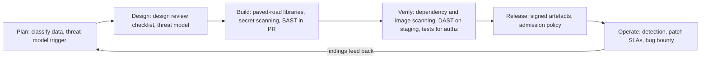
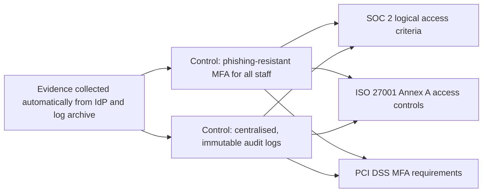

## 96.10 Running a security programme across teams

#### Concept

A **security programme** is how an organisation makes security happen continuously across all its teams, not only when the security team is in the room. Its parts: a **secure software development lifecycle (SDLC)** with security built into each stage; **paved roads** that make the secure way the easy way; **security champions** embedded in product teams; a **risk register** that records what is accepted and by whom; **metrics** that show whether risk is going down; and a **compliance mapping** that turns external frameworks into the controls you already run.

#### Why does it exist?

A security team is usually small: one security engineer per 50 to 100 engineers is a common ratio, and many companies have fewer. If security depends on that team reviewing every change, it becomes a bottleneck and is bypassed, or it reviews superficially and misses what matters. The only model that scales is one where product teams own the security of what they build, the platform makes the secure path cheap, and the security team sets direction, builds leverage and handles what needs specialists.

#### Mental model

Imagine public health rather than a hospital. A hospital treats each patient individually; public health changes the environment so fewer people get sick: clean water, vaccination, food standards, health education, statistics on what is improving. The security programme is public health for software: clean defaults, standard protections, trained champions in every team, and measurements that show where problems cluster.

#### How it works

**1. Secure SDLC, stage by stage.**



Frameworks such as NIST's Secure Software Development Framework (SP 800-218), OWASP SAMM and BSIMM describe the activities and maturity levels; use one as a checklist for gaps rather than as a programme in itself.

**2. Paved roads.** The single most effective lever. Every recurring security need gets a platform-provided default (see Part 90 — Architecture Governance, Standards and Paved Roads, 90.2, and Part 92 — Org Design, Conway's Law and Platform Engineering, 92.4): a service template with authentication middleware, tenant context and audit logging wired in; a secrets library bound to the secrets manager; a standard egress gateway; a signed-URL helper; a CI template with signing, SBOM and scanning; the landing-zone account factory. Teams that use the paved road inherit the controls; teams that leave it must justify why and own the controls themselves.

**3. Security champions.** One engineer per team, with a few hours a month for security: trained in threat modelling and the review checklist, the first reviewer for security-relevant changes in their team, and the security team's two-way channel. Make it a recognised role with a career benefit, a regular community meeting and real authority to raise risks. Champions multiply the security team's reach far more than hiring alone can.

**4. Vulnerability management with SLAs.** Findings from scanners, penetration tests, bug bounty and incidents go into one queue, deduplicated, assigned to owning teams through the service catalog, with fix-by dates by severity (for example: critical exploitable in production, 7 days; high, 30 days; medium, 90 days). Severity combines technical scores such as CVSS with context: is it reachable, is it exploited in the wild (CISA's Known Exploited Vulnerabilities catalogue is one signal), what data does the system hold?

**5. The risk register.** Not every risk can or should be fixed now. A risk register records each significant risk with a description, likelihood, impact, current controls, a **treatment** (mitigate, accept, transfer through insurance or contract, or avoid by not doing the thing), an **owner** in the business who has the authority to accept it, and a review date. The register's purpose is to make risk acceptance explicit and owned by someone accountable, rather than implicit and owned by nobody.

| ID | Risk | Likelihood | Impact | Treatment | Owner | Review |
|---|---|---|---|---|---|---|
| R-17 | Support staff can read any tenant's data with standing access | Medium | High | Mitigate: JIT tenant-scoped access by Q2 | VP Customer Success | Monthly |
| R-23 | Legacy reporting service runs an unsupported runtime | Medium | Medium | Accept until migration completes in Q3; network isolated | Director of Engineering, Data | Quarterly |
| R-31 | Single region for EU tenants | Low | High | Accept; documented recovery plan | CTO | Yearly |

**6. Metrics that matter.** Prefer metrics that track risk and outcomes over activity counts:

| Metric | Why it matters |
|---|---|
| Share of services on the paved road (template, auth, signing) | Leading indicator of inherited controls |
| Phishing-resistant MFA coverage for staff and admins | The most common entry point |
| Count of long-lived credentials (cloud keys, tokens) | Directly measures attack surface |
| Critical and high findings past SLA, by team | Execution on known risk |
| Mean time to detect and to contain, from incidents and exercises | Response capability |
| Threat-model coverage for tier 1 services | Design-time security |
| Detection precision and ATT&CK coverage for priority techniques | Quality of monitoring |

Avoid vanity metrics: number of scans run, number of trainings completed, total vulnerabilities found (which rises when you look harder).

**7. Compliance mapping.** Customers ask for frameworks: **SOC 2** (an attestation report by an independent auditor against the AICPA's Trust Services Criteria; Type I describes controls at a point in time, Type II tests that they operated over a period), **ISO/IEC 27001** (a certifiable standard for an information security management system, with a catalogue of controls in Annex A), and **PCI DSS** (requirements for organisations that store, process or transmit payment card data). Build one **control set** that you actually operate (MFA, access reviews, logging, change management, vulnerability SLAs, encryption, incident response, vendor review), and map each control to the requirements of each framework, so evidence collected once serves several audits. Compliance is a consequence of a working programme, not a substitute for it; passing an audit does not mean you are secure, and this Part makes no claim about what any particular framework legally requires of your organisation: that is for your auditors and legal advisers.



#### Failure scenario

A company's security team of three reviewed every pull request touching authentication, payments or tenant data. Review queues reached two weeks; teams learned to split changes so they did not touch "security-relevant" paths, or labelled them as refactors. A tenant-isolation bug shipped in a change that bypassed review this way. The programme was rebuilt around champions doing first-line reviews with a checklist, paved-road libraries for tenant context and authorisation that made the risky code rare, and the security team reviewing only threat models and high-risk designs.

#### How a Senior Backend Engineer thinks about this

A senior judges a security programme by whether the secure path is the easiest path and whether risk is visibly falling, not by how many reviews the security team performs. They invest first in paved roads and champions, keep a risk register that business owners actually sign, and choose a handful of metrics tied to real attack paths.

## 96.11 Security reviews and the architect's design checklist

#### Concept

A **security design review** examines a proposed system or significant change before it is built, against threats and principles, and produces decisions and actions. It complements the pull-request checklist in Part 44.38 (which reviews code) and the threat-modelling session (which explores threats); the design review asks whether the architecture is sound. Part 88 — Writing as an Architect, 88.5, covers running design reviews in general; this section supplies the security content.

#### Why does it exist?

Many of the most expensive security problems are design choices that no line-by-line code review can see: where tenant isolation is enforced, which identity a background job uses, whether a new vendor receives personal data, what happens when the policy service is down. Finding them in a design document costs an hour; finding them in production costs an incident.

#### How it works

Include a short **security section** in every design document template, so authors answer the questions before review; reviewers then focus on gaps.

```markdown
### Security considerations (required for every design doc)

1. Data: which data classes does this touch? Any new restricted or personal data? Residency?
2. Trust boundaries: what new boundaries or external integrations? Attach the DFD.
3. Identity: which human roles and which workload identities act? Any new long-lived secrets?
4. Authorisation: where is each access decision made? How is tenant isolation enforced, and what is the second layer?
5. Failure modes: what happens when auth, policy, KMS or the IdP is unavailable? Fail open or closed, and why?
6. Blast radius: if this component is compromised, what can the attacker reach?
7. Abuse: rate limits, quotas, cost abuse, enumeration, user-supplied URLs or files?
8. Supply chain: new dependencies, vendors or CI changes?
9. Detection: which audit events and security logs does this emit? Which alerts would fire on misuse?
10. Compliance and privacy: does this change scope (PCI, SOC 2 systems, DPA with customers)? Erasure and retention handled?
```

**Review depth by risk tier.**

| Tier | Examples | Review |
|---|---|---|
| High | New auth flow, new tenant-facing data access path, handling restricted data, new external trust boundary | Threat model session plus security architect review; sign-off required |
| Medium | New service on the paved road handling confidential data | Champion review of the security section; security team consulted on questions |
| Low | Feature inside existing boundaries and patterns | Self-review against the checklist |

**What reviewers look for most often**, from experience across many reviews:

- Authorisation decided in one layer only, or based on client-supplied identifiers.
- Background jobs and event consumers running with broad privileges and trusting the tenant ID in the message.
- New user-supplied URLs, files or templates (SSRF, file parsing, injection).
- Secrets introduced instead of workload identity.
- Data copied to a new store (cache, search index, analytics, vendor) without classification, access control or erasure.
- No audit events for administrative and cross-tenant actions.
- Implicit fail-open behaviour on timeouts.

**Outputs.** A review ends with: approved, approved with actions (tickets with owners), or changes required. Accepted risks go to the risk register with an owner. Recurring findings become paved-road improvements or lint rules (fitness functions, see Part 90 — Architecture Governance, 90.5).

#### How a Senior Backend Engineer thinks about this

A senior makes reviews predictable and cheap: a fixed template, depth by risk tier, champions for the middle tier, and the security architect's time reserved for the high-risk designs. They review architecture, not style, and they convert repeated findings into defaults so the same comment never has to be written twice.

## 96.12 Communicating risk to executives

#### Concept

Executives and boards decide how much to spend on security and which risks to accept. They need risk expressed in the language of the business: what could happen, how likely it is, what it would cost, what reducing it would cost, and what the options are. Part 93 — Influence, Communication and the Business Case, 93.2 and 93.3, covers communicating with executives and building business cases; this section applies it to security risk.

#### Why does it exist?

Security teams often report in their own language: vulnerability counts, CVSS scores, red-amber-green heat maps, framework maturity levels. Executives cannot compare those with other business risks or with the cost of reducing them, so security spending is either rubber-stamped after an incident or cut before one. The architect's job is to translate.

#### How it works

1. **Frame risks as scenarios with business impact.** Not "we have 214 high vulnerabilities" but "an attacker who phishes one support agent can today read any tenant's data; for us that means notification to up to 1,200 customers, likely loss of several enterprise contracts and regulatory exposure".
2. **Use ranges, not false precision.** "We estimate a 10 to 25% chance per year of a cross-tenant exposure incident with current controls; impact between $1 million and $6 million including lost revenue and response costs." Quantitative methods such as FAIR (Factor Analysis of Information Risk) structure these estimates; even rough ranges beat colours, because they can be compared with the cost of controls. State the assumptions.
3. **Present options with costs.** Three options, each with cost, time, residual risk and trade-offs: do nothing (accept, with named owner); a targeted fix (just-in-time support access, one quarter, two engineers); a broader programme (tenant-scoped access everywhere plus per-tenant keys for enterprise, three quarters).
4. **Ask for a decision.** Executives should leave with a decision recorded: fund option two, or accept the risk with a named owner and review date.
5. **Report trends quarterly.** A one-page update: top five risks and their movement, the handful of programme metrics (96.10), incidents and near misses with lessons, and upcoming decisions.

```text
Security risk update, Q3 (one page)

Top risks                              Trend   Owner                 Decision needed
1 Standing support access to tenants   Down    VP Customer Success   None, JIT live for 70% of staff
2 Long-lived credentials in CI         Down    VP Engineering        None, 41 to 6 remaining
3 EU single-region recovery            Flat    CTO                   Approve DR test budget, Q4
4 Third-party scripts on web app       Up      VP Marketing          Approve tag review policy
5 Legacy reporting runtime             Flat    Dir. Data Eng         None, migration on track

Metrics: phishing-resistant MFA 96% (target 100% by Q4); criticals past SLA 2 (was 9);
mean time to contain in exercises 38 min (was 2 h 10 min)
Incidents: 1 low-severity (leaked test key, revoked in 12 minutes, no data access)
```

#### Failure scenario

A security lead presented the board with a 40-slide deck of framework maturity scores and a heat map in which nearly everything was amber. The board asked which three things to fund; the deck could not say. A year later, after a credential-stuffing incident on customer accounts, the board approved a large budget in a week. The capability built afterwards was what a scenario-based, option-priced proposal could have funded beforehand at a fraction of the cost. The lesson: risk communication that does not lead to a decision is not communication.

#### How a Senior Backend Engineer thinks about this

A senior speaks in scenarios, ranges, options and decisions; keeps a short, stable set of metrics; tells executives clearly which risks they are accepting; and never hides uncertainty behind precise-looking numbers. They also avoid fear as a sales tactic: credibility with leadership is built by being proportionate, so that when they say "this one is urgent", people act.

#### Interview questions

1. **How do you scale security across 20 teams with a security team of three?** Paved roads that embed controls, champions for first-line review, depth-by-risk reviews, automated scanning with SLAs, and the security team focused on threat models, high-risk designs and leverage.
2. **What is a risk register for, and who signs it?** Making risk acceptance explicit, with business owners who have authority to accept it, reviewed on a schedule.
3. **How do you present security risk to a board?** Scenarios in business terms, likelihood and impact as ranges with assumptions, options with costs, a decision requested, and quarterly trend reporting.
4. **SOC 2 or ISO 27001 first?** Depends on what customers ask for in your market; build one operated control set and map it to both, so the second costs much less than the first.
