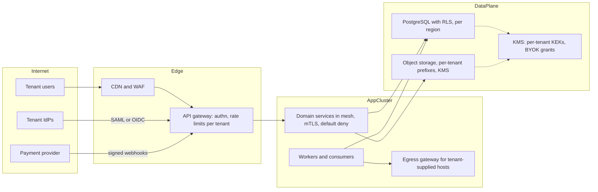
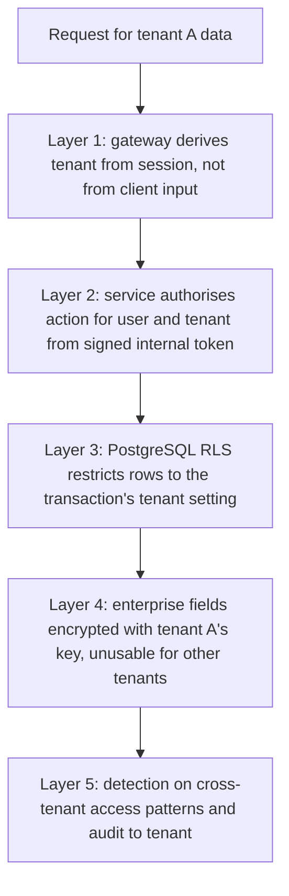

## 96.13 Worked architecture: security for a multi-tenant SaaS

> **Try it first** · Level: Advanced · About 60 minutes
>
> **Build:** the security architecture for the multi-tenant inventory and order management SaaS used throughout this Part.
>
> **Requirements:**
> - About 1,200 tenants in a pooled model, with an enterprise tier that wants SSO, SCIM, customer-managed keys, audit log export and private connectivity.
> - Tenants in India and the EU; EU tenants' personal data must stay in the EU.
> - Card payments for subscriptions; tenants' own customers' personal data in order records.
> - A SOC 2 Type II report is required by most enterprise prospects; ISO 27001 is asked for by some.
> - Support staff must be able to help tenants without standing access to their data.
>
> **Scale and constraints:** 40 services on Kubernetes in AWS, 120 engineers in 15 teams, a security team of four, roughly 30,000 requests per second at peak, and an existing CI on a hosted platform.
>
> **Your task:** draw the trust boundaries and the main controls per layer (identity, network, data, supply chain, detection), state how tenant isolation is defended in depth, and list the top five risks with treatments.
>
> Spend the time on paper before you read on. The model design follows.

### 96.13.1 Trust boundaries and the request path

Every request carries a session issued after authentication (local MFA, or the tenant's IdP via SSO); the gateway resolves the tenant from the session, never from a header the client controls, and passes a signed internal token with user, tenant and roles to services. Services authorise each action against that token; the database enforces tenant isolation again through row-level security keyed to a setting the trusted middleware sets per transaction (see Part 95 — Enterprise and Multi-Tenant SaaS Architecture, 95.2 and 95.3).

### 96.13.2 Controls by layer

| Layer | Controls |
|---|---|
| Workforce identity | One IdP, SCIM from HR, passkeys or security keys for everyone, SSO to AWS through federated roles, identity-aware proxy for admin tools, JIT production access, break-glass accounts with alerts |
| Customer identity | Local accounts with MFA; per-tenant SAML or OIDC; SCIM for enterprise; tenant policies (enforce SSO, session length); tenant-scoped IdP trust so one tenant's IdP cannot assert into another |
| Workload identity | Mesh mTLS with default-deny AuthorizationPolicies; pods get AWS credentials through workload identity; CI deploys through OIDC federation; no IAM users with keys (SCP) |
| Network and cloud | Landing zone with accounts per environment and region; separate account for KMS and payments integration; private subnets; VPC endpoints with policies; default-deny egress through a central firewall; separate egress gateway for tenant-supplied hosts that blocks private ranges and metadata |
| Data | Classification tags on every column; per-tenant KEKs for enterprise, BYOK through cross-account KMS grants; field-level encryption for restricted fields; card data never touches the platform (provider-hosted fields); EU data plane in an EU region with EU keys |
| Support access | Support tool behind the identity-aware proxy; access to a tenant's data only through a time-bound grant linked to a ticket, optionally requiring the tenant admin's approval for enterprise; every action written to the tenant's exportable audit log |
| Supply chain | Registry proxy with minimum release age; `--ignore-scripts`; actions pinned by SHA; SBOM and SLSA provenance per image; keyless signing; admission policy enforcing signatures in production |
| Detection | Org-wide CloudTrail and data events for sensitive buckets into a write-once log archive; Kubernetes audit; application audit events; SIEM with detection-as-code; runbooks for cross-tenant exposure, credential leak, account takeover |
| Programme | Champions in all 15 teams; paved-road service template with tenant context, audit and authz; design-review security section; vulnerability SLAs; risk register owned by business leaders; one control set mapped to SOC 2 and ISO 27001 |

### 96.13.3 Tenant isolation in depth

The layers are independent in the sense that matters: a bug in a service's query (missing tenant filter) is caught by RLS; a bug in RLS policy for a new table is caught by a CI fitness function that fails when any tenant table lacks a policy; a compromised service credential cannot decrypt enterprise tenants' restricted fields without their KEKs, whose use is logged and anomalous use alerts.

### 96.13.4 Top five risks and treatments

| Risk | Treatment | Residual |
|---|---|---|
| Cross-tenant data exposure through an application bug | Defence in depth above; authz tests in the paved-road template; attack-tree review yearly | Low; monitored |
| Engineer or support account compromise | Phishing-resistant MFA, managed devices, JIT access, no standing production access | Low to medium |
| Supply-chain compromise via dependency or CI | Controls in 96.8; short-lived credentials limit impact | Medium; accepted with monitoring |
| Customer key revocation breaking jobs (BYOK) | Clear errors, per-tenant job isolation, alerting, runbook | Low; operational |
| EU residency breach through logs, analytics or vendors | Residency tags in the catalog, regional log pipelines, vendor review with data-flow lineage | Low; audited yearly |

## 96.14 Exercises with worked answers

#### Practical exercise

**Exercise 1.** Your company has 300 IAM users with access keys across 12 AWS accounts, most created by engineers for scripts and CI. Plan how to reach zero within two quarters without breaking production.

**Exercise 2.** An enterprise prospect asks: "Can your support staff see our data?" Today the answer is "yes, all of them, at any time". Design the change and the answer you will give in six months.

**Exercise 3.** Write the first-hour runbook for "a tenant reports seeing another tenant's order in their dashboard".

**Exercise 4.** The CEO asks whether the company is "secure enough" ahead of a large enterprise deal. Prepare the answer.

#### Worked answer to the exercise

**Exercise 1.** Inventory first: list every key with its last-used time, service and region from IAM credential reports and CloudTrail across accounts; tag each with an owner. Classify: unused for 90 days (disable, then delete after two weeks of silence); CI usage (move to OIDC federation with roles scoped per repository and branch); workloads on Kubernetes or compute (move to workload identity); humans using keys on laptops (move to SSO-based CLI sessions); third-party integrations that require keys (keep as exceptions in the secrets manager with rotation and owners, and look for vendor support for role assumption). Execute in waves by account, newest risk first (production, keys with admin rights). Prevent regression with an SCP that denies `iam:CreateAccessKey` and `iam:CreateUser` except for a break-glass role, and a detection on any access-key use. Track the count weekly to zero, with named exceptions in the risk register.

**Exercise 2.** Replace standing access with just-in-time, tenant-scoped grants: support agents request access to one tenant for a ticket, for a few hours, with read-only by default; write actions need a second approver; enterprise tenants can require their own admin's approval. All actions are recorded in the tenant's audit log, which the tenant can export. Restricted fields remain encrypted with tenant keys the support role cannot use, and BYOK tenants can revoke key access entirely. In six months the answer is: "Only when you open a ticket and, if you choose, only after your administrator approves; access is limited to the time needed, every action appears in your audit log, and your most sensitive fields remain encrypted with keys you control."

**Exercise 3.** Minute 0 to 10: treat as a potential cross-tenant exposure; page the security on-call and the owning team; declare an incident with an incident commander; preserve evidence (screenshot and request IDs from the reporter, logs and traces for the affected requests, snapshot of relevant tables). Minute 10 to 30: contain: if the path is identifiable (one endpoint, one cache), disable it with a feature flag or kill switch; if not, consider read-only or maintenance mode for the affected feature; check whether the cause is a cache key missing tenant ID, a missing RLS policy, or a query bug, using the trace. Minute 30 to 60: scope: query audit and access logs for the same pattern across all tenants since the last relevant deploy; identify affected tenants and records; bring in legal and privacy to assess notification obligations; prepare holding communication for the reporting tenant; keep a timeline. Do not rush a fix into production without review; containment comes first.

**Exercise 4.** Reframe "secure enough" as "are the risks that matter for this deal known, reduced and owned?" Prepare: the top five risks in scenario terms with current controls and trend; evidence the customer will ask for (SOC 2 report or its timeline, penetration test summary, answers on SSO, encryption, key management, support access and residency); any gaps the customer is likely to find and the plan and dates to close them; and a recommendation on which commitments are safe to make in the contract and which are not. End with the decision the CEO needs to make, such as funding the JIT support-access work before signature because the prospect's questionnaire makes it a blocker.

## 96.15 Interview questions

1. **Walk me through how you would run threat modelling across 40 services.** Expected answer: triggers rather than blanket coverage; short sessions with builders and a facilitator; DFDs and STRIDE per element; attack trees for existential goals; outputs as tickets, risk-register entries and paved-road items; coverage tracked in the service catalog. Follow-up: how do you measure whether it works.
2. **Explain zero trust to a CTO who thinks it is a product.** Every request authenticates and is authorised by identity and context, not network location; components are bought, the architecture and policies are yours; sequence: MFA and SSO, remove static credentials, identity-aware access, service authorisation.
3. **How do you defend tenant isolation in depth?** Tenant from trusted session, per-service authorisation from a signed token, database RLS, per-tenant keys for sensitive data, detection; layers independent of each other.
4. **Design the key hierarchy for a SaaS offering BYOK.** HSM-backed roots, KEKs per tenant (customer-owned for BYOK via cross-account grants), data keys per object with envelope encryption, rotation automated, revocation as a handled operational state.
5. **What are the most important supply-chain controls, in order?** No long-lived secrets in CI, pinned actions and dependency policy at a proxy, no install scripts, SBOM inventory, signing with provenance and admission control.
6. **How do you know your detection works?** Detection as code with tests, precision metrics, ATT&CK coverage for priority techniques, purple-team or simulated attacks, and tabletop exercises measuring time to contain.
7. **How do you scale security across many teams with a small security team?** Paved roads, champions, review depth by risk, automated scanning with SLAs, and metrics tied to attack paths.
8. **How do you tell the board about security risk?** Scenarios, ranges with assumptions, options with costs, decisions with named owners, quarterly trends on a few metrics.
9. **A team wants to fail open when the policy engine is down. Your view?** Fail closed by default; make the dependency local and cached so outages are rare; if a specific control must fail open, document it, bound it, alert on it, and record the risk acceptance.
10. **What is the difference between being compliant and being secure?** Compliance shows that defined controls exist and operate against a framework; security is whether attack paths that matter are blocked and detected; a working programme produces compliance as a by-product, not the reverse.

## Senior Checklist — Part 96

- [ ] I understand the concept
- [ ] I can explain it simply
- [ ] I can implement it
- [ ] I understand its failure modes
- [ ] I understand its scaling limitations
- [ ] I understand its security implications
- [ ] I understand its operational implications
- [ ] I can choose between alternatives
- [ ] I can explain the tradeoffs
- [ ] I can answer senior-level interview questions
- [ ] I can run threat modelling as a practice with DFDs, STRIDE per element, attack trees and backlog outputs
- [ ] I apply least privilege, defence in depth with independent layers, secure defaults, fail closed and blast-radius reduction
- [ ] I can explain and sequence zero trust without vendor language
- [ ] I can design workforce, customer and machine identity with no long-lived secrets in the common case
- [ ] I can design a landing zone with segmentation, private connectivity and default-deny egress
- [ ] I can design data protection by class, including tokenisation, per-tenant keys and BYOK
- [ ] I can design a supply chain with SBOMs, signing, provenance and admission control
- [ ] I can design detection backwards from incident questions and run a security incident
- [ ] I can run a security programme with paved roads, champions, a risk register and meaningful metrics
- [ ] I can communicate security risk to executives as scenarios, ranges, options and decisions

## Part 96 — Key Takeaways

- Security architecture is about attack paths and how the pieces fit, which no single code review can see.
- Threat modelling is a short, early, repeated practice whose output is tickets, accepted risks and paved-road fixes.
- Defence in depth counts only independent layers; three checks of the same token are one control.
- Fail closed by default, and make security dependencies local and cached so that failing closed is rare.
- Zero trust means identity and policy on every request; mTLS without authorisation is encryption, not zero trust.
- The best secret is no secret: SSO and passkeys for people, workload identity for services, federation for CI.
- Cloud accounts are the strongest blast-radius boundary; guard them with policies nobody can bypass and watch for convenience links.
- Ask who can decrypt data and through which path, not whether it is encrypted.
- Assume a dependency or CI action will be compromised; limit what it can reach and prove what you run.
- Collect the evidence you will need during an incident, where an attacker cannot erase it, and rehearse the response.
- Security scales through paved roads and champions, not through a review queue.
- Leaders decide on risk; give them scenarios, ranges, options and a clear decision to make.
