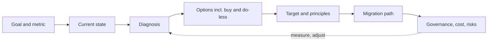
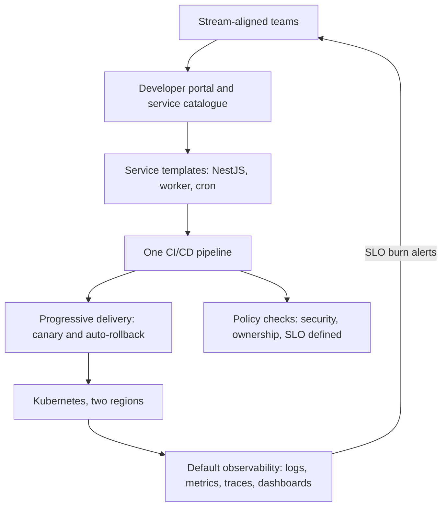
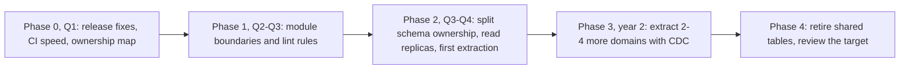

## 97.4 Ambiguous large-scope system design at staff level

#### Concept

The staff-level design round gives you a problem that is bigger than one system and vaguer than a senior prompt: "design the platform that lets our 40 teams ship services safely", "we need to move off our monolith without stopping feature work", "our checkout spans nine services and five teams and p99 is two seconds". There is no single right diagram. The interviewer is scoring how you find the real problem, what options you put on the table, how you get from today to the target, and how you account for teams, cost, time and governance.

#### Why does it exist?

Staff engineers rarely design a system from an empty page. They inherit systems, teams and contracts, and their designs succeed or fail on migration, adoption and organisation more than on the boxes and arrows. A senior design round cannot see those skills, because its prompts start from nothing and end at one service. The large-scope round starts from a messy present and ends at a multi-year path.

#### Mental model

Imagine the difference between designing a house and redesigning a city's transport. The house has one client and a plot. The city has existing roads that must keep flowing, a budget, several departments that disagree, residents who will complain, and a ten-year horizon. A good transport planner's first question is not "trams or buses?" but "where do people actually travel, what is broken, and what can we change without closing the roads?"

#### How it works

**How it differs from senior system design.**

| Dimension | Senior design round (59.0, 68.3) | Staff large-scope round |
|---|---|---|
| Starting point | Empty page | A messy present: existing systems, teams, contracts |
| Scope | One system or service | Several systems and teams; sometimes the whole org |
| Horizon | Launch | One to three years, in phases |
| First question | Requirements and scale | The business goal and what is actually broken |
| Output | An architecture | A target, a migration path, an organisation and governance model |
| Constraints you must raise | Latency, throughput, consistency | Plus cost, team skills, ownership, compliance, feature work that cannot stop |
| Build versus buy | Rarely discussed | Expected (68.19, 82.6) |
| What "done" means | The design works | Teams adopted it and the metric moved |

**A framework for 60 minutes.** Seven steps, with a time budget. Say the plan out loud at the start, so the interviewer can redirect you early.

| Step | Minutes | What you do | Book reference |
|---|---|---|---|
| 1. Goal and success metric | 0–5 | Ask why now, what the business needs, and how success would be measured | 89.2 |
| 2. Current state | 5–12 | Systems, teams, pain, numbers; state your assumptions if the interviewer has none | 92.1, 92.3 |
| 3. Diagnosis | 12–17 | Name the one or two root problems behind the symptoms | 89.2 |
| 4. Options | 17–27 | Two or three real options including buy and "do less"; trade-offs in a table | 88.4, 63.22 |
| 5. Target and principles | 27–40 | The target architecture and three to five guiding principles | 89.2, Part 90 |
| 6. Migration path | 40–50 | Phases, first slice, stop conditions, how feature work continues | Part 91 |
| 7. Governance, cost, risks | 50–60 | Who owns what, how adoption is measured, cost, top risks, what you will not do | Parts 55, 90 and 92 |

The steps are not rigid. If the interviewer drives straight into the target architecture, follow, then return to diagnosis and migration before the hour ends. A design with no migration path is the most common way a strong candidate scores "senior".

### 97.4.1 Worked design: the platform that lets 40 teams ship services safely

**Step 1: goal and metric.** Candidate: "Before designing, why now? What does 'safely' mean here: fewer incidents caused by changes, faster delivery, compliance, or all three?" Interviewer: "We had three serious incidents last quarter caused by bad deploys, and teams complain it takes weeks to get a new service to production." Candidate: "Then I will aim at two metrics: change failure rate and time from 'new service' to 'first production request'. I will also watch deploy frequency so we do not buy safety with slowness (51.12)."

**Step 2: current state (stated as assumptions).** "I will assume about 300 engineers in 40 teams, roughly 180 services, Kubernetes in two regions, three different CI systems because teams chose their own, observability that varies from excellent to none, and a central operations team of eight that handles production access and new environments by ticket. New service setup takes three to four weeks, mostly waiting on tickets."

**Step 3: diagnosis.** "Two root problems. First, every team solves the same production problems differently, so safety depends on each team's skill: some have canaries and rollback, some deploy by hand. Second, the path to production goes through a ticket queue, so teams bypass it when they can. The incidents and the slowness have the same cause: there is no shared, easy, safe default."

**Step 4: options.**

| Option | What it is | Gives | Costs | Fits when |
|---|---|---|---|---|
| A. Central gatekeeping | Operations team reviews and runs all deploys | Control quickly | A bottleneck; slows 40 teams; does not scale | Very small orgs or regulated emergency |
| B. Buy an internal developer platform product | A commercial platform or a managed portal | Speed to a portal and catalogue | Licence cost, fit to your stack, still need templates and pipelines behind it | You lack platform engineers and your stack is standard |
| C. Thinnest viable platform: a paved road | Templates, one CI/CD pipeline with progressive delivery, observability and policy defaults, self-service | Safety by default, autonomy kept | A platform team as a product, two to three quarters to adopt | Most orgs at this size |

"I recommend C, built with off-the-shelf parts where they exist (an open-source developer portal such as Backstage for the catalogue, the existing Kubernetes, a standard progressive-delivery tool), and A only as a temporary guard: for the next quarter, services with no rollback path need a second reviewer on deploy."

**Step 5: target and principles.**

Principles, said out loud: "One, the paved road is optional but so much easier that 90% choose it (90.2). Two, self-service, no tickets for anything routine. Three, every service has an owner, an on-call rotation and an SLO before it gets production traffic. Four, the platform team runs as a product team with the stream-aligned teams as customers, a roadmap and adoption metrics (92.4). Five, policies are checks in the pipeline (fitness functions, 90.5), not review meetings."

**Step 6: migration path.** "Phase 1, one quarter: a platform team of six to eight, drawn partly from the operations team. Build the template and pipeline for the most common service type, and onboard three volunteer teams that had recent deploy incidents. Success: their change failure rate drops and new-service time is under two days. Phase 2, two quarters: progressive delivery and default dashboards for every service on the road; migrate the remaining teams by service tier, highest risk first. Phase 3: retire the two other CI systems with a dated deprecation (91.6). Stop condition: if after phase 1 the volunteer teams do not choose to stay on the road, the platform has a product problem, and we fix that before migrating anyone else."

**Step 7: governance, cost, risks.** "Adoption is measured weekly: percentage of services on the road, change failure rate per team, new-service lead time. Cost: about eight engineers for the platform team, roughly 3% of engineering, justified against three serious incidents a quarter and the hours lost to setup (93.3). Risks: the platform team builds what is interesting instead of what is needed, so the roadmap is driven by customer interviews and the three volunteer teams; teams with special needs feel forced, so there is a written waiver process (90.6); and the ops team feels replaced, so they get first choice of platform roles. What I will not do this year: a custom deployment system, multi-cloud, or a mandate to migrate every service by a date."

**Probes and strong answers.**

| Probe | Strong answer | What a principal-level answer adds |
|---|---|---|
| "Why not just mandate the standard?" | "Mandates without an easy path produce waivers and quiet bypasses. Make the road better than the alternative, then mandate only the few non-negotiables, like ownership and an SLO." | Links it to how the org decides: who would enforce a mandate, and at what cost to trust. |
| "How do you know the platform team is building the right thing?" | "Customer interviews, adoption, and the time teams spend on undifferentiated work, measured quarterly (92.5)." | Kills a platform feature that nobody uses, and says so publicly. |
| "A big team refuses to move." | "Find out why. If the road lacks something they need, it is a roadmap item. If it is preference, let them stay off-road with the cost visible: they own their own pipeline, on-call and audit evidence." | Uses the waiver process as data about the platform, not as a discipline tool. |

### 97.4.2 Worked design: moving a monolith serving 10 million users without stopping feature work

**Step 1: goal and metric.** Candidate: "Why move? Which pain matters most: deploy speed, reliability, scaling the database, or team autonomy?" Interviewer: "All of them, but leadership is angry about delivery. Features take a quarter and every release is scary." Candidate: "Then the primary metric is lead time for changes in the domains with the most product demand, and the guardrails are incident rate and the share of capacity going to migration. I want to agree that number up front, because the request is 'without stopping feature work'."

**Step 2: current state.** "Assume a single NestJS or similar monolith of about 600,000 lines, one PostgreSQL primary of 4 TB with two replicas, 10 million registered users and about 1.5 million daily actives, 90 engineers in 11 teams all committing to one repository and releasing weekly. The release takes four hours and is rolled back about one week in six. The database is near the largest instance size and CPU peaks around 70%."

**Step 3: diagnosis.** "The symptom is slow delivery, but the causes are coupling in code and in data. Eleven teams share one deploy and one schema, so every change waits for and risks everyone else's. The database is a second, separate problem with a deadline: at current growth it runs out of vertical headroom in roughly 18 months. I would treat these as two problems that share a solution path."

**Step 4: options.**

| Option | Gives | Costs and risks | Verdict |
|---|---|---|---|
| Rewrite into microservices | A clean target | Two systems for years, feature freeze in practice, the classic 80% done forever (91.1) | Reject |
| Modular monolith first, then extract a few services | Faster builds and clear ownership inside one deploy; extraction where it pays | Discipline to enforce module boundaries; does not fix the database alone | Recommend, combined with the next |
| Strangler Fig extraction by domain (66.30) | Independent deploys for the domains that need them | Data separation is the hard part; operational cost per service | Use selectively |
| Do nothing but improve the release process | Cheap, quick wins | Does not touch coupling or the database deadline | Do the quick wins anyway, in phase 0 |

**Step 5: target and principles.** "Target in two to three years: a modular monolith for most domains, with three to five extracted services for the domains with the most change and the most load (likely checkout, catalogue search and notifications), each owning its data. Principles: one team owns each module and its tables; modules talk through published interfaces, never each other's tables; new features in a domain are built in its module or service, never in the shared core; we extract a service only when a module boundary has held for a quarter and there is a measured reason (deploy cadence, scaling, or isolation)."

**Step 6: migration path with feature work.**

"Feature work continues because the migration is done by the teams that own each domain, on a fixed share of capacity, about 20%, agreed with product leadership (89.3). Each phase has a deliverable that helps delivery on its own, so if funding stops after any phase, we keep the gains. Phase 0 quick wins: parallel test runs and a deploy pipeline that can release twice a day. Phase 1: module boundaries enforced by a dependency rule in CI (90.5), so the coupling stops growing. Phase 2: each module's tables get a single owner; cross-module joins are replaced by interface calls or read models; the first extraction is a domain with few joins and real demand, chosen to prove the path, not the hardest one (91.4). Phase 3: extractions use change data capture and backfill with reconciliation (91.5). Stop conditions: if lead time in migrated domains does not improve within two quarters, or migration capacity creeps above 30%, we stop and re-plan."

**Step 7: governance, organisation, risks.** "Team boundaries follow domain boundaries (the inverse Conway manoeuvre, 92.1); where they do not, I would raise it with engineering leadership before extraction, because a service owned by two teams is worse than a module. A small enabling group of two or three engineers builds the extraction tooling and pairs with each team (92.2). Progress is reported monthly to leadership in delivery terms: lead time per domain, release rollbacks, database CPU headroom. Top risks: the database deadline arrives before the extractions, so in phase 2 I also buy time with read replicas, partitioning of the two largest tables, and moving reporting queries to a replica or warehouse (Part 26, Part 42); teams skip boundary rules under deadline pressure, so the rules are CI checks, not documents; and the programme loses sponsorship after a reorganisation, so every phase stands alone."

**Probes and strong answers.**

| Probe | Strong answer | What a principal-level answer adds |
|---|---|---|
| "Why not microservices directly? Everyone else did." | "Extraction pays only where independent deployment or scaling is worth a network hop, a new failure mode and an on-call rotation. For most of our domains, a module gives 80% of the benefit at 20% of the cost (68.2)." | States what evidence would change the decision, so it is not a dogma. |
| "Product says 20% is too much." | "Then we agree on what moves: the end date or the scope. I would show them the release rollback rate and lead time trend; in the business case those are lost features (93.3)." | Offers a smaller first phase that pays back inside one quarter, to earn the rest. |
| "What do you do in week one?" | "Build the ownership map: every module and table, who changes it, how often. It is the input to every later decision, and the conversations to build it are how I meet the 11 teams." | Uses the map as a political tool: it makes the coupling visible to leadership without blaming anyone. |

### 97.4.3 Where strong candidates fall short in this round

#### Failure scenario

A candidate given the monolith prompt drew a clean target of fourteen microservices with an event bus in the first twenty minutes, then spent the rest explaining the event schemas. When the interviewer asked how the eleven teams would get there while shipping features, the answer was "we would migrate service by service". Probed on data: "each service gets its own database". Probed on the 4 TB shared schema: silence. The written feedback: "Strong senior-level target design. No diagnosis, no migration path, no treatment of data or teams. Not staff." The diagram was not wrong; it answered a question nobody had asked.

#### Edge cases & failure modes

- **The interviewer gives no numbers.** State assumptions in round numbers and say they are assumptions; ask if they are in the right range.
- **The interviewer insists on detail in one component.** Go deep for ten minutes; it is testing that your altitude can change. Then come back up.
- **The prompt hides a "do nothing" answer.** Sometimes the right move is to fix the process, not the architecture. Say so if the evidence points there.
- **Regulated domains.** Compliance can dictate data location and change control; raise it in step 2 (95.6, 95.7).
- **You run out of time.** Make sure the last five minutes cover migration and risks, even briefly.

#### How a Principal Engineer thinks about this

A principal starts from the goal and the present, not the target. They put "buy" and "do less" on the options table every time, because the cheapest system is the one not built. They design the path as carefully as the destination, with phases that pay for themselves and stop conditions written in advance. They treat team boundaries and ownership as part of the architecture. And they say clearly what they will not do this year, because a design that tries everything delivers nothing.

#### Common mistakes

- Starting with the target diagram before asking why.
- Only one option, or options that are straw men.
- No migration path, or "migrate service by service" with no treatment of data.
- Ignoring the teams: who builds it, who owns it, who has to change.
- No cost and no measurement of progress.
- Architecture astronautics: event sourcing, a service mesh and multi-region for a problem that needed module boundaries and a faster pipeline.

#### Interview questions

1. **"Design how our company should handle authentication across 30 products."** Expected: goal and pain first; options including a bought identity provider; a migration that does not log everyone out; governance for new products.
2. **"We have five teams writing to one database. What do you do?"** Expected: an ownership map, module or schema boundaries, read models, and extraction only with a measured reason (91.4).
3. **"How would you know your platform is succeeding?"** Expected: adoption by choice, change failure rate, lead time, developer survey (92.5), and the features you killed.
4. **"What would you not do?"** Expected: a specific list with reasons; it is often the strongest signal in the round.

#### Practical exercise

Run the 60-minute framework on one of these prompts with a peer acting as interviewer: "Our 25 services each have their own way of handling errors and retries; incidents cascade", or "We must offer EU data residency to enterprise customers within a year". Acceptance criteria: you asked about the goal before drawing; you had at least three options including buy or do-less; the migration path had phases that each deliver value alone and at least one stop condition; you named who owns what; you stated what you would not do.
